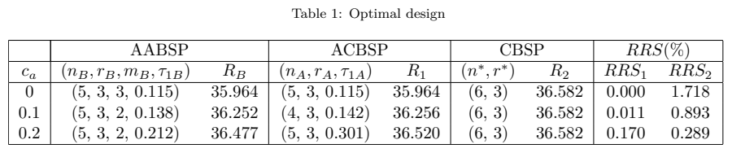

# 升级观测强度，能比固定在某个时刻升级省多少？

<!-- 全库方法复筛开始 -->
> **方法储备 · 模型自进化**。保留“贝叶斯反馈驱动的加速采样”这一研究问题或机制；是否用于当前业务另行验证。
> 原有阅读范围与证据等级不变；储备不等于效果已验证。
> 已恢复此前因业务距离被移出的原笔记；旧取舍原因仅作历史记录。
> [[研究前沿/论文库复筛与阅读路线|全库阅读路线]] · [[研究前沿/模型自进化/存量论文分层索引|本方向完整分层]]
<!-- 全库方法复筛结束 -->

什么时候值得付出额外成本，加快收集反馈后再决定接受还是拒绝？ 把升级触发和最终接受规则放在同一损失下，并与各自重新优化的固定方案比较。

## 论文与阅读范围

Bayesian reliability acceptance sampling plans under adaptive accelerated type-II censored competing risks data。Rathin Das、Soumya Roy、Biswabrata Pradhan。本周为 Annals of Operations Research 期刊发表；精读作者同题 arXiv v1 §2–7、表 1、5。期刊网页确认发表，正式版 PDF 取回的是摘要页。 首次公开 2025-07-31，核验版本 v1，本次阅读 2026-11-13。 期刊上线 2026-11-09。 [一手来源](https://doi.org/10.1007/s10479-026-07478-2) · [author-v1.pdf](./assets/source/author-v1.pdf)

## 方法及关键假设

先放入 $n$ 个样品，在 $\tau_1$ 时刻数已发生的失效，少于 $m$ 才加速；收满第 $r$ 个失效停止。按各原因的计数、失效时间和压力历史更新原因特异失效率的后验。终点将接受批次的后验期望损失与拒绝成本比较。离线联合选择 $(n,r,m,\tau_1)$，计入测试、等待、升级与决策错误的代价。令 $m=0$ 或 $m=r$ 可恢复两种基线。

## 证据和比较基线

§6 表 1 的对照在各自方案内优化样本数和时间。加速成本为零时，自适应与固定加速方案风险均为 35.964；成本 0.1 时对固定加速的优势仅 0.004。§7 在 35 个太阳能灯样品的两类失效上估计参数，属于参数校准示例。表 1 来自既定先验和损失下的数值求解。

作者预印本表 1，PDF 第 14 页。以各方案列的原始风险评价，规避正文与表头相对节约列次序不一致的歧义。。[原表所在页](./assets/source/author-v1.pdf#page=14)

## 迁移条件与局限

模型要求两类失效分布、加速规律、先验和损失可指定。换信号收集方式后，等待行为与退出原因也可能改变。迁移到重试或人工复核前需要验证观测和风险改变的机制。数值依据为作者公开预印本；未核实作者代码仓库。[预印本](https://arxiv.org/abs/2507.23293v1)

[[研究前沿/面向决策的履约建模/02-可复用方法卡/AdaptiveTestRisk-按早期事件数决定是否追加观测|按早期事件数决定是否追加观测]] · [[研究前沿/面向决策的履约建模/03-实验假设与结果/AdaptiveTestRisk-只在早期反馈不足时追加一次信息收集|只在早期反馈不足时追加一次信息收集（未运行）]]
