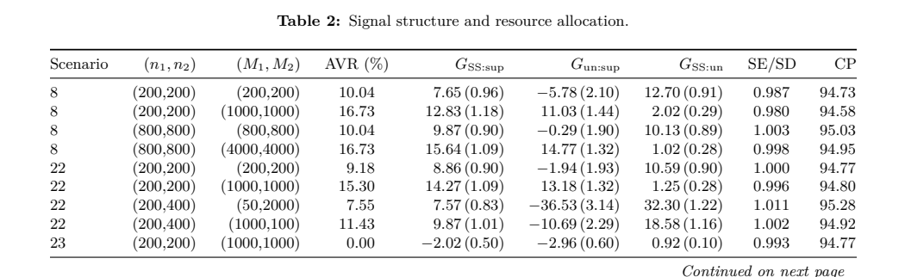

# 无标签协变量能否提高两个群体时长排序概率的精度

<!-- 全库方法复筛开始 -->
> **方法储备 · 面向决策的履约建模**。保留“半监督多权重删失修正”这一研究问题或机制；是否用于当前业务另行验证。
> 原有阅读范围与证据等级不变；储备不等于效果已验证。
> 已恢复此前因业务距离被移出的原笔记；旧取舍原因仅作历史记录。
> [[研究前沿/论文库复筛与阅读路线|全库阅读路线]] · [[研究前沿/面向决策的履约建模/存量论文分层索引|本方向完整分层]]
<!-- 全库方法复筛结束 -->

Model-assisted semi-supervised estimation of the Mann-Whitney probability under right censoring。作者为 Xu, Hengyao、Tan, Tao。arXiv 首投 2026-11-08，本次核验 v1。 [版本记录](https://arxiv.org/abs/2611.11456v1) · [本地 PDF](./assets/source/paper.pdf) · [本地 HTML](./assets/source/paper.html)

## 研究问题

在两组中分别观测有限的已结局个体和大量只有协变量的个体，目标是比较两人事件孰先发生的概率。

## 方法与关键计算

先处理两组右删失的成对比较，再对每组影响贡献作协变量投影，用有标签与辅助样本间的均值差作校正。依据两组辅助样本量和投影信号给校正项不同权重。分别估计四个样本池带来的不确定性。

$$
\theta=\Pr(T_1<T_2)
$$

从两群体各取一人，比较完整事件时间。对删失与辅助协变量均值估计的不确定性需要同时计入。 [原文定位](https://arxiv.org/html/2611.11456v1#S1.Ex1)

## 对照、结果和限制

§5 表 2 的平衡双侧信号设置中，辅助/标记比例从 1 到 5，资源加权相对监督估计的方差收益从 8.86% 到 14.27%。另两种不对称配置中，不收缩的修正为 −36.53% 和 −10.69%。 [原文证据](https://arxiv.org/html/2611.11456v1#S5.T2)

原文 PDF 第 16 页。

要求独立删失及相应支持；无标签样本需代表同一组协变量分布。弱信号、小样本可以抵消收益；群体差异不等于动作因果效应。

## 复用和阅读范围

已核问题设定、方法与上文所列的关键对照，详细证明及未列出的实验以所附全文为准。本次未核实作者公开实现入口。

[[研究前沿/面向决策的履约建模/02-可复用方法卡/AuxSurvivalRank-按辅助样本量收缩的时长比较|按辅助样本量收缩的时长比较]] · [[研究前沿/面向决策的履约建模/03-实验假设与结果/AuxSurvivalRank-标签稀少时，按辅助样本量收缩能否减少两组履约时间排序估计的波动|标签稀少时，按辅助样本量收缩能否减少两组履约时间排序估计的波动]]
