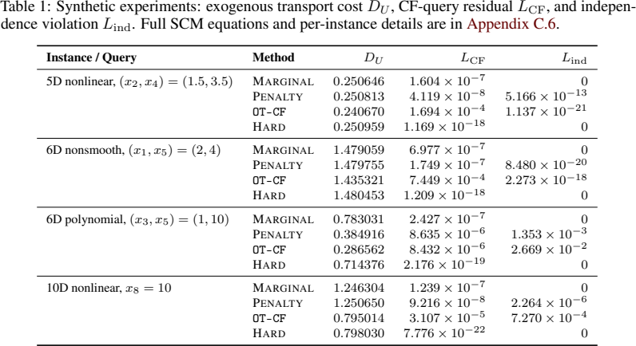

# 用独立噪声约束审计反事实情景

Transporting the Past: An Optimal Transport View of Backtracking Counterfactuals · Liu, Zhangyi, Fatemi, Pouria, Sra, Suvrit。arXiv 首投 2026-11-05，本次阅读版本 v1（2026-11-05）。 [版本记录](https://arxiv.org/abs/2611.08682v1) · [本地 PDF](./assets/source/paper.pdf) · [本地 HTML](./assets/source/paper.html)

## 研究问题

已知一条观测结果，若要让另一条路径解释指定结果，原有结构方程下的外部扰动应如何变化？这是对产生结果的前提进行回溯。

## 方法及关键计算

先在给定事实下求外生噪声的后验，可能包含多个原子。§3 的 OT-CF 将每个原子投影到满足目标条件的可行集合，以尽量小的输运代价得到情景。IOT-CF 另要求反事实噪声分布分解为各维边际的乘积，以保留独立外生噪声的语义。§5 比较求解边际、软惩罚和乘积支持上的硬约束；要同时查看输运代价、目标残差及独立性违例。

## 关键公式

$$
q_{\mathrm{IOT}}^{\star}\in\arg\min_{q\in\mathcal{Q}_{\mathrm{CF}}^{\otimes}}W_{2}^{2}(\mu_{e},q)
$$

μe 是给定事实后的外生噪声分布，优化变量 q 同时满足目标事实与各噪声分量的独立性。以二阶 Wasserstein 距离衡量改变大小；可行性依赖结构方程和噪声独立假设。 [公式原文](https://arxiv.org/html/2611.08682v1#S3.E2)

## 证据、对照与边界

表 1 的六维多项式合成 SCM 上，无独立约束 OT 的代价为 0.286562、独立性违例为 0.02669；硬约束为 0.714376、违例为 0，目标残差约 2.18×10⁻¹⁹。这是同一构造上的可行性与成本权衡。

表 1　独立性、目标残差与外生输运代价的权衡，原文 PDF 第 9 页。

回溯回答“哪些前提能产生指定结果”。在事实后验上寻找新噪声不等于固定噪声、切换派单动作的干预效应。仅在结构方程和外生噪声假设可检验时作情景审计。

## 阅读覆盖与复用

已核对上述设定、关键计算、主对照及限制，附录证明未逐行复证。未从作者版本页、正文或公开检索核实可用的作者代码入口。

[[研究前沿/面向决策的履约建模/02-可复用方法卡/BacktrackingOT-用独立噪声约束审计反事实情景|用独立噪声约束审计反事实情景]] · [[研究前沿/面向决策的履约建模/03-实验假设与结果/BacktrackingOT-模拟器中的罕见履约轨迹是否依赖不合理的噪声相关|模拟器中的罕见履约轨迹是否依赖不合理的噪声相关]]

[[研究前沿/面向决策的履约建模/01-论文原文与精读/BacktrackingOT/原文导航|原文章节和图表索引]]
