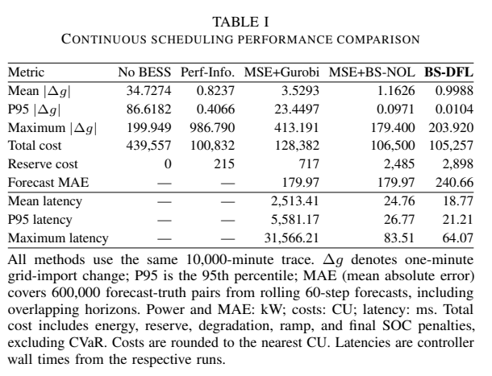

# 锁定预留量，再用实况评估预测所做的承诺

<!-- 全库方法复筛开始 -->
> **方法储备 · Scaling up 与效率**。保留“将承诺与后续补救分开的神经优化层”这一研究问题或机制；是否用于当前业务另行验证。
> 原有阅读范围与证据等级不变；储备不等于效果已验证。
> 已恢复此前因业务距离被移出的原笔记；旧取舍原因仅作历史记录。
> [[研究前沿/论文库复筛与阅读路线|全库阅读路线]] · [[研究前沿/Scaling up 与效率/存量论文分层索引|本方向完整分层]]
<!-- 全库方法复筛结束 -->

**Decision-Focused Learning via Neural Optimization Layers for Battery-Assisted Grid-Import Smoothing in AI Data Centers**  
arXiv 首次提交 2026-11-10（UTC），核验时版本历史仅有 v1；本次检索日为上海时间 2026-11-12。正式发表日期待核。 [官方版本历史](https://arxiv.org/abs/2611.13694v1)

[原版 PDF](./assets/source/paper.pdf) · [原文 HTML 快照](./assets/source/paper.html)

## 研究问题

供电负荷尚未揭晓时要预留电池功率，负荷到达后才可动用预留量。作者在日前承诺与实时追随之间显式建两阶段优化，代价含购电、预留、爬坡及尾部风险。

## 方法、计算与决策时点

训练先用历史需求场景以真实调度目标训练神经优化层，解码器将指令限制在功率、能量和禁止反送电的可行区间。再冻结该层，由预测需求决定未来承诺，保持承诺不变，以同一起点、实况需求重新解码事后响应，反传到需求预测器。后向计算剩余时段可行能量区间，防止提前用掉后续承诺需要的能量。执行每分钟重新规划，只落地当前时段（第 II、III 节，式 13–14）。

## 实验结果与证据边界

10,000 分钟仿真中，表 I 报告 MSE+Gurobi、MSE+BS-NOL、BS-DFL 的总成本依次为 128,382、106,500、105,257。固定相同 BS-NOL 后，决策导向训练只额外降低约 1.17%；预测 MAE 从 179.97 升至 240.66，平均绝对电网变化从 1.1626 降至 0.9988，而最大变化从 179.400 增至 203.920。表中实况总成本含能量、预留、损耗、爬坡及末端容量罚项，剔除训练目标中的 CVaR 附加项；功率与 MAE 的单位为 kW。负荷源自实际工作负载，不含生产部署或实际电费实验。 [证据原文](https://arxiv.org/html/2611.13694v1#S4.T1)

*表 I · 三条预测和调度链路的连续回放，固定版 PDF 第 4 页。*

沿用此前选边研究的冻结层训练思路，新增证据是含先后信息揭晓的连续资源调度和固定 BS-NOL 的对照。主对照 MSE+Gurobi 用 32 场景，神经层用 8 场景，两者差异含预测训练、求解器和场景预算。

## 迁移到履约问题

适合确有预留动作和后续可调动作的闭环。若评估前允许优化器利用实况修改已经承诺的量，会引入未来信息。 本地尚未运行验证。

## 方法卡与候选实验

- [[研究前沿/面向决策的履约建模/02-可复用方法卡/BatteryDFL-commit-replay|承诺用预测生成，履约成本用实况重算]]
- [[研究前沿/面向决策的履约建模/03-实验假设与结果/2026-11-12-预留容量决策能否从真实揭晓顺序获益|预留容量决策能否从真实揭晓顺序获益（未运行）]]

## 来源与实现核验

已检查论文正文外链和题名、作者的公开检索；本论文的作者实现入口未知。

本次核验公开 v1 正文、列明的方法和实验及下列证据定位。作者报告的数值未做独立复算。 [先承诺后执行](https://arxiv.org/html/2611.13694v1#S2) · [模型和训练](https://arxiv.org/html/2611.13694v1#S3) · [仿真及对照](https://arxiv.org/html/2611.13694v1#S4)

预留资源与后续执行能否独立比较，取决于前一阶段是否已承诺。 [[研究前沿/动态等待与匹配决策/01-论文原文与精读/ForeSpark/精读|另一方向的对照]]
