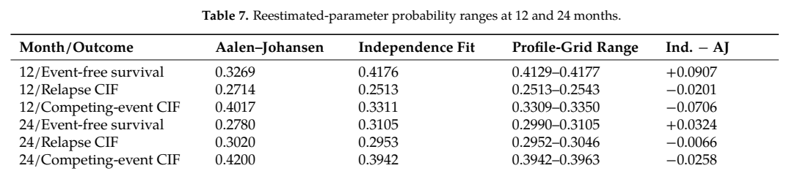

# 不同终点的潜在时间相依，能从观测数据判断多强吗？

<!-- 全库方法复筛开始 -->
> **方法储备 · 面向决策的履约建模**。保留“有依赖竞争风险与精确边际保持”这一研究问题或机制；是否用于当前业务另行验证。
> 原有阅读范围与证据等级不变；储备不等于效果已验证。
> 已恢复此前因业务距离被移出的原笔记；旧取舍原因仅作历史记录。
> [[研究前沿/论文库复筛与阅读路线|全库阅读路线]] · [[研究前沿/面向决策的履约建模/存量论文分层索引|本方向完整分层]]
<!-- 全库方法复筛结束 -->

表 7 中，177 人数据的 12 个月无事件率经验估计为 0.3269，独立模型给出 0.4176。逐点重拟依赖参数后只得到 0.4129–0.4177，未消除偏差。

## 论文与阅读范围

Exact Beta-P Margins for Dependent Competing Risks: Partial Identification and Sensitivity Bounds。Yousef Al-Zalzalah。首次公开 2026-11-13，所读版本 期刊版（2026-11-13）。精读构造、观测似然、§6.4 双重敏感性分析、表 6–7，核实期刊配套代码。 [一手来源](https://doi.org/10.3390/appliedmath6110196) · [paper.pdf](./assets/source/paper.pdf) · [publisher-supplement.zip](./assets/source/publisher-supplement.zip)

## 怎样计算

以共享 Gamma 随机效应连接原因特异的潜在时间，选择风险函数使每个原因的 Beta-P 边缘生存分布保持不变。用观测到的最早终点和类型形成观测似然。累计发生率由对应的原因次密度积分得到。先固定各边缘参数只改变依赖，再在 25 个固定依赖值上重拟六个边缘参数。两步对应不同的问题。

## 与哪些方法比较

固定边缘时，12 个月无事件率随示例扰动从 0.4176 升至 0.4571，进一步偏离 Aalen–Johansen 的 0.3269。重拟时，测试到的最高对数似然为 −561.210720，位于独立边界；12 个月复发累计率在 0.2513–0.2543，经验值 0.2714。

原文表 7，最后一列为独立拟合减去 Aalen–Johansen 经验估计。 [原文第 15 页](./assets/source/paper.pdf#page=15)

## 适用条件与迁移

拟合最优位置不能识别真实潜在事件是否独立。表 7 是给定家族和网格下的范围。模型诊断要求可区分终点及妥当处理右删失。配套包 S2 的 02_Gamma_Profile/profile.py 和 04_Clinical_Comparison/compare.py 对应重拟与外部对照，已核验文件。

[[研究前沿/面向决策的履约建模/02-可复用方法卡/BetaPDependence-让竞争终点的依赖假设接受可观察事件率核对|让竞争终点的依赖假设接受可观察事件率核对]] · [[研究前沿/面向决策的履约建模/03-实验假设与结果/BetaPDependence-以完成和取消的经验累计发生率校验依赖敏感性|以完成和取消的经验累计发生率校验依赖敏感性（未运行）]]
