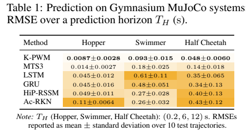

# 只看到部分状态，如何把不确定性连同动作向前推

<!-- 全库方法复筛开始 -->
> **方法储备 · 司乘行为序列建模**。保留“双线性状态与信念的世界模型”这一研究问题或机制；是否用于当前业务另行验证。
> 原有阅读范围与证据等级不变；储备不等于效果已验证。
> 已恢复此前因业务距离被移出的原笔记；旧取舍原因仅作历史记录。
> [[研究前沿/论文库复筛与阅读路线|全库阅读路线]] · [[研究前沿/司乘行为序列建模/存量论文分层索引|本方向完整分层]]
<!-- 全库方法复筛结束 -->

**K-PWM: Control-Oriented Structured Bilinear World Models under Partial Observation**  
arXiv 首次提交 2026-11-08（UTC），核验时版本历史仅有 v1；本次检索日为上海时间 2026-11-12。正式发表日期待核。 [官方版本历史](https://arxiv.org/abs/2611.11521v1)

[原版 PDF](./assets/source/paper.pdf) · [原文 HTML 快照](./assets/source/paper.html)

## 研究问题

当传感器或过程日志看不到完整状态时，用一个最可能状态往前推会丢失估计误差。K-PWM 用隐变量、带动作的双线性转移与非线性观测解码器，同时维护潜在状态的均值和协方差。

## 方法、计算与决策时点

固定当前控制 $a$ 时转移对增广隐状态是线性的，式 (2) 可写为 $z'=A(a)z+w$。预测得到 $\mu'=A(a)\mu$、$P'=A(a)P A(a)^\top+Q$；到达下一观测后，以解码器的局部线性化做扩展卡尔曼更新。训练以平滑后的潜状态矩更新转移和噪声，并优化非线性解码器。第 3 节把预测协方差的惩罚加入 MPPI 代价，以比较相同当前信念下的动作序列。

## 实验结果与证据边界

表 1 在部分观测 MuJoCo 的 10 条测试轨迹上，Half Cheetah 的 12 秒 RMSE 为 0.048±0.006，对照 MTS3 为 0.14±0.018。表 2 的四类机器人末端跟踪并非全部领先，如 ALOHA 2 上 2.5 mm，高于 DK 的 2.1 mm。效果支撑整套表示、推断和训练，未单独隔离风险惩罚的贡献。 [证据原文](https://arxiv.org/html/2611.11521v1#S4.T1)

*表 1 · 三类部分观测动力系统多步预测误差，固定版 PDF 第 8 页。*

给定高斯信念和固定动作，线性预测步的矩传播精确；非线性观测后的滤波和平滑依然只是局部近似。模型假设规则采样，未强制长期稳定，多峰隐状态和真实硬件延迟均缺验证（附录 D）。

## 迁移到履约问题

适合观测缺口可用潜在连续状态近似的流程；动作支持、规则采样及校准的噪声模型须先确认。 本地尚未运行验证。

## 方法卡与候选实验

- [[研究前沿/面向决策的履约建模/02-可复用方法卡/BilinearBelief-gaussian-transition|固定动作下传播隐状态均值与协方差]]

## 来源与实现核验

正文给出作者仓库地址。本次通过 GitHub 公共 contents API 复核返回 HTTP 404，当前可读的实现文件与提交未知；论文附录算法 1、2 可查训练与控制步骤。[原文所列仓库](https://github.com/santoshrajkumar/k-pwm-world-model-control)

本次核验公开 v1 正文、列明的方法和实验及下列证据定位。作者报告的数值未做独立复算。 [隐状态转移](https://arxiv.org/html/2611.11521v1#S2) · [离线训练](https://arxiv.org/html/2611.11521v1#S2.SS1) · [在线规划](https://arxiv.org/html/2611.11521v1#S3) · [仿真比较](https://arxiv.org/html/2611.11521v1#S4) · [局限](https://arxiv.org/html/2611.11521v1#A4)
