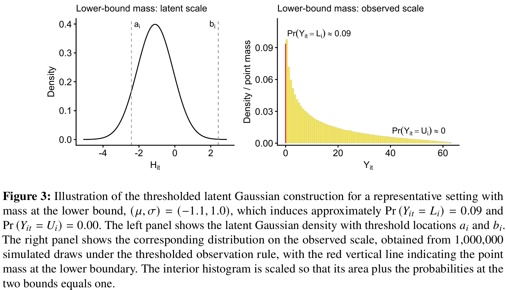

# Reference-based sensitivity analysis for bounded longitudinal outcomes

[官方论文](https://arxiv.org/abs/2611.02642) · [本地PDF](./assets/source/paper.pdf) · [HTML快照](./assets/source/paper.html)

版本记录：[Submitted on 2 Nov 2026]；本次核验与精读：2026-11-06。本篇为滚动窗口内首次入库；检索日不等于首次发表日。

阅读范围：§3–4全部建模/补全、§5.2–5.3模拟和§7讨论；MCMC代码未运行。未逐行复证全部数学证明，未声称逐页翻译。[[研究前沿/面向决策的履约建模/01-论文原文与精读/BoundedSensitivity/阅读覆盖|原文章节与公式索引]]；HTML为原始快照，外部样式和图片可能需要联网，PDF可离线阅读。

代码：本次核验的论文原文与元数据未提供可确认的作者实现入口；代码状态未知，不能据此断言不存在。未运行代码。 [[研究前沿/面向决策的履约建模/01-论文原文与精读/BoundedSensitivity/代码核验|核验记录]]

## 问题与结构

有界纵向结果（比例/评分/受上限截断收益）既有连续内点又有真实边界质量，且后续缺失。简单Gaussian补值可能越界；裁剪不能表达边界概率。本文把缺失敏感性规则放在阈值高斯潜变量H上，再映回[L,U]。

设a=Φ⁻¹(pL)、b=Φ⁻¹(pU)。H≤a输出L，H≥b输出U，内点输出 $L+(U-L)(\Phi(H)-p_L)/(p_U-p_L)$。边界观察对应潜变量尾部事件，Stan约束增广；内点用逆变换和Jacobian。阈值固定不意味着边界概率固定，概率随潜均值/方差变。

## 缺失补全（§3–4）

先在MAR下拟合公共潜协方差Σ与两臂均值。触发前间歇缺失按本臂补；触发后必须是完全缺失尾段。J2R用参考臂后段均值，但历史以处理臂均值居中；CR后段和历史都按参考臂；ω加权J2R在MAR与J2R条件均值间插值，协方差保持不变。

每后验抽样补潜值再映回原尺度。已完成样本队列的均值对比不确定性，与总体效应的多重插补+二级分析/Rubin方差是不同目标，不能混用。

## 证据与局限（§5–7）

Study2匹配真实补全规则在8场景中7个最小绝对偏差，RMSE不总最优。Study3每场景300重复、n100、最终约39.5%缺失：Gaussian MAR下混合边界bias0.06 vs shifted-log裁剪0.32；J2R下0.08 vs0.10，95%覆盖两者均99.7%，明显保守。t5错设只给有限稳健性证据。

潜尺度固定后验状态下仿射估计方差不变是精确结果；原尺度非线性映射与Rubin总体推断仅有启发/模拟，不能说保持真实信息量已证明。实际预测比较中连续有界模型略优于混合边界模型，也应保留。

敏感性ω/参考规则不可由观察数据验证，不识别MNAR。共同协方差、固定阈值、MCMC成本与独立边界生成机制都是限制。迁移价值是结果边界和失访假设一起传播到决策风险，而非选择一个补值当真值。

## 原文关键图表

原文 Figure 3，PDF 第 8 页；原始裁图，机制和证据解释见上文。裁图坐标与源文件校验值见 assets/source/figure-provenance.json。

## 方法卡

- [[研究前沿/面向决策的履约建模/02-可复用方法卡/BoundedSensitivity-bounded-imputation|阈值潜高斯上的有界结果敏感性补全]]
