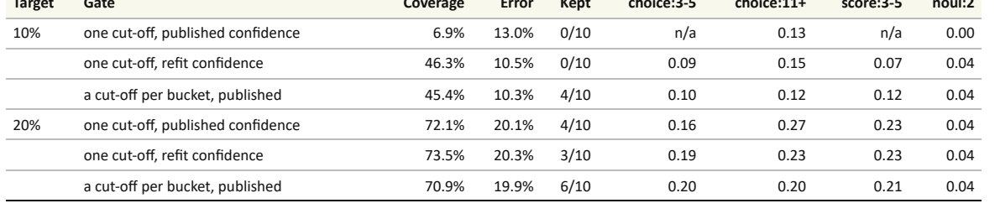

# 按候选数分桶设阈值，能解释多少校准收益

<!-- 全库方法复筛开始 -->
> **方法储备 · 面向决策的履约建模**。保留“按输出类型进行置信度校准”这一研究问题或机制；是否用于当前业务另行验证。
> 原有阅读范围与证据等级不变；储备不等于效果已验证。
> 已恢复此前因业务距离被移出的原笔记；旧取舍原因仅作历史记录。
> [[研究前沿/论文库复筛与阅读路线|全库阅读路线]] · [[研究前沿/面向决策的履约建模/存量论文分层索引|本方向完整分层]]
<!-- 全库方法复筛结束 -->

Recalibrating a Typed-Decision Model in an Afternoon: A Hands-On Recipe for Laya’s Confidence Scores  
Mohammed Nayeem Khan、Aliyas Ahmad Misri。2026-11-12 首次提交 arXiv，本次核对 v1。[arXiv v1](https://arxiv.org/abs/2611.16499v1)

一个统一门槛的通过率很低，收益究竟来自重新拟合概率，还是只来自分开设门槛？

## 怎样从输入得到输出

对按题型和选项数分组的决策头，分别测量整体和组内置信度偏差。将温度、Platt 等校准映射仅在训练折拟合，在独立折比较统一阈值与分桶阈值。门槛也只用训练折定，保留原始置信度加分桶阈值作为独立对照。

对桶 $b$ 的选项 logits 用 $p=\mathrm{softmax}(z/T_b)$；门控为 $\max(p)\ge c_b$。通过率报告全部题目中被回答比例，错误率分母为被回答的题目，ECE 应另分桶宏平均。

## 哪个对照支持这个判断

1,065 道合成、LLM 标注题目中，原始统一阈值只回答 6.9%。在目标错误率 10% 时，分桶重拟合概率后统一门槛回答 46.3%、实际错 10.5%；保留原始概率仅分桶设门槛也回答 45.4%、错 10.3%。故不能把约 39 个百分点的增加都归于温度缩放。

表 9 续页，10% 和 20% 错误目标下的门控对照。[本地原文](./assets/source/paper.pdf#page=17)

## 使用条件与可检验的迁移

分布来自同一生成器，样本少的桶阈值波动大；留一评估集的分桶宏 ECE 为 0.099，随机交叉拟合为 0.073。目标错误率没有得到严格保证。作者将其定位为已有方法的负面对照教程。

若候选数改变了置信度分布，按候选数单独选通过阈值，可能已经解释大部分所谓校准收益。应先比较覆盖相同或风险相同的决策曲线。

[[研究前沿/面向决策的履约建模/02-可复用方法卡/BucketGateControl-method|方法卡 · 按候选数分桶设阈值，能解释多少校准收益]] · [[研究前沿/面向决策的履约建模/03-实验假设与结果/BucketGateControl-候选数分桶阈值能否复现重新校准的收益|待验证 · 候选数分桶阈值能否复现重新校准的收益]]

## 阅读范围与复现入口

25 页，核对表 2、5、7、9 及图 15–17，复核合成标签和留集外测试边界。文末给出基础模型 Laya 的入口；本稿五步评估的独立可运行仓库未核实。 本地验证状态为未运行。
