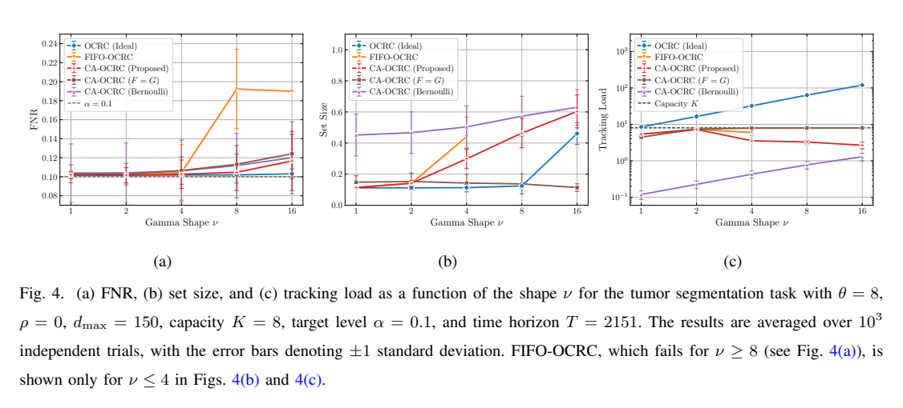

# 追踪位置有限时，怎样用晚到标签校准风险

<!-- 全库方法复筛开始 -->
> **方法储备 · 面向决策的履约建模**。保留“Capacity-Constrained Delayed Feedback for Online Conformal Risk Control”这一研究问题或机制；是否用于当前业务另行验证。
> 原有阅读范围与证据等级不变；储备不等于效果已验证。
> [[研究前沿/论文库复筛与阅读路线|全库阅读路线]] · [[研究前沿/面向决策的履约建模/存量论文分层索引|本方向完整分层]]
<!-- 全库方法复筛结束 -->

Capacity-Constrained Delayed Feedback for Online Conformal Risk Control  
Bowen Wang; Osvaldo Simeone。2026-11-12 首次提交 arXiv，本次核对 v1。[arXiv v1](https://arxiv.org/abs/2611.17059v1)

标签回来前每个样本占一个位置，满员会漏标签，此时怎样更新预测集合？

## 怎样从输入得到输出

每轮先生成预测集。对非平凡集合随机抽一个最长等待期限，超过期限清出，有空位才收新样本。真实标签回传时按其延迟被保留的机会加权修正下一轮阈值。空集和全集若损失固定则直接更新。给定固定容量，作者分别针对任意延迟和独立随机延迟设计等待期限分布。

式 (22) 对收到的损失偏差 $L_i-\alpha$ 乘 $[q_G(d_{\max}^{proxy})F(d_i)]^{-1}$，其中 $F$ 是追踪期限的生存函数，$q_G$ 是真实延迟在最长追踪界内的概率。容量饱和额外进入风险上界，不能只靠权重消除。

## 哪个对照支持这个判断

图 4 肿瘤分割回放取容量 8、延迟尺度 8，平均延迟由 8 增至 128 轮。两种容量感知规则的漏检率均接近目标 0.10；FIFO 在形状参数达到 8 及以上失效。图 3 显示短延迟或更大容量下模型可同时使用较小集合。

图 4，固定 8 个追踪位置，拉长反馈延迟。[本地原文](./assets/source/paper.pdf#page=24)

## 使用条件与可检验的迁移

理论约束是长期平均风险；随机延迟版需要相应的延迟分布和负载条件。若某些结局永不记录或回传机制随真实风险变化，不能照搬论文权重。四类任务使用的是设置的反馈延迟。

给定同时可追踪的订单数，随机等待期限有机会降低“慢结局被系统性丢弃”造成的校准偏差。检验时必须保留另行获得的完整终态。

[[研究前沿/面向决策的履约建模/02-可复用方法卡/CapacityOCRC-method|方法卡 · 追踪位置有限时，怎样用晚到标签校准风险]] · [[研究前沿/面向决策的履约建模/03-实验假设与结果/CapacityOCRC-固定追踪容量下比较等待期限与先进先出|待验证 · 固定追踪容量下比较等待期限与先进先出]]

## 阅读范围与复现入口

48 页，核对算法 1、式 (22)、定理 1–2 及图 3–9；未逐行复算补充证明或重跑数据。正文给出算法 1 和设计优化问题，作者独立源码入口未核实。 本地验证状态为未运行。
