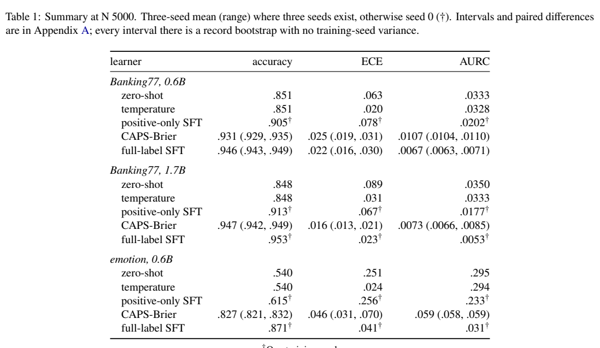

# 只知道选中项成败，失败样本该怎样进入损失

<!-- 全库方法复筛开始 -->
> **方法储备 · 面向决策的履约建模**。保留“Learning a calibrated decision head from logged bandit feedback”这一研究问题或机制；是否用于当前业务另行验证。
> 原有阅读范围与证据等级不变；储备不等于效果已验证。
> [[研究前沿/论文库复筛与阅读路线|全库阅读路线]] · [[研究前沿/面向决策的履约建模/存量论文分层索引|本方向完整分层]]
<!-- 全库方法复筛结束 -->

Learning a calibrated decision head from logged bandit feedback  
Ye Yuan。2026-11-11 首次提交 arXiv，本次核对 v1。[arXiv v1](https://arxiv.org/abs/2611.15572v1)

已执行选项收到的二值反馈，直接拟合和当作策略奖励有何不同？

## 怎样从输入得到输出

一个状态有若干互斥答案，模型一次输出各项概率。记录器随机选一项并记录正确与否。CAPS 在这一项上对二值反馈直接求概率损失的梯度，利用成功和失败。作者另把分数当作采样动作的停止梯度奖励，分析其策略梯度为何可能给低概率错误项错误方向。

Brier 形式为 $L=(p_\theta(a\mid x)-r)^2$，只取所选项，沿 $p_\theta$ 反传。作为 REINFORCE 奖励时则沿 $\log\pi_\theta(a\mid x)$ 反传，更新项不同。记录器要覆盖待学动作；仅知执行项绝不提供每条记录的其他动作真值。

## 哪个对照支持这个判断

表 1 中 Banking77、0.6B、5,000 条反馈，CAPS 准确率 0.931、ECE 0.025，仅保留成功项的 SFT 为 0.905、0.078。前者三种子，后者单种子。具有全标签时，四个 bandit 方案均未在四个未见标签体系的平均 ECE 上超过交叉熵加单温度。

表 1，同一批 5,000 条已选动作反馈的训练比较。[本地原文](./assets/source/paper.pdf#page=10)

## 使用条件与可检验的迁移

原任务每题仅一个正确选项；多司机可能同时愿接单，完整 softmax 约束并不自然。这里只验证给定日志分布上正确性的评分，不能据此声称比较未执行动作的因果效应。

要判断收益来自更好的表示还是纳入失败反馈，可冻结主干和样本池，先检验已执行候选二值损失；应同时报告执行分布、校准和排序。

[[研究前沿/面向决策的履约建模/02-可复用方法卡/ChosenActionScore-method|方法卡 · 只知道选中项成败，失败样本该怎样进入损失]] · [[研究前沿/面向决策的履约建模/03-实验假设与结果/ChosenActionScore-保留执行失败反馈能否改善执行项校准|待验证 · 保留执行失败反馈能否改善执行项校准]]

## 阅读范围与复现入口

40 页，核对目标梯度、表 1、附表 A.2、A.4、A.5 和噪声条件；未运行作者模型。作者 §7 提供 [代码](https://github.com/yuan-phd/jevmark) 和 [逐条结果](https://huggingface.co/datasets/yuanphd/jevmark-runs)，论文指定 v5-paper 标签。 本地验证状态为未运行。
