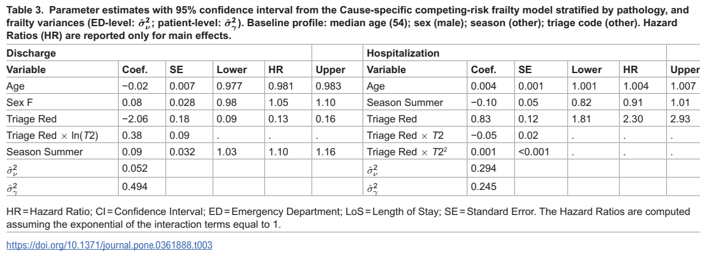

# 两种退出方式为什么有完全不同的长尾？

<!-- 全库方法复筛开始 -->
> **方法储备 · 面向决策的履约建模**。保留“竞争风险 frailty 的层次异质性”这一研究问题或机制；是否用于当前业务另行验证。
> 原有阅读范围与证据等级不变；储备不等于效果已验证。
> 已恢复此前因业务距离被移出的原笔记；旧取舍原因仅作历史记录。
> [[研究前沿/论文库复筛与阅读路线|全库阅读路线]] · [[研究前沿/面向决策的履约建模/存量论文分层索引|本方向完整分层]]
<!-- 全库方法复筛结束 -->

把所有请求的服务时长压成一个分位数，会遗漏哪类差异？ 用相同入口时间分别建模两个互斥终点，再看地点和重复个体各贡献了多少差异。

## 论文与阅读范围

Prolonged length of stay in the Italian emergency departments: A competing risks frailty model。Battaglia 等。PLOS One；精读模型式 (1)、样本选择、表 2–3、图 1–2 与讨论。 首次公开 2026-11-11，核验版本 期刊版，本次阅读 2026-11-13。 期刊上线 2026-11-11。 [一手来源](https://doi.org/10.1371/journal.pone.0361888) · [journal.pdf](./assets/source/journal.pdf) · [journal.html](./assets/source/journal.html)

## 方法及关键假设

对每种退出原因 $k$ 单独设瞬时风险。式 (1) 使不同终点拥有不同系数和基线，地点效应和重复患者效应分别进入对数风险。论文以病理分层，对分诊状态引入时长交互，经 Schoenfeld 残差检查比例风险假设。

$$
\lambda_k(t\mid x,b_i,c_{il})=\lambda_{0k}(t)\exp\{x(t)^\top\beta_k+b_{ik}+c_{ilk}\}.
$$

从各原因瞬时风险合成总体存续率，再积分得到各自累计发生概率。R 的 coxph 单次只支持一个 frailty 项，作者采用参考文献中的惩罚似然估计流程。

## 证据和比较基线

表 2 的描述量来自全部合格访问，离院/入院中位数 1.70/3.77 小时。表 3 在拟合子样本估计，医院层对数随机效应方差分别为 0.052/0.294，患者层为 0.494/0.245。图 1–2 展示不同病理分层下累积发生曲线。结果支持分终点和分层诊断，论文未报告去除某个随机效应后在独立时间段的预测误差对照。

原文表 3，PDF 第 8 页。表中两类方差分别属于地点和患者，系数乘时长交互后再解释。。[原表所在页](./assets/source/journal.pdf#page=8)

## 迁移条件与局限

样本排除了死亡和治疗前离开者，部分离开时间缺失；这会改变适用人群。在线等待场景若忽略退出，不能直接沿用医院的数值。地区、时期和数据切分影响可迁移性。实现例程为 R survival::coxph 与 cox.zph，论文附件提供表图，未核准有完整作者建模脚本。

[[研究前沿/面向决策的履约建模/02-可复用方法卡/ClusteredExit-用分终点和两层随机效应定位等待长尾|用分终点和两层随机效应定位等待长尾]] · [[研究前沿/面向决策的履约建模/03-实验假设与结果/ClusteredExit-完成与取消的尾部误差是否来自地点差异|完成与取消的尾部误差是否来自地点差异（未运行）]]
