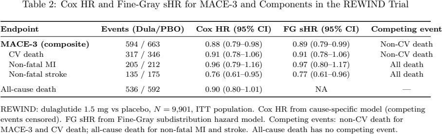

# 竞争结局下风险比的压力测试

Competing Risk Analysis in Cardiovascular Outcome Trials: A Simulation Comparison of Cox and Fine-Gray Models · Wang, Tuo, Du, Yu。arXiv 首投 2026-02-17，本次阅读版本 v2（2026-11-06）。2 月首投；v2 新增 REWIND 例证和多种敏感性分析，图 5–6 将偏离生成参数的量明确标为 estimand gap。 [版本记录](https://arxiv.org/abs/2602.16031v2) · [本地 PDF](./assets/source/paper.pdf) · [本地 HTML](./assets/source/paper.html)

## 研究问题

比较取消和完单策略时，结局不同、风险集不同，两个都叫“风险比”的数值可能回答不同的问题。怎样识别这种区别有多大？

## 方法及关键计算

§2 用 copula 生成两个相关潜在事件时间，只观测最早时间和类型。改变竞争事件基础率、动作对竞争事件的影响和两个时间的依赖。对同一份数据拟合两套模型：原因别 Cox 只比较仍无任何事件的人，Fine–Gray 用修改后的风险集估计与目标事件累积发生概率相关的子分布风险。显式比较各自目标量及其与生成机制指定参数的距离。

## 关键公式

$$
\text{HR}_{\text{CS}}=\frac{h_{1}^{\text{cs}}(t\mid Z=1)}{h_{1}^{\text{cs}}(t\mid Z=0)}=\theta_{1}^{\alpha}\cdot\left[\frac{(\lambda_{1}\theta_{1})^{\alpha}+(\lambda_{2}\theta_{2})^{\alpha}}{\lambda_{1}^{\alpha}+\lambda_{2}^{\alpha}}\right]^{1/\alpha-1}
$$

在作者的联合生存生成模型下，λ 为两类事件的基准参数，θ 为动作对各类潜在事件时间分布的参数，α 刻画依赖。α=1 时可化为 θ₁；有依赖时，另一事件的参数也能进入原因别风险比。 [公式原文](https://arxiv.org/html/2602.16031v2#S2.E4)

## 证据、对照与边界

§3 的参数网格将竞争事件年率从 0.5% 改为 5%，Kendall τ 从 0 改为 0.50。在该生成机制中，竞争事件少时两模型结果接近。新增 §4 表 2 在 REWIND 试验 9,901 人的四个可比较终点上，两种比值相差至多 0.01；复合终点为 0.88 与 0.89。

表 2　相同试验数据的 Cox 与 Fine–Gray 估计，原文 PDF 第 15 页。

模型目标量不同，模拟参数与拟合比值的距离包含目标量差异。试验中的数值相近不能推出高取消率订单也相近；两种比值均不直接等于某期限的完单率差。

## 阅读覆盖与复用

已核对上述设定、关键计算、主对照及限制，附录证明未逐行复证。作者说明代码和模拟结果可按需索取。未核验到公开运行入口，试验个体数据也未公开。

[[研究前沿/面向决策的履约建模/02-可复用方法卡/CompetingEstimands-竞争结局下风险比的压力测试|竞争结局下风险比的压力测试]] · [[研究前沿/面向决策的履约建模/03-实验假设与结果/CompetingEstimands-取消与完单竞争会否扭曲策略收益的解释|取消与完单竞争会否扭曲策略收益的解释]]

[[研究前沿/面向决策的履约建模/01-论文原文与精读/CompetingEstimands/原文导航|原文章节和图表索引]]
