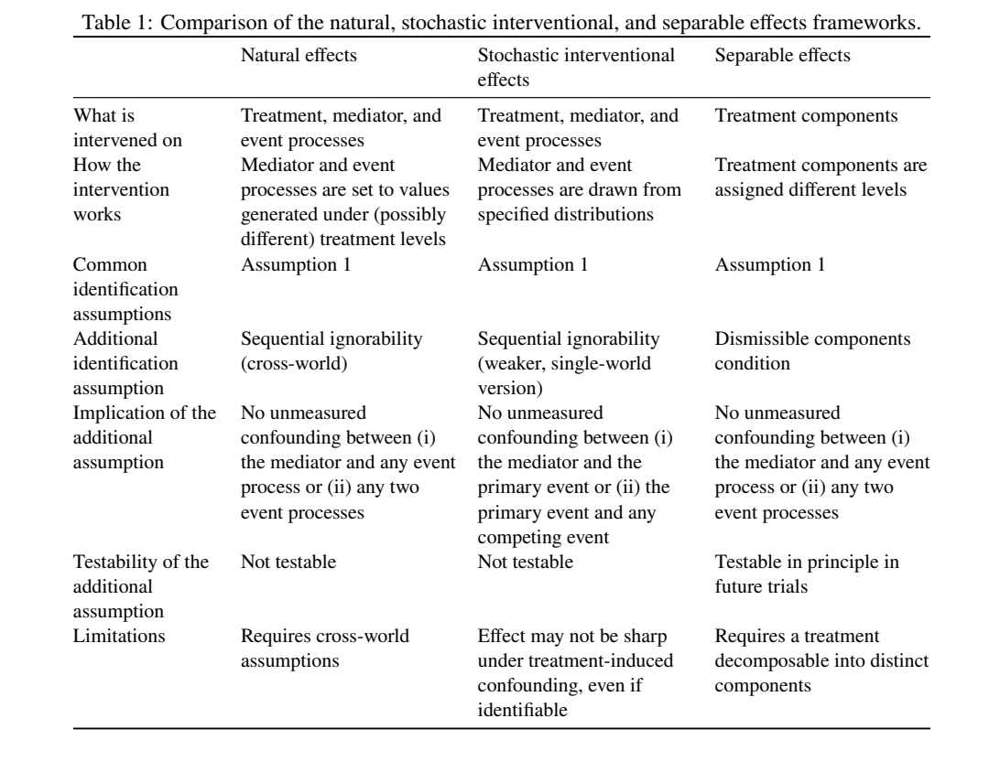

# 把中介路径和竞争事件路径从总风险差中拆开

<!-- 全库方法复筛开始 -->
> **方法储备 · 面向决策的履约建模**。保留“竞争风险下的因果中介分解”这一研究问题或机制；是否用于当前业务另行验证。
> 原有阅读范围与证据等级不变；储备不等于效果已验证。
> 已恢复此前因业务距离被移出的原笔记；旧取舍原因仅作历史记录。
> [[研究前沿/论文库复筛与阅读路线|全库阅读路线]] · [[研究前沿/面向决策的履约建模/存量论文分层索引|本方向完整分层]]
<!-- 全库方法复筛结束 -->

Causal mediation analysis for a time-to-event endpoint in the presence of competing events。作者为 Deng, Yuhao、Gilbert, Peter、Fong, Youyi、Zhang, Bo。arXiv 首投 2026-11-09，本次核验 v1。 [版本记录](https://arxiv.org/abs/2611.13327v1) · [本地 PDF](./assets/source/paper.pdf) · [本地 HTML](./assets/source/paper.html)

## 研究问题

一种动作可能改变目标事件、一个中间响应，也可能先改变另一个终态。只给出总风险差难以定位变化来源。

## 方法与关键计算

在固定时点对指定原因的累积发生率构造四种干预组合，分别切换中介分布、目标事件机制和竞争事件机制；相邻组合做差。按自然、随机干预或可分离效应选择识别假设，估计各项干扰函数后用有效影响函数修正，推断保留共同样本的相关性。

$$
F^{111}-F^{000}=(F^{100}-F^{000})+(F^{110}-F^{100})+(F^{111}-F^{110})
$$

省略同一时点和事件编号。三个下标依次代表产生中介、目标风险及竞争风险的处理水平。各项解释依赖所选框架和切换顺序。 [原文定位](https://arxiv.org/html/2611.13327v1#S7.F1)

## 对照、结果和限制

表 1 逐列列出三种解释各自需要的假设。§7.1 图 1 在模拟化的疫苗实例中，三项估计均未达到显著，不能凭总效应给中介记功。补充表 S1–S4 检查偏差和区间覆盖。 [原文证据](https://arxiv.org/html/2611.13327v1#S2.T1)

原文 PDF 第 18 页。

随机化处理不能自动消除中介–结局混杂。三个框架可能给出相同的观测数据函数，但可干预对象与假设不同，敏感性分析只覆盖作者指定的偏离。

## 复用和阅读范围

已核问题设定、方法与上文所列的关键对照，详细证明及未列出的实验以所附全文为准。已按公开仓库快照核对文件路径。[simulation.R](https://github.com/naiiife/MedCmprsk/blob/51912c44bfa415416c3d7cea27b5536a89c66ac6/simulation.R)

[[研究前沿/面向决策的履约建模/02-可复用方法卡/CompetingMediation-竞争路径中介分解|竞争路径中介分解]] · [[研究前沿/面向决策的履约建模/03-实验假设与结果/CompetingMediation-对干预后的确认环节、取消和完单，比较只改确认分布与完整三项分解|对干预后的确认环节、取消和完单，比较只改确认分布与完整三项分解]]

显式区分中介贡献与其他路径，需要写清楚谁的哪个分布受干预。 [[研究前沿/uplift模型迭代/01-论文原文与精读/ClusterPaths/精读|另一方向的对照]]
