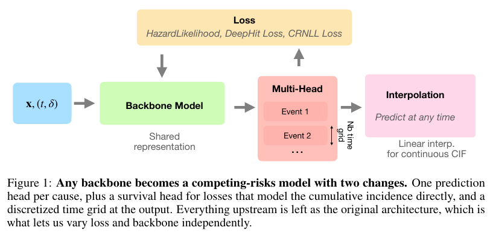
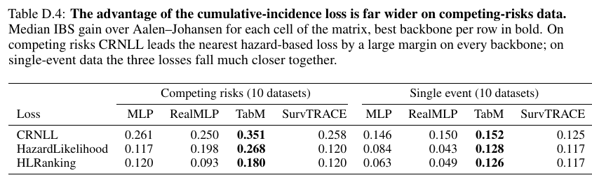
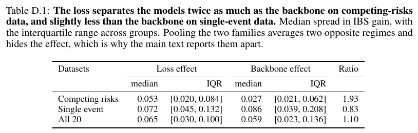

# The Loss or the Architecture? What Matters in Survival Analysis with Competing Risks

10 月 16 日历史补录。10 个竞争风险表格数据集上，以 IBS 相对 Aalen–Johansen 的增益度量，切换损失的中位极差为 0.053，切换主干为 0.027；10 个单事件数据集的对应比值从 1.93 降为 0.83。

Julie Alberge、Gaël Varoquaux、Judith Abécassis。arXiv v1 于 2026-10-16 首次提交，2026-11-09 首次在本库精读；既有 11-05 和 11-06 查询保留过检索痕迹。[arXiv 版本](https://arxiv.org/abs/2610.23322v1) · [HTML](https://arxiv.org/html/2610.23322v1) · [本地完整 PDF](./assets/source/paper.pdf)

**阅读覆盖**　§§2–7、图 1–2、附录 C.3、D.1–D.6 的对照、关键表与失效条件。附录 A 每份数据的加工过程与数学附录未逐行复核。**代码状态**　v1 的 Reproducibility statement 说明完整 benchmark 的损失、搜索空间、数据加载及评估脚本拟在发表后公开。本次未核实已发布的官方 benchmark 仓库，文中引用的 pycox、torchvision 只是依赖。

## 1. 从风险排序转向截止时点的概率

有多个互相排斥的首次事件，例如在随访中先发生哪种结局。观测包含基线 $x$、首事件或删失的时间 $t$ 和类型 $\delta$，其中 0 表示右删失。目标是每个原因 $k$ 的累积发生率 $F_k(\tau\mid x)=P(T^*\le\tau,\Delta^*=k\mid X=x)$，另有存活概率 $S(\tau\mid x)=1-\sum_k F_k(\tau\mid x)$。应用中“截止 10 分钟仍未完单、也未取消”就是后一类状态，而提前中断观察的样本到该截止点时真类未知。

## 2. 三种损失和适配的输出头

- **HazardLikelihood（HL）**按式（1）对事件使用其发生类型/时刻的密度，对删失使用该时刻仍无事件的概率。共享表示后有每种原因一个头，积分得到累积发生。
- **HLRanking**在 HL 上按 $\alpha$ 混入排序损失。式（2）只比较类型 $k$ 较早发生且另一样本仍可比较的配对；排序项可提升某些次序但破坏严格适当性。
- **CRNLL**在每个时间网格处预测“已发生各类型”或“仍无首事件”的概率。已观测到某原因事件者按其事件时刻留观概率倒数加权，仍被观测且未发事件者按查询时刻留观概率倒数加权，过早被删失者不提供该时点的类别标签。式（3）原排版右侧写作 log 概率和，以下取负号表示**用于最小化的负对数损失**，记 $G$ 为删失生存函数。

$$
\ell_\tau=-\frac1n\sum_i\left[
\sum_{k=1}^{K}\frac{\mathbf1(t_i\le\tau,\delta_i=k)}{G(t_i\mid x_i)}\log\widehat F_k(\tau\mid x_i)
+\frac{\mathbf1(t_i>\tau)}{G(\tau\mid x_i)}\log\widehat S(\tau\mid x_i)
\right].
$$

论文训练以边际 Kaplan–Meier 估计 $G$。适当评分结论依赖可忽略的删失机制与正确的删失权重；某些时段 $G$ 很小时需要单独查验。附录 C.4 表中仅在三种权重均能拟合的 35 个数据–主干组合比较，条件 Cox 在 11 个组合显著不稳定。这里的表现不能保证边际 KM 在条件相关删失的其他应用中仍正确。

§4 用未删失事件的观测时间构造网格，分辨率 20–60 点参与搜索。CRNLL 以 $K+1$ 个头和每个时点的 softmax 实现概率归一化，查询任意时点时线性插值。逐时点求和为 1 本身不保证跨时间的单调性。图 D.10–D.11 比较 CRNLL 用专门生存头或仅用 $K$ 个输出另行归一化，两版 IBS 与校准均未出现系统胜负。

## 3. 交叉对照和效果口径

三种损失交叉 MLP、RealMLP、TabM、SurvTRACE 四种表格主干。表格部分为 10 个竞争风险和 10 个单事件数据集，另有 3 个共 635 张 TCGA 病理图像的数据集，用三种冻结的预训练视觉主干、另加 MLP 对照。表格矩阵按相同调参预算，每格分别以验证 IBS 或 C-index 作搜索目标，各 150 次随机搜索，超参数选择后以五次划分评估。固定损失的外部方法不进入交叉归因。$1-\mathrm{IBS}/\mathrm{IBS}_{AJ}$ 是相对无协变量 Aalen–Johansen 的增益，越高越好；图像结果报告原始 IBS，越低越好。

表 D.4 的竞争风险 TabM 行列交点，CRNLL、HL、HLRanking 分别为 0.351、0.268、0.180。单事件 TabM 对应为 0.152、0.128、0.126。相同主干换损失的证据与相同损失换结构的证据均可读取。图像三个数据集上 CRNLL 仍在各主干内领先，预训练编码器优于 MLP。仅有三个图像数据集，且固定特征，不能外推出微调收益。

附录 D.1 固定主干与数据集后算三种损失的最大–最小增益；固定损失与数据集后算四种主干的极差，再分别取中位数。可用格为 229/240，只有各成员齐全的组参与，分别有 75/49 组。竞争风险的 1.93 是两种中位极差之比，既非绝对概率提升，也不是某个骨干比另一个快一倍。表 D.5 对同一 HLRanking 改用 C-index 选超参数，74 个可配对组合的中位 C-index 变化 +0.0018、原始 IBS 变化 +0.0117（变差）。这说明用何种指标选模会影响部署所需的概率精度。

## 4. 迁移到履约的边界

需要逐单标明观察起点、完整随访、第一种互斥终点及其原因。接单后仍可能完单，不能把它们直接并列为竞争终点；可从接单时刻起将完单与取消定义为首个终态。该研究只估计观察条件下的事件分布，未比较不同派单动作的反事实价值；时变协变量、复发、多状态轨迹和下游策略后悔值超出其实验范围。

## 方法与实验

[[研究前沿/面向决策的履约建模/02-可复用方法卡/删失加权的竞争事件累积概率损失|删失加权的竞争事件累积概率损失]] · [[研究前沿/面向决策的履约建模/02-可复用方法卡/竞争风险损失与主干的等预算交叉对照|竞争风险损失与主干的等预算交叉对照]] · [[研究前沿/面向决策的履约建模/03-实验假设与结果/完单与取消首事件的损失和主干交叉验证|完单与取消首事件的损失和主干交叉验证]]
