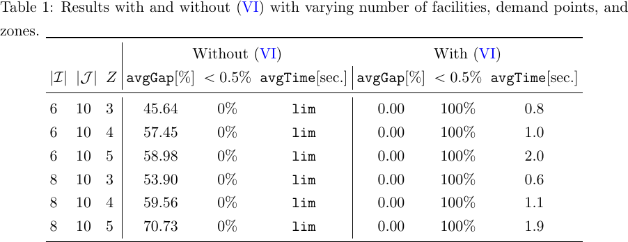

# DD-LS · 让分配方案决定需求分布，再用容量上界加速求解

A Solution Method for Single-Source Capacitated Facility Location Problems Under Decision-Dependent Demand Uncertainty

Pantuso, Giovanni, Lejeune, Miguel。arXiv v1 首投 2026-11-05。本轮新发现，检索于 2026-11-09，会议发表日期未核验。[版本页](https://arxiv.org/abs/2611.08090) · [本地 PDF](./assets/source/paper.pdf) · [本地 HTML](./assets/source/paper.html)

## 从决策到需求，再到可兑现收益
每个需求点先指定一家设施。分配会改变需求向量的联合分布，容量又限制每个情景下能服务多少。§2 将开设、连边费用和期望二阶段收益放进同一目标。直接列举所有分布随需求点数指数增长，分配会同时改变目标和应该用来算目标的情景。
## 对所有分配都成立的剪枝条件
§3 算法 1 只在遇到候选整数方案时计算相应分布的收益。命题 4 先用二阶段收益关于需求的凹性取 Jensen 上界，再放松共享容量、按可行分布取最宽松的均值。若 $R_{ij}$ 是单位收益、$M_i$ 是设施容量、$y_{ij}$ 为连边决策，主问题里的收益变量须满足
$$
\mu\leq\sum_{i,j}R_{ij}y_{ij}\max_d\min\{M_i,\mathbb E_{P_d}[\xi_j]\}.
$$
这个界在还没遇到特定情景时就能排除夸大收益的方案。第二条路线是把新双线性割与原最优性割联用，代价是线性化引入额外变量与约束。
## 实验怎么读
§4 每个分布抽 50 个需求情景，180 个随机实例，单线程 CPLEX，统一限时 1,800 秒。表 2 中双割 V2 在全体证明最优 118/180，原割 112/180；20 个需求点的最大组中，原割平均缺口 0.27%，V2 为 1.20%。能关闭更多中型算例和在固定时间给出更紧的解是两个指标。

## 原始证据

§4.1 表 1 的独立开关对照覆盖 60 个十需求点实例。没有该上界时全部超时，各组平均缺口 45.64%–70.73%；加入后全部证明最优，各组平均耗时 0.6–2.0 秒。

原表 1　有无有效不等式的配对求解结果。

## 阅读范围和迁移边界

原文依据人为指定的动作条件需求分布做优化。迁移到履约需估计或设计情景并独立验证，求解器加速本身不能证明历史分配引起了需求变化。

阅读深度为核心方法、主实验与证据边界精读；数值来自作者，未逐行复证全部附录推导。查阅版本页、正文所列链接并按标题检索，未核验到作者实现入口。

[[研究前沿/面向决策的履约建模/02-可复用方法卡/DD-LS-跨分配的期望收益上界|跨分配的期望收益上界]] · [[研究前沿/面向决策的履约建模/03-实验假设与结果/DD-LS-给容量约束分配加收益上界|给容量约束分配加收益上界]]

[[研究前沿/面向决策的履约建模/01-论文原文与精读/DD-LS/原文导航|原文章节及图表公式导航]]
