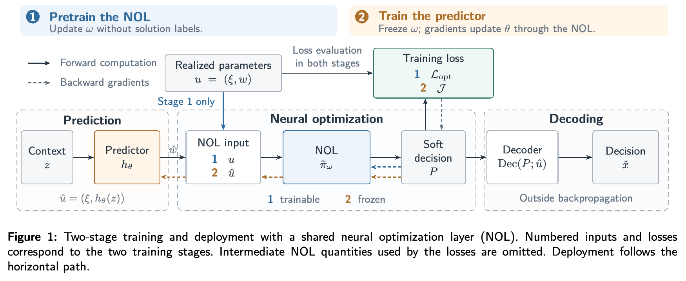

# 先学连续选边，再按真实成本训练预测器

预测误差相近的两组边成本，可能让求解器走出完全不同的路线。先比较同一求解器下按预测误差或决策损失训练的表现，再单看换解码器的代价。作者在合成选边实例评估，本地尚待检验。

[[研究前沿/面向决策的履约建模/README#预测更准能让决策更好吗|比较同一问题的其他方法]] · [[研究前沿/面向决策的履约建模/02-可复用方法卡/DFLNOL-frozen-layer|冻结软选边层]] · [[研究前沿/面向决策的履约建模/03-实验假设与结果/2026-11-10-冻结选边层的决策损失与解码代价|未运行：决策损失与解码代价的对照]]

**Solver-Free Decision-Focused Learning via Neural Optimization Layers for Edge Selection**  
Xinda Zheng、Frits de Nijs、Edward Lam。首次提交及当前版本 v1 均为 2026-11-06。arXiv v1 预印本。 [arXiv 版本记录](https://arxiv.org/abs/2611.09560v1)

[本地 PDF](./assets/source/paper.pdf) · [本地 HTML](./assets/source/paper.html) · [[研究前沿/面向决策的履约建模/01-论文原文与精读/DFLNOL/阅读覆盖|阅读范围与原文定位]] · [[研究前沿/面向决策的履约建模/01-论文原文与精读/DFLNOL/代码核验|代码核验]]

## 预测什么，按什么更新

在选边问题中，决策时观测上下文 $z$，已知实例参数为 $\xi$，未知边成本或节点收益 $w$ 在事后可见。回归器 $h_\theta(z)$ 预测 $\hat w$。决策目标是按真实参数执行后的巡回成本或可获得的收益。即使回归误差相近，错误发生在关键边还是无关边可能产生不同遗憾。作者用同一个可微神经优化层连接预测与执行。[问题设定](https://arxiv.org/html/2611.09560v1#S2)

**阶段一。** 在真实 $u=(\xi,w)$ 上学软选边矩阵 $P_\omega$，以连续目标加结构正则训练，超出平均容忍度的约束违例会抬高对应非负乘子。训练没有最优解标签，每个小批次对模型做下降、对乘子做投影上升。软可行性是经验训练目标，最终离散可行性靠解码。**阶段二。** 冻结优化层，从预测的 $\hat u=(\xi,\hat w)$ 得到 $P$，回到真实 $u$ 计算下游代价与违规，再穿过冻结层把梯度传给预测器。验证按解码后真实执行效果选 checkpoint。[式 (3)–(7)](https://arxiv.org/html/2611.09560v1#S4.SS2)

$$
P=\tilde\pi_\omega(\hat u),\qquad
\mathcal J(\hat u;u)=\tilde F(P;u)+\sum_k\mu_k v_k^{\rm pred}(\hat u;u)+\mathcal R_{\rm pred}(\hat u;u).
$$

上式是式 (6) 的简记。软目标与离散目标间的线性成本差最多为 $\|c(u)\|_\infty\|P-x\|_1$（式 8）；这仅给定矩阵与某一离散决策间的条件界，没有保证解码遗憾小。[式 (8)](https://arxiv.org/html/2611.09560v1#S5)

## 图结构与执行规则

以成本注意力编码节点，边打分读当前正反边软质量、两步连接 $P^2$ 和共同前驱 $P^\top P$。实验用四轮共享参数更新，每轮 50 次 Sinkhorn 归一化。ATSP 另用度、连通性、二值性等先验，离散化先解多项式的指派问题形成环覆盖，再按预测代价增量合并子环。文中所称 solver-free 指无须调用原来的 NP 难组合求解器。无固定终点的定向越野问题 EFOP 按软偏好乘预测收益成本比贪心解码；测试将计划顺序锁定，只计真实预算可支付的最长前缀，覆盖约束误差对执行的影响。[第 5 节](https://arxiv.org/html/2611.09560v1#S5) · [第 6.3 节](https://arxiv.org/html/2611.09560v1#S6.SS3)

## 基线与效果归因

合成 50/100/200 节点，十维上下文、4/6 次生成函数、独立乘性噪声；各方法用相同线性预测器和锁定划分。ATSP/EFOP 每设置使用 1,000/2,000 训练实例、64 验证、500 测试。坐标及生成系数在同一数据集中固定，训练种子为 0。[第 6.1 节](https://arxiv.org/html/2611.09560v1#S6.SS1)

| 100 节点 ATSP，生成多项式的次数为 4，表 1 | 平均遗憾（%） | 推理（毫秒/例） |
|---|---:|---:|
| MSE 回归＋Gurobi | 64.81 | 356.73 |
| PFYL | 11.78 | 365.07 |
| DFLNOL＋神经解码 | 13.58 | 12.04 |
| 同一 DFLNOL 预测器＋Gurobi | 9.60 | 470.70 |

同求解器对照可单独读出预测训练的价值；神经解码与同预测器＋Gurobi 比较体现执行时质量/延迟代价。神经部署并未在表 1 的每种设置胜过已有 DFL。EFOP 200 节点、生成多项式的次数为 4、仅成本未知时，神经部署相对 MSE 的平均遗憾由 52.53% 降至 14.83%，P95 从 68.81% 降至 21.82%；成本与收益同时未知的设置未比较只适用于约束不确定的 Odece。训练耗时含优化层预训练，推理计时为暖机后 batch=1，测试参考值和超参搜索另计。[表 1](https://arxiv.org/html/2611.09560v1#S6.T1) · [表 2](https://arxiv.org/html/2611.09560v1#S6.T2)

## 履约迁移与限制

可把预估时长、容量消耗或接单收益作为边参数，在有真实成本及明确定义的执行模拟器时优化分配结果。训练损失依赖全参数可见；典型业务日志只看到被选边的结果，未补足反事实标签前无法直接照搬。作者未提供真实订单结果、跨图分布泛化或分离每个边特征的消融。[局限](https://arxiv.org/html/2611.09560v1#S7)

## 原文关键图表

图 1 中实线是正向计算，虚线标出可传梯度部分。两阶段在真实参数下计损失，离散解码在反传路径外。

## 方法与实验

[[研究前沿/面向决策的履约建模/02-可复用方法卡/DFLNOL-frozen-layer|冻结神经优化层，以真实参数计决策损失]] · [[研究前沿/面向决策的履约建模/02-可复用方法卡/DFLNOL-edge-decoding|连续选边与可行离散执行的分开检验]]

[[研究前沿/面向决策的履约建模/03-实验假设与结果/2026-11-10-冻结选边层的决策损失与解码代价|冻结选边层的决策损失与解码代价（未运行）]]
