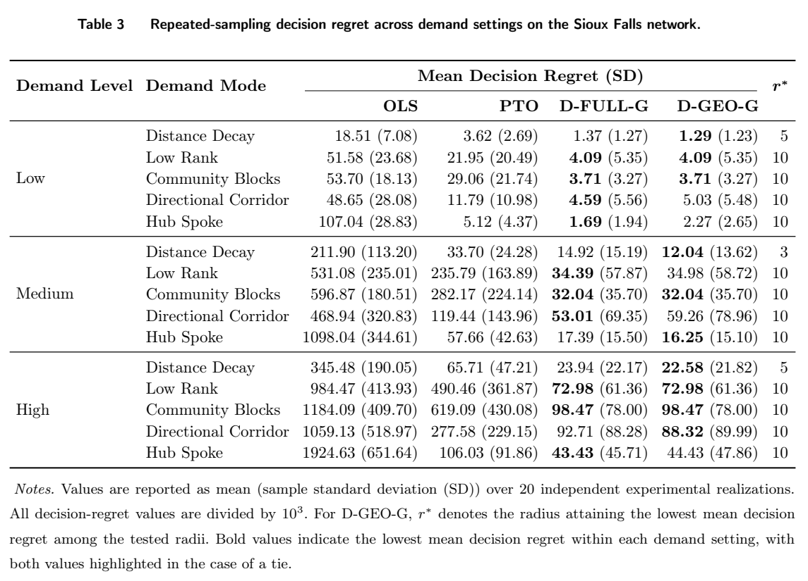

# 路段计数相同，哪份 OD 估计更适合做决策

<!-- 全库方法复筛开始 -->
> **方法储备 · 面向决策的履约建模**。保留“Decision Aware Origin-Destination Demand Estimation with Structurally Constrained Data”这一研究问题或机制；是否用于当前业务另行验证。
> 原有阅读范围与证据等级不变；储备不等于效果已验证。
> [[研究前沿/论文库复筛与阅读路线|全库阅读路线]] · [[研究前沿/面向决策的履约建模/存量论文分层索引|本方向完整分层]]
<!-- 全库方法复筛结束 -->

**Decision Aware Origin-Destination Demand Estimation with Structurally Constrained Data**  
arXiv 首次提交 2026-11-09（UTC），核验时版本历史仅有 v1；本次检索日为上海时间 2026-11-12。正式发表日期待核。 [官方版本历史](https://arxiv.org/abs/2611.11946v1)

[原版 PDF](./assets/source/paper.pdf) · [原文 HTML 快照](./assets/source/paper.html)

## 研究问题

路段流量与 OD 满足 $L=Xf$。路段少、OD 对多时，多组 OD 都能解释完全相同的观测。作者在这组解里寻找一个能让下游线性规划减少决策损失的需求估计。

## 方法、计算与决策时点

把可行流写成 $f=X^+L+Vz$，$V$ 张成不改变路段流量的零空间，同时限制流量上下界。用可行多面体解析中心及障碍函数 Hessian 给可调方向加椭球约束；在历史先验及残差生成的需求样本上，最小化参数化的凸遗憾上界。式 (7) 的次梯度可由两个线性决策求解得到。D-FULL-G 放开几何半径，D-GEO-G 使用该限制。

## 实验结果与证据边界

Sioux Falls 24 节点、76 路段、552 OD 对，需求按 5 种模式、3 个等级生成。附录表 3 每种条件重复 20 次：中等社区模式的平均遗憾 PTO 282.17、全空间法和几何法均 32.04。中等方向走廊为 119.44、53.01 和 59.26，几何约束在这个对照中更差。表中遗憾单位为原始值除以 $10^3$，几何半径取各档所试半径中平均遗憾最低者；独立验证选半径的收益仍待检验。真实路网结构配合生成需求，尚无运营数据收益。 [证据原文](https://arxiv.org/html/2611.11946v1#A9.T3)

*附录表 3 · Sioux Falls 15 类条件各重复 20 次，固定版 PDF 第 46 页。*

网络用固定链接—OD 矩阵、准确路段计数，且已给定线性下游目标。椭球半径会约束有用的 OD 修正，误差分布、路径映射漂移以及缺乏可核验 OD 真值都会改变应用条件。

## 迁移到履约问题

用于只有按路段或区域汇总计数的下游资源分配。矩阵、流量口径、估计边界与测试决策需一致；下游目标非线性时该上界不能直接沿用。 本地尚未运行验证。

## 方法卡与候选实验

- [[研究前沿/面向决策的履约建模/02-可复用方法卡/DecisionOD-nullspace-regret|在观测无法区分的解中按下游遗憾选估计]]
- [[研究前沿/面向决策的履约建模/03-实验假设与结果/2026-11-12-相同汇总计数下按下游遗憾估计需求|相同汇总计数下按下游遗憾估计需求（未运行）]]

## 来源与实现核验

已检查论文正文外链和题名、作者的公开检索；本论文的作者实现入口未知。

本次核验公开 v1 正文、列明的方法和实验及下列证据定位。作者报告的数值未做独立复算。 [守恒空间](https://arxiv.org/html/2611.11946v1#S3.SS1) · [代理损失](https://arxiv.org/html/2611.11946v1#S3.SS3) · [路网实验](https://arxiv.org/html/2611.11946v1#S4.SS3) · [重复试验](https://arxiv.org/html/2611.11946v1#A9.SS2)
