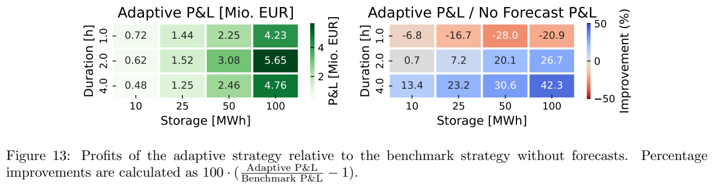

# 滚动分配时，何时值得为未来的机会保留容量？

<!-- 全库方法复筛开始 -->
> **方法储备 · 面向决策的履约建模**。保留“概率预测与储能决策机会窗口”这一研究问题或机制；是否用于当前业务另行验证。
> 原有阅读范围与证据等级不变；储备不等于效果已验证。
> 已恢复此前因业务距离被移出的原笔记；旧取舍原因仅作历史记录。
> [[研究前沿/论文库复筛与阅读路线|全库阅读路线]] · [[研究前沿/面向决策的履约建模/存量论文分层索引|本方向完整分层]]
<!-- 全库方法复筛结束 -->

同一个利用未来机会的策略，在持续服务时间长短不同时，收益方向相反。迁移时可以先验证机会窗口，再决定是否要让预测影响当前动作。

## 文献与版本

Improving Algorithmic Trading for BESS on Intraday Electricity Markets through Distributional Price Forecasts。Simon Hirsch、David Schaurecker、David Wozabal。arXiv v1 首投于 2026-11-12。 检索及精读于 2026-11-16。精读未来价格分布标签、动态规划、滚动参数选择、图 5、12–13 及两年高频仿真边界。 [一手来源](https://arxiv.org/abs/2611.17170v1)

本地资料　[paper-v1.pdf](./assets/source/paper-v1.pdf) · [paper-v1.html](./assets/source/paper-v1.html)

## 方法与关键计算

用当前时刻至交付之间的订单簿中间价格分布构造监督目标，学习未来机会的分位数。低/高分位给滚动优化器提供未来买/卖机会，临近交付逐渐减弱预测作用。自适应版本用此前 30 天选择区间宽度与止损参数，参数在当日应用；对照为同一滚动方法只用当前订单簿。

## 效果证据与对照

图 13 的 2023–2024 高频仿真中，容量 100 MWh 时，4 小时储能的自适应方案相对无预测基线为 +42.3%，2 小时为 +26.7%，1 小时为 −20.9%。10 MWh、1 小时的差也为负（−6.8%）。

收益是分位数输入、临期衰减、风险控制和滚动优化共同运行的结果。作者分别对照有无止损及不同预测模型；同一个总体收益不能归给单独的预测头。

图 13。不同储能容量和持续时长下相对无预测基线的收益。 [原文第 20 页](./assets/source/paper-v1.pdf#page=20)

## 能迁移到什么问题

迁移到资源占用时长不一的履约任务，可预测截止前的可用机会分布并验证短时资源是否受损。原研究使用历史订单簿仿真，结果依赖流动性和执行假设。

算法与参数可在 §5 和附表中核对，本次未核实可公开运行的作者代码及原始高频订单簿。

[[研究前沿/面向决策的履约建模/02-可复用方法卡/DecisionWindowQuantiles-按剩余窗口预测机会分位数并接入滚动优化|按剩余窗口预测机会分位数并接入滚动优化]] · [[研究前沿/面向决策的履约建模/03-实验假设与结果/DecisionWindowQuantiles-按资源可占用时长检验是否值得等待未来候选|按资源可占用时长检验是否值得等待未来候选（未运行）]]
