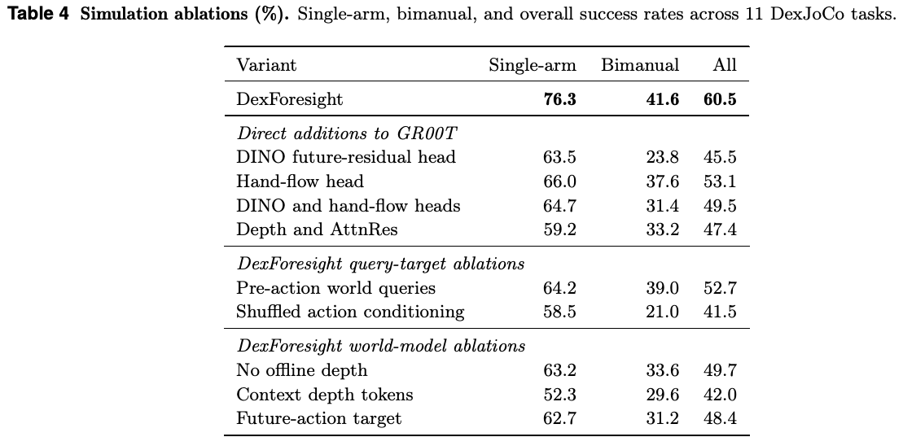

# 把已执行动作的预测表征蒸馏到轻量策略

<!-- 全库方法复筛开始 -->
> **方法储备 · 司乘行为序列建模**。保留“训练期特权动作教师与部署期学生”这一研究问题或机制；是否用于当前业务另行验证。
> 原有阅读范围与证据等级不变；储备不等于效果已验证。
> 已恢复此前因业务距离被移出的原笔记；旧取舍原因仅作历史记录。
> [[研究前沿/论文库复筛与阅读路线|全库阅读路线]] · [[研究前沿/司乘行为序列建模/存量论文分层索引|本方向完整分层]]
<!-- 全库方法复筛结束 -->

DexForesight: Grounding Dexterous Policies with Implicit Spatial Foresight  
Zhongxi Chen 等九位作者。arXiv v2。首次提交 2026-11-08，当前版本提交 2026-11-10；会议或期刊正式发表日未核实。 [作者或出版社记录](https://arxiv.org/abs/2611.11166v2)

相同仿真任务，完整策略成功率 60.5%，提前读取动作前表征为 52.7%，打乱教师的动作条件为 41.5%。三项真实机器人任务另有小样本对照。

## 作者要解决什么问题

操作策略需要预见抓握时手和物体怎样移动，但部署相机只有当前图像，逐帧解码多个未来的代价又很高。

## 方法怎样从输入得到决策或预测

以离线深度、手部运动学、RGB 和示范控制训练教师，预测手部三维位移与视觉残差 → 冻结教师，导出示范动作条件下的查询表征 → 策略从当前 RGB、语言与机器人状态读自己的查询，用动作损失、对应查询余弦损失和查询间相似度损失联合训练 → 推理仅保留策略读出和动作模块。

式 (5) 同时匹配教师/学生的查询向量及其两两关系：$L=L_{\rm action}+\lambda(L_{\rm token}+\beta L_{\rm relation})$。教师含示范控制和训练时额外模态，学生并不知道随后实际会采取的动作。可检验教师是否从真实动作而非未来场景共现学到了可用信号。

## 实验观察和证据范围

表 1，11 个仿真任务每项 100 次，原 GR00T N1.7 49.4%，完整模型 60.5%。表 4 完整模型 / 动作前查询 / 打乱动作 / 不用离线深度分别为 60.5%、52.7%、41.5%、49.7%；原策略直接加手位移预测头为 53.1%。表 2，另以 QwenVLA 为底座的三项实机任务每项每方法 20 次，完整模型平均 58.3%，最佳基线 WLA 50.0%。

表 4，教师动作与未来预测目标的仿真对照。[原文 PDF](./assets/source/paper.pdf#page=10)

真机共 60 次/方法，样本小且与仿真底座不同。打乱动作检验教师配对信息的作用；无法据此识别非实验业务动作对履约何种结果的因果效应。低维事件序列中是否有等价的训练期富观测需另验。

## 可采用的部分

最小检验是冻结教师并在同一学生上比较真配对与打乱配对的查询目标。若复现原文，需要手部位移/视觉残差标签、原策略动作目标、配对查询与可部署学生。

在带实际执行记录的任务中，可用训练阶段额外信号帮助学习当前表示，并严格隔离测试时可见信息。缺少有意义的配对和未来观测时，直接增加蒸馏损失没有依据。

[[研究前沿/面向决策的履约建模/02-可复用方法卡/DexForesight-action-query|方法卡：以动作条件教师的查询及关系蒸馏可部署策略]]

## 阅读与核验范围

v2 PDF 共 12 页，核对 §3 两阶段和损失、§4 表 1–4。11 月 8 日首发，11 月 10 日修订，本次按首次归档 v2，未把版次变化当作新增成效。 核查作者[项目页](https://dexforesight.github.io/)和 arXiv 正文，未查到能定位训练或推理文件的公开作者仓库。 本地未运行原作者实验。 [本地 PDF](./assets/source/paper.pdf) · [本地 HTML 原文](./assets/source/paper.html)
