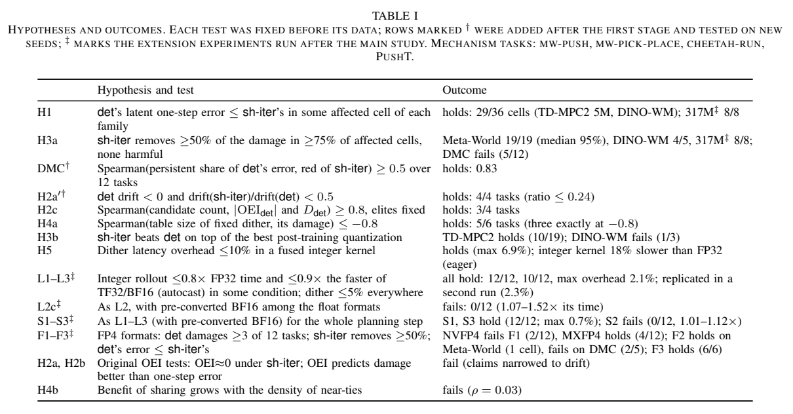

# 反复搜索是否会主动选中模型固定偏差

<!-- 全库方法复筛开始 -->
> **方法储备 · 司乘行为序列建模**。保留“低比特扰动与规划器利用模型漏洞的诊断”这一研究问题或机制；是否用于当前业务另行验证。
> 原有阅读范围与证据等级不变；储备不等于效果已验证。
> 已恢复此前因业务距离被移出的原笔记；旧取舍原因仅作历史记录。
> [[研究前沿/论文库复筛与阅读路线|全库阅读路线]] · [[研究前沿/司乘行为序列建模/存量论文分层索引|本方向完整分层]]
<!-- 全库方法复筛结束 -->

**Planners Exploit Deterministic Error: Dithered Low-Bit World Models**  
arXiv 首次提交 2026-11-09（UTC），核验时版本历史仅有 v1；本次检索日为上海时间 2026-11-12。正式发表日期待核。 [官方版本历史](https://arxiv.org/abs/2611.11780v1)

[原版 PDF](./assets/source/paper.pdf) · [原文 HTML 快照](./assets/source/paper.html)

## 研究问题

量化世界模型会让不同候选行动的长期收益形成立即可重复的误差。只要规划器能反复搜索，这种误差可能吸引下一轮候选，即使一步潜状态预测的均方偏差仍很小。

## 方法、计算与决策时点

作者固定模型权重、规划器、bit 数与配对任务种子。普通最近舍入产生固定误差；随机舍入在每次前向调用重抽一张扰动表，同一批候选在同一层共享这张表；另设独立抽样、固定整步、固定整回合等对照。每一步比较模型相对浮点返回值的误差如何随搜索迭代偏向有利方向，并用实际任务成败评估。

## 实验结果与证据边界

5M TD-MPC2 的 Meta-World 中，19 个已证实受损任务×位宽格全部挽回至少一半损失，中位 95%；DMC 只有 5/12，walker 的 3-bit 甚至更差。低位实现相对 FP32 有加速，预转权重的 BF16 仍更快。对履约可迁移的是反复优化对固定误差的压力测试，表 1 并未在履约预测器上验证扰动。 [证据原文](https://arxiv.org/html/2611.11780v1#S3.T1)

*表 I · 预设与追加检验及失败项，固定版 PDF 第 4 页。*

在三项 TD-MPC2 机制任务里，把扰动固定整步/整回合带回 70%–130% 的确定性漂移；PushT 的全尺寸固定表未复现这个现象。追加假设与最初预注册项在表 I 区分，机制不能外推到所有模型误差。

## 迁移到履约问题

可用于检验同一求解器扩大搜索预算后是否专挑响应模型高估的候选。参考评估器必须尽量独立于用于排序的模型。 该修正对应粗网格量化和迭代搜索；对一般预测偏差仅迁移诊断，不能推断加噪即可改善。 本地尚未运行验证。

## 方法卡与候选实验

- [[研究前沿/面向决策的履约建模/02-可复用方法卡/DitherPlanning-planner-drift|随规划迭代测量候选偏差的漂移]]
- [[研究前沿/面向决策的履约建模/02-可复用方法卡/DitherPlanning-shared-rounding|候选共用、每次前向刷新随机舍入扰动]]
- [[研究前沿/面向决策的履约建模/03-实验假设与结果/2026-11-12-搜索越深是否越会选中响应模型的固定高估|搜索越深是否越会选中响应模型的固定高估（未运行）]]

## 来源与实现核验

表 I 记载分析在对应检验前固定。原文及按题名、作者检索未找到可验证的本论文代码入口。

本次核验公开 v1 正文、列明的方法和实验及下列证据定位。作者报告的数值未做独立复算。 [量化对照](https://arxiv.org/html/2611.11780v1#S3) · [受损格](https://arxiv.org/html/2611.11780v1#S4) · [搜索漂移](https://arxiv.org/html/2611.11780v1#S5) · [计时](https://arxiv.org/html/2611.11780v1#S6) · [失败边界](https://arxiv.org/html/2611.11780v1#S7)
