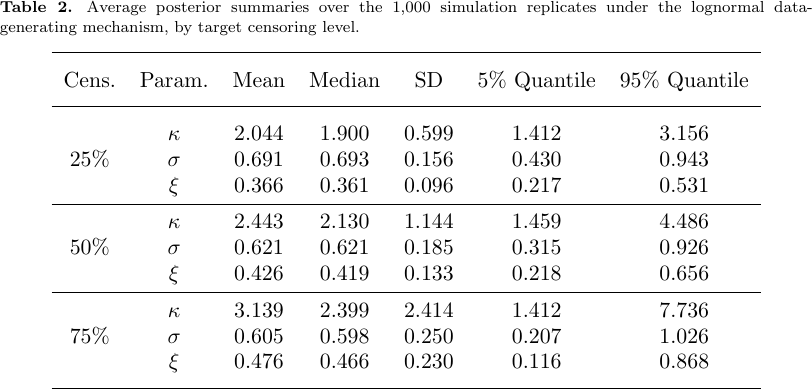

# EGP-Hazard · 将右删失下的暴露时长用于估计长尾等待风险

Intensity-Based Estimation of Extreme Value Models for Highly Censored Data via a Latent Poisson Process

Janotti, Eduardo, de Lima, Antonio Carlos Pedroso, Henriques-Rodrigues, Lígia。arXiv v1 首投 2026-11-05。本轮新发现，检索于 2026-11-09，会议发表日期未核验。[版本页](https://arxiv.org/abs/2611.08068) · [本地 PDF](./assets/source/paper.pdf) · [本地 HTML](./assets/source/paper.html)

## 观测时间只能到记录截止时
§2–3 将实际随访拆成多个区间。$D_j$ 为该段事件数，$E_j$ 汇总仍在风险集中的暴露时长。分段指数近似给出风险率 $\widehat h_j=D_j/E_j$ 和近似标准误 $\widehat\tau_j=\widehat h_j/\sqrt{D_j}$。第一步把删失前贡献的时间也算进分母。
## 从分段估计恢复连续风险
§3–5 用扩展广义帕累托（EGP）的连续风险曲线拟合第一步估计。在每段内令 $L_j\sim U(\ell_j,u_j)$，以 $h(L_j)$ 为截断正态的位置参数，将第一步不确定性传入后验。宽区间中点的瞬时风险可能偏离整段平均风险。作者用指数近似初始化区间，实际实现没有循环重估分箱。协变量可以分别影响尺度和尾形。
## 分箱和外推有什么代价
§6 图 4–5 比较分箱数及多种删失情景，5 或 10 箱的区间覆盖通常接近标称 90%。在对数正态数据上错设 EGP 时，表 2 揭示了重删失时的参数漂移。§7 应用含 2,982 人，删失 56.87%；图 7 在观察区间内与 Kaplan–Meier 对照，无法借此核验随访以外的远端概率。

## 原始证据

§6.2 表 2 在错设模型的 1,000 次模拟中，25% 和 75% 删失时，尾形参数的平均后验汇总均值分别为 0.366、0.476。表 3 的性别尾形差系数 90% 可信区间为 [−0.46, 0.70]。证据支持报告不确定性，单独采用潜在位置的增益未隔离。

原表 2　模型错设时随删失比例变化的参数汇总。

## 阅读范围和迁移边界

适合研究记录截止前尚未结束的单一事件。取消和完单若互相排斥，需显式处理竞争风险；观察分组的生存差异也需与动作的因果效应区分。

阅读深度为核心方法、主实验与证据边界精读；数值来自作者，未逐行复证全部附录推导。查阅版本页、正文所列链接并按标题检索，未核验到作者实现入口。

[[研究前沿/面向决策的履约建模/02-可复用方法卡/EGP-Hazard-删失暴露量与尾部风险的两阶段拟合|删失暴露量与尾部风险的两阶段拟合]] · [[研究前沿/面向决策的履约建模/03-实验假设与结果/EGP-Hazard-用人为截短的日志检验长尾等待校准|用人为截短的日志检验长尾等待校准]]

[[研究前沿/面向决策的履约建模/01-论文原文与精读/EGP-Hazard/原文导航|原文章节及图表公式导航]]
