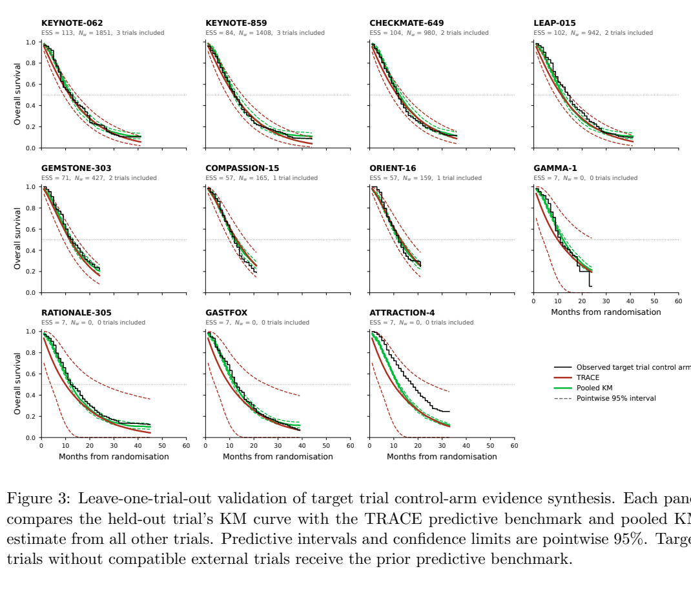

# 用历史试验预测新对照组，何时应放弃借数

<!-- 全库方法复筛开始 -->
> **方法储备 · 模型自进化**。保留“历史试验借用前的相容性检查”这一研究问题或机制；是否用于当前业务另行验证。
> 原有阅读范围与证据等级不变；储备不等于效果已验证。
> 已恢复此前因业务距离被移出的原笔记；旧取舍原因仅作历史记录。
> [[研究前沿/论文库复筛与阅读路线|全库阅读路线]] · [[研究前沿/模型自进化/存量论文分层索引|本方向完整分层]]
<!-- 全库方法复筛结束 -->

TRACE: Target-Trial Relevance Assessment and Compatibility-Guided Evidence Synthesis  
Wei Wei; Liangze Ke; Tianzhi Tang; Pavan Challa; Tulika Rudra Gupta; Guannan Gong; Satrajit Roychoudhury; Raghav Sundar。2026-11-12 首次提交 arXiv，本次核对 v1。[arXiv v1](https://arxiv.org/abs/2611.16870v1)

旧批次的生存曲线可以怎样给新批次提供预测基准，又何时证据过弱？

## 怎样从输入得到输出

先按资格与设计筛试验。取两试验共同报告特征的绝对标准化差异最大值，结合可比较特征数和相容先验计算 ICS，过预设门槛才纳入。重建历史对照组生存数据，用分层 beta–Stacy 过程预测新试验曲线及中位数；没有相容试验时回退到弱先验。

$D_{jT}=\max_{k\in K_{jT}}|\mathrm{SMD}_{jk,Tk}|$。本文用 $\mathrm{ICS}_{jT}\ge0.50$ 选历史试验，计算依据是基线汇总和预设先验，不能利用留出目标组的结局。分层模型再对试验之间的异质性建模。

## 哪个对照支持这个判断

11 项肿瘤试验逐项留出，7 项找到相容历史试验；TRACE 的 95% 中位数预测区间覆盖 7/7，池化 KM 的 95% 置信区间覆盖 5/7，平均宽度分别为 6.1 和 1.8 月。曲线的平均逐月覆盖比例为 92% 对 59%。另 4 项均回退到弱先验。

图 3，对每个目标试验留出的对照组预测区间。[本地原文](./assets/source/paper.pdf#page=23)

## 使用条件与可检验的迁移

预测区间包含新试验差异，池化均值置信区间回答的问题不同，不能把覆盖差完全归于筛选。只使用共同报告的协变量，不能排除遗漏的效应修饰和不可比较的终点。此 TRACE 与 SurvivalTRACE（2611.11923）的入组和删失分解是两项不同研究。

对新批次的自然完单或取消曲线，可将历史相容性筛选和区间宽度同时留出检验，并检验没有相容批次时拒绝强借数的价值。

[[研究前沿/面向决策的履约建模/02-可复用方法卡/ExternalControlTRACE-method|方法卡 · 用历史试验预测新对照组，何时应放弃借数]] · [[研究前沿/面向决策的履约建模/03-实验假设与结果/ExternalControlTRACE-筛选历史对照能否提升新批次曲线的预测|待验证 · 筛选历史对照能否提升新批次曲线的预测]]

## 阅读范围与复现入口

24 页，核对 §3 的相容分数与分层模型、§4 留一试验和图 2–4；未复原原始病人数据。正文说明数据提取和重建流程，本次未核实作者完整分析仓库。 本地验证状态为未运行。
