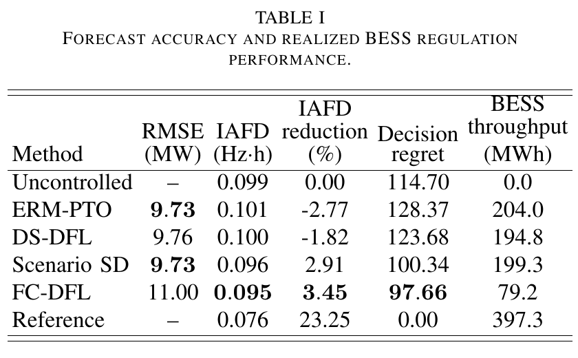

# Frequency-Calibrated Decision-Focused Learning for BESS Dispatch Under Renewable Uncertainty

[官方论文](https://arxiv.org/abs/2610.41238) · [本地PDF](./assets/source/paper.pdf) · [HTML快照](./assets/source/paper.html)

版本记录：[Submitted on 30 Oct 2026]；本次核验与精读：2026-11-06。本篇为滚动窗口内首次入库；检索日不等于首次发表日。

阅读范围：§2.3/§3/§4 目标、整数优化和平滑梯度，§5.1/§5.2/§5.6 实验、主结果与敏感性；解释机制仅核验定义，不单独拆独立增益卡。未逐行复证全部数学证明，未声称逐页翻译。[[研究前沿/面向决策的履约建模/01-论文原文与精读/FC-DFL/阅读覆盖|原文章节与公式索引]]；HTML为原始快照，外部样式和图片可能需要联网，PDF可离线阅读。

代码：本次核验的论文原文与元数据未提供可确认的作者实现入口；代码状态未知，不能据此断言不存在。未运行代码。 [[研究前沿/面向决策的履约建模/01-论文原文与精读/FC-DFL/代码核验|核验记录]]

## 问题与整体流程

可再生能源预测被送入含整数变量的储能调度器：充放电互斥、SOC 跨期约束使常规反向传播困难。论文先用 MSE 预训练预测器，再以实际运行成本对预测器做决策导向微调。预测更准确不必然使调度更好。

设 $z^*(\rho)$ 是预测 $\rho$ 下的固定约束混合整数调度解，真实可再生能源为 $r_i$，实际评价成本为 $F_i(\rho)=\Psi(z^*(\rho);r_i)$。参考值 $F_i(r_i)$ 是同约束、知道真实供给的后见最优；其差定义 regret。预测通过供需平衡进入问题，短缺/盈余松弛变量刻画不平衡。频差采用准稳态关系 $\Delta f=-\mathrm{imbalance}/B_{sys}$，不是完整瞬态电网仿真；电池 throughput 惩罚也不是电化学老化模型。

## 可复用模块：绕过整数求解器的零阶梯度

先把扰动投影到容许预测域 $\mathcal R$，记 $\bar F(y)=F(\Pi_{\mathcal R}y)$，再进行高斯平滑：

$$\widetilde F_\sigma(\rho)=\mathbb E_U[\bar F(\rho+\sigma U)],\qquad U\sim\mathcal N(0,I).$$

训练使用中心基线的一侧估计：

$$\widehat g=\frac1{K\sigma}\sum_{k=1}^K[\bar F(\rho+\sigma u_k)-\bar F(\rho)]u_k.$$

每次需要 $K+1$ 次优化求解；通过 $\langle\operatorname{stopgrad}(\widehat g),f_\theta(x)\rangle$ 传回预测网络。无偏性针对平滑后的目标，不是原始离散目标。需要固定可测的 solver tie-break；平滑尺度带来偏差与方差权衡。

解释分析采用对称差分 $[\bar F(\rho+\sigma u)-\bar F(\rho-\sigma u)]u/(2K\sigma)$。决策梯度绝对值与预测器 Jacobian 的幅度组合是敏感性启发式，不应视为因果特征归因。

## 实验与证据定位

**离线系统实验，§5/Table 1**：德国 OPSD 小时数据，48 小时历史预测未来 48 小时；560 训练、140 验证、100 按时间分开的测试窗口，5 个种子。测试覆盖 2020 年 3–9 月的 4,800 小时；调度平衡需求重复前一天轨迹，只有可再生供给建模为不确定。

|方法|RMSE|IAFD|regret|throughput|
|---|---:|---:|---:|---:|
|ERM|9.73|0.101（未四舍五入为 0.10143）|128.37|204.0|
|可微替代 DS|9.76|0.100|123.68|194.8|
|场景优化 Scenario-SD|同 ERM 预测|0.096|100.34|199.3|
|FC-DFL|11.00|0.09529|97.66|79.2|

相对 ERM，FC-DFL 的 IAFD 降 6.05%、regret 降 23.92%、throughput 降 61.17%，预测 RMSE 反而更高。相对更强的 Scenario-SD，IAFD 改善只有 0.56%，不能只报弱基线收益。配对窗口 Wilcoxon 检验对 ERM/DS 的 $p$ 值为 0.0066/0.0310。

**敏感性，Table 3**：$K=2,4,8$ 的训练时间约 135.82、195.79、332.76 秒；更多采样没有单调改善 IAFD。$\sigma=0.5,1,2$ 的结果接近，不能据此推广到其他尺度和求解器。

## 归因、边界与迁移

证据支持完整“预训练→平滑决策损失微调→精确调度”方案。高斯平滑及零阶估计本身是已有技术，本文价值包括把它们接入该调度与评价流程。没有线上生产结果，也不能把整体收益归给尚未独立消融的解释模块。

迁移推断：若匹配/派单下游是离散优化器，可固定优化器，扰动预测量并以可信的实际代价重算决策，学习对决策更有用的预测。前提是离线代价可评价且覆盖相关动作；“扰动预测输入”并不等于在真实世界随机实施动作，不能自行提供因果识别。

## 原文关键图表

原文 Table I，PDF 第 7 页；原始裁图，机制和证据解释见上文。裁图坐标与源文件校验值见 assets/source/figure-provenance.json。

## 方法卡

- [[研究前沿/面向决策的履约建模/02-可复用方法卡/FC-DFL-solver-feedback|用投影高斯平滑把离散求解器成本传回预测器]]

## 待验证想法

[[研究前沿/面向决策的履约建模/03-实验假设与结果/2026-11-06-离散优化器零阶反馈|离散优化器零阶反馈（未运行）]]
