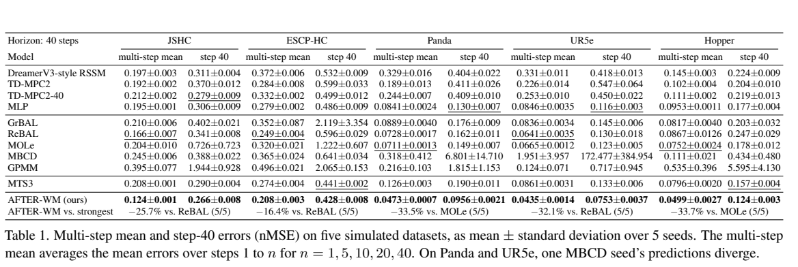

# 状态突变时快速纠错，暂时无观测时保留持续变化

<!-- 全库方法复筛开始 -->
> **方法储备 · 模型自进化**。保留“快慢模型按近期误差自适应组合”这一研究问题或机制；是否用于当前业务另行验证。
> 原有阅读范围与证据等级不变；储备不等于效果已验证。
> 已恢复此前因业务距离被移出的原笔记；旧取舍原因仅作历史记录。
> [[研究前沿/论文库复筛与阅读路线|全库阅读路线]] · [[研究前沿/模型自进化/存量论文分层索引|本方向完整分层]]
<!-- 全库方法复筛结束 -->

AFTER: A World Model with Adaptive Fast–Slow Timescales for Error-Driven Retention  
Haoyi Zhang; Qi Zhang; Yunfan Ren; Yi Bin; Lei Zhu; Heng Tao Shen。2026-11-11 首次提交 arXiv，本次核对 v1。[arXiv v1](https://arxiv.org/abs/2611.15215v1)

怎样区分一次冲击和持续动力学变化，并在预测多步时记住后者？

## 怎样从输入得到输出

第一阶段训练共享动力学专家及路由器，第二阶段冻结这些基础网络并训练适应模块。新观测到来时比较一步预测与真实状态，更新快、慢校正及专家权重记忆；无新观测的开环段让快校正衰减，保持慢校正和路由记忆。

式 (4) 的专家权重由当前状态动作的路由分数及历史路由记忆 $q$ 共同进入 softmax。只有真实观测产生的创新能更新持久记忆；将快、慢全部冻结或消融时要保持其余设置和预测跨度相同。

## 哪个对照支持这个判断

表 1 在五个模拟任务、每组五种子上，平均多步 nMSE 比各自最强对照低 16.4%–33.7%；UR5e 为 0.0435 对 ReBAL 的 0.0641。图 7 的等参数重训练消融去掉误差输入后 UR5e 误差增加 38.8%。文中另检验真实飞行记录，控制收益仅有模拟实验支持。

表 1，五个仿真动力学任务的 40 步滚动误差。[本地原文](./assets/source/paper.pdf#page=5)

## 使用条件与可检验的迁移

任务假设动作和近期真实状态可及时观测，动力学变化主要在可复用专家覆盖内。开环预测误差、控制回报和新动作因果识别的证据须分别看。

订单状态短暂积压和持续供给转折可有相似首步残差；只有真实回传触发慢校正可能改善长期滚动，且不把短暂峰值保留下去。

[[研究前沿/面向决策的履约建模/02-可复用方法卡/FastSlowRetention-method|方法卡 · 状态突变时快速纠错，暂时无观测时保留持续变化]] · [[研究前沿/面向决策的履约建模/03-实验假设与结果/FastSlowRetention-快慢校正能否区分短暂拥堵与持续状态变化|待验证 · 快慢校正能否区分短暂拥堵与持续状态变化]]

## 阅读范围与复现入口

62 页，核对 §3–5、表 1、图 5–7 和补充表 S1–S2；逐轨迹补充图及全部推导未逐项重复。本版本称将公开代码和数据，正文未核实该方法的正式源码地址。 本地验证状态为未运行。
