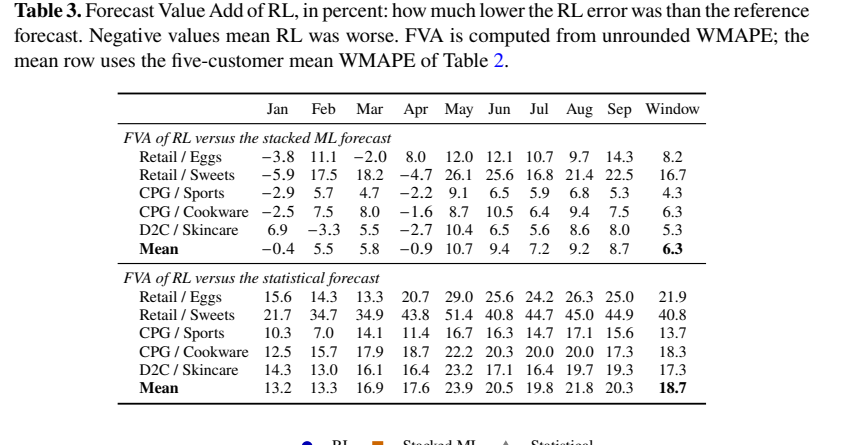

# 只准从已有预测值中选择，何时值得调整基准

<!-- 全库方法复筛开始 -->
> **方法储备 · 业务决策与理论储备**。保留“按决策价值而非预测误差选择预测器”这一研究问题或机制；是否用于当前业务另行验证。
> 原有阅读范围与证据等级不变；储备不等于效果已验证。
> 已恢复此前因业务距离被移出的原笔记；旧取舍原因仅作历史记录。
> [[研究前沿/论文库复筛与阅读路线|全库阅读路线]] · [[研究前沿/业务决策与理论储备/存量论文分层索引|本方向完整分层]]
<!-- 全库方法复筛结束 -->

Forecast Value Add: Reward-Based Action Selection over Probabilistic Demand Forecasts  
Ankur Verma。2026-11-09 首次提交 arXiv，本次核对 v1。[arXiv v1](https://arxiv.org/abs/2611.12116v1)

能否从基准、区间端点和分位数中选一个已知候选，少改预测模型也能改善尖峰误差？

## 怎样从输入得到输出

先在验证集选三项预测配置做凸组合，产出基准预测、上下界、分位数及偏差修正。每个时段只从候选中选择，按相似历史时期计算重放报酬，考虑事件、趋势、价格与促销，再用季节结构规则校核并记录人工覆盖。论文明确将学习步骤描述为直接法的离线上下文 bandit。

历史相似权重 $w_k\propto\rho^{k-1}\exp(-\tau\|c-c_k\|^2)$；在权重下比较过去同一动作候选与既成实况的误差，并辅以合计偏差和调整后实况评分。候选是不同预测值，不会改变已观测的真实销量。

## 哪个对照支持这个判断

五个客户、九个月的表 2–3，整套调整后平均 WMAPE 为 0.390，堆叠基准为 0.416，相对下降 6.3%；45 个客户月中有 35 个误差最低。客户均值的 1 月和 4 月相对变化为 −0.4%、−0.9%。

表 3，各客户各月相对堆叠预测的误差变化。[本地原文](./assets/source/paper.pdf#page=11)

## 使用条件与可检验的迁移

验证指标是预测值与实现量的差，论文没有库存或履约决策的因果收益。重放、季节约束和人工流程共同构成方案，表 3 没有分别归因。只有在候选预测不改变后续需求标签时历史重放才可直接比较。

固定既有等待时长预测，可让一个轻量选择器只从基准及候选分位数中选，并以真实高峰日前的类似窗口做验证，避免把相似日重复使用带来的乐观估计当收益。

[[研究前沿/面向决策的履约建模/02-可复用方法卡/ForecastActionLadder-method|方法卡 · 只准从已有预测值中选择，何时值得调整基准]] · [[研究前沿/面向决策的履约建模/03-实验假设与结果/ForecastActionLadder-相似历史选分位数能否改善高峰时长误差|待验证 · 相似历史选分位数能否改善高峰时长误差]]

## 阅读范围与复现入口

12 页，核对 §3–8、式 (9)–(14)、表 1–3 及实际评价端点；未审计企业明细。正文给出候选与结构规则，未核实作者公共运行仓库或可公开的企业明细。 本地验证状态为未运行。
