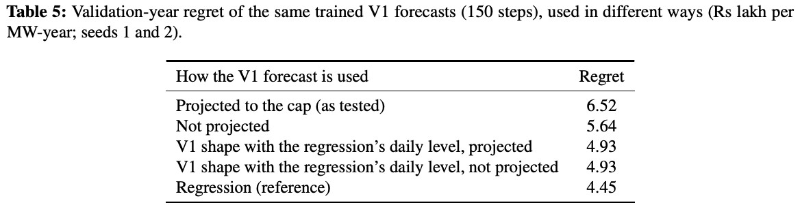

# 预测截断到合法范围为何会增加调度遗憾

<!-- 全库方法复筛开始 -->
> **方法储备 · 面向决策的履约建模**。保留“Forecast Projection and Decision Regret: Theory and Evidence from Battery Arbitrage”这一研究问题或机制；是否用于当前业务另行验证。
> 原有阅读范围与证据等级不变；储备不等于效果已验证。
> [[研究前沿/论文库复筛与阅读路线|全库阅读路线]] · [[研究前沿/面向决策的履约建模/存量论文分层索引|本方向完整分层]]
<!-- 全库方法复筛结束 -->

Forecast Projection and Decision Regret: Theory and Evidence from Battery Arbitrage  
Debangana Mukherjee、Akash Ashirbad Panda。arXiv v1。首次提交 2026-11-10；会议或期刊正式发表日未核实。 [作者或出版社记录](https://arxiv.org/abs/2611.14030v1)

同一份电价预测，截断后的验证遗憾为 6.52，原值为 5.64。1,158 天留出期内，三种统计预测的等权平均优于五种决策导向模型。

## 作者要解决什么问题

电池每天开始和结束时的储能相同。若无损耗，电价整体上移不会改变买卖排序；有损耗时，最优日程对电价平均水平仍可能不敏感。训练忽视整体偏移，部署时再截断合法电价，会压平原先的有利价差。

## 方法怎样从输入得到决策或预测

用历史电价按日预测下一日 96 个价块 → 训练 SPO+ 或扰动 Fenchel–Young 预测器及统计基线 → 同一预测经过截断、水平锚定或原样保留 → 用相同电池约束求日程 → 按真实电价回放并与同约束、知道真实价的日程比较。

记可行日程为 $z$、真实利润为 $V(p,z)$。遗憾 $R(p,u)=\max_z V(p,z)-V(p,z^*(u))$。检查 $R(p,\Pi u)-R(p,u)$ 会隔离部署截断的影响。定理 4 用原解的对偶阈值给出截断后仍最优的充分条件；多个并列解时保留原解也会影响实现。

## 实验观察和证据范围

表 5 保持预测器 V1、两个种子和验证日不变，截断 / 原始 / 用回归日均值锚定后截断分别为 6.52 / 5.64 / 4.93（每 MW 年，十万卢比）。表 6 中超过一半价块越过上限的一组仅 4 个“日×种子”，该组不可当代表性天数。表 8 印度 1,158 天留出期，三种统计预测均值 EW3 为 2.43，最佳决策导向 V4 为 2.90，两者差 0.47，95% 区间 [0.34, 0.59]。

表 5，同一验证预测经过四种后处理的遗憾。[原文 PDF](./assets/source/paper.pdf#page=19)

表 10 随后的 53 天有 62% 的真实价块触顶，回归 2.67、EW3 2.90、V4 3.32，V4 相对 EW3 的区间跨零。市场数据回放依赖价格接受者、固定电池模型与日内守恒。理论仅在给出的可行集合及对偶条件下保证；没有对实际运营者作随机干预。

## 可采用的部分

配对回放可以独立采用。电池理论证书依赖特定能量平衡、功率界及相应对偶阈值。换求解器时仍可比较裁剪与原始解，但须重推证书。

用于容量上限或等待惩罚被截断的滚动资源分配，在保持求解器、标签和测试日一致时定位异常。先核验是否存在水平近似不敏感的守恒结构。

[[研究前沿/面向决策的履约建模/02-可复用方法卡/ForecastProjection-clipping-regret|方法卡：用同一预测分离裁剪与水平偏移的决策代价]] · [[研究前沿/面向决策的履约建模/03-实验假设与结果/2026-11-13-履约成本截断对决策遗憾的影响|未运行假设：预测裁剪是否抹掉可分配时段之间有价值的差异]]

## 阅读与核验范围

38 页原文，核读 §2–6、定理 4、表 5/6/8/10 与附录操作规则；未逐式复推所有证明。 论文 Declarations 称复现包含代码、数据、协议与校验和，可向作者获取，计划公开。未核到可下载的作者代码包。 本地未运行原作者实验。 [本地 PDF](./assets/source/paper.pdf) · [本地 HTML 原文](./assets/source/paper.html)
