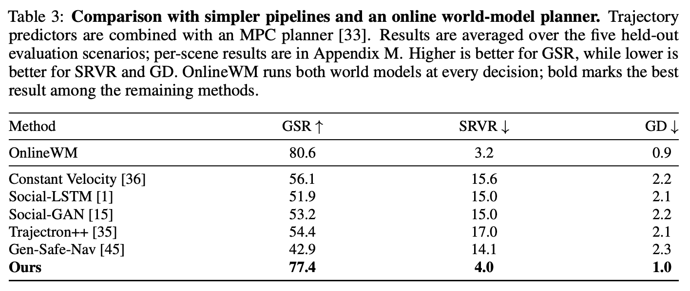

# 把动作后果蒸馏进单次前向的导航策略

**Seeing Beyond the Next Step: World-Model-Guided Human-Like Navigation in Multi-Agent Scenes**  
Seong-Eun Hong、JuYeong Hwang、Jinhyun Kim、Hanyoung Jang、HyeongYeop Kang。首次提交及当前版本 v1 均为 2026-11-05。作者在 arXiv 版本记录注明已获 NeurIPS 2026 接收。 [arXiv 版本记录](https://arxiv.org/abs/2611.07730v1)

[本地 PDF](./assets/source/paper.pdf) · [本地 HTML](./assets/source/paper.html) · [[研究前沿/面向决策的履约建模/01-论文原文与精读/ForesightNav/阅读覆盖|阅读范围与原文定位]] · [[研究前沿/面向决策的履约建模/01-论文原文与精读/ForesightNav/代码核验|代码核验]]

## 从动作示范开始，部署时输出什么

人群中同样能走通的两个动作可能在下一刻导致对向拥挤或离开人行区域。作者把 ETH/UCY 行人轨迹的 20 帧片段（25 FPS，步长 10）变成以自身为原点的 40 维向量，以 K-means 建 100 个可执行轨迹原型。监督阶段以实际片段的最近原型为标签，从当前画面、目标、速度、邻居和动态物体等观测预测动作。训练有在示范中可行的起点，词表外的动作只能近似执行。[图 1、式 (1)–(2)](https://arxiv.org/html/2611.07730v1#S3.SS1)

## 分开预测社会交互与场景约束

状态模型给定轨迹原型和历史，对附近个体预测下一相对位置变化与速度，用位置、速度平方误差和方向余弦损失；语义模型给定同一个候选和历史生成未来分割图，使用去噪与感知损失，评估轨迹足迹下的人行道、道路和障碍物占比。两者各做一次条件预测。附录 E 的留出诊断分别给出 0.1846 米位置 ADE、20.77° 朝向误差，以及 EDM 分割的 87.0020% mIoU。观测轨迹上的预测精度不能验证未执行动作的所有后果。[式 (3)–(5)](https://arxiv.org/html/2611.07730v1#S3.SS2) · [表 5–6](https://arxiv.org/html/2611.07730v1#A5)

## 组内比较如何进入策略

对每个观测取当前策略概率最高的 5 个原型，再从余下均匀抽 5 个。冻结两个预测器，逐候选计算原文式 (6)。

$$
r_t^{(i)}=G_t^{(i)}-C_t^{(i)}-P_{\mathrm{cur},t}^{(i)}-P_{\mathrm{fut},t}^{(i)}+M_t^{(i)}. \qquad\text{(6)}
$$

五项分别是目标进展、动作突变、即时交互风险、预测交互风险与语义可行性。各项先统一尺度再用单位权重，GRPO 以候选相对于同组平均分的优劣更新策略。部署时只用策略单次前向选原型，免除候选搜寻、分割、风险计算等在线成本。[第 3.3 节](https://arxiv.org/html/2611.07730v1#S3.SS3) · [附录 B 评分明细](https://arxiv.org/html/2611.07730v1#A2)

## 什么收益有对照

五个场景中，两个是训练场景内的留出轨迹，两个是以已有资源构造的新布局，一个改变群组规模。平均无碰撞到达率 GSR 越高越好，违规区域时间占比 SRVR 越低越好。完整蒸馏为 GSR 77.4%、SRVR 4.0%；去双预测器后是 37.3%、19.5%。在十字路口，只去状态模型 GSR 83.3% 降到 51.9%，只去语义模型到 66.7%；在狭廊去语义模型令 SRVR 从 0.9% 增到 13.7%。同组全选 top-10 或全随机也有消融，只能说明该系统的混合候选对照有效。Zara01_Group 的 GSR 分别是 14.8%、18.5%、混合 77.8%。[表 1–2](https://arxiv.org/html/2611.07730v1#S4.T2)

同一双模型用于在线规划时 GSR 80.6%、SRVR 3.2%；蒸馏在两项上都有代价。在单张 RTX 6000 Ada 上，作者报告在线规划一次约 1.2 秒，部署策略 65 毫秒。常速外推加 MPC 的 GSR 56.1%、SRVR 15.6%。感知质量问卷仅 20 人；实际机器人及更长时段的行为未验证。100 个固定轨迹原型、短程单步预测、手设风险权重限制可迁移范围。[表 3](https://arxiv.org/html/2611.07730v1#S4.T3) · [附录 J 表 8](https://arxiv.org/html/2611.07730v1#A10.T8) · [第 5 节](https://arxiv.org/html/2611.07730v1#S5)

## 履约迁移

动作原型可由明确可执行的操作替代，两个短程评分分支可对应完单收益和服务约束。先确认候选在数据覆盖范围内且结果可按动作比较，再尝试把离线重评分蒸馏为低延迟排序器。这里的导航实验没有估计派单的真实处理效应。

## 原文关键图表

表 3 按五个场景平均。保留在线规划的首行才能看见移除教师后约 3.2 个百分点的到达率差距。

## 方法与实验

[[研究前沿/面向决策的履约建模/02-可复用方法卡/ForesightNav-dual-consequence|动作条件的邻域动态与约束双评分]] · [[研究前沿/面向决策的履约建模/02-可复用方法卡/ForesightNav-group-distillation|混合候选组的后果偏好蒸馏]]

[[研究前沿/面向决策的履约建模/03-实验假设与结果/2026-11-09-离线后果评分蒸馏的排序损失与时延|离线后果评分蒸馏的排序损失与时延（未运行）]]
