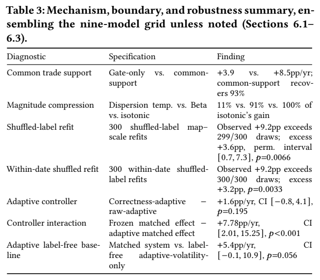

# 概率重新校准后，下游只看排名还是使用分值大小，会不会改变收益？

<!-- 全库方法复筛开始 -->
> **方法储备 · 面向决策的履约建模**。保留“Ordinal Gates, Cardinal Bets: Matching LLM Confidence to the Financial Decision Operator”这一研究问题或机制；是否用于当前业务另行验证。
> 原有阅读范围与证据等级不变；储备不等于效果已验证。
> [[研究前沿/论文库复筛与阅读路线|全库阅读路线]] · [[研究前沿/面向决策的履约建模/存量论文分层索引|本方向完整分层]]
<!-- 全库方法复筛结束 -->

分别冻结分数映射和下游动作强度，把同一套分数交给不同控制器，直接观察校准收益来自哪一步。

## 文献与版本

Ordinal Gates, Cardinal Bets: Matching LLM Confidence to the Financial Decision Operator。Rayansh Singh、Sara Rezaeimanesh。首投 08-31，作者稿 v2 为 09-02。11-13 正式收入 ACM ICAIF 论文集；出版方 PDF 未取得，本地全文和下列页码均来自作者 v2。 检索及精读于 2026-11-15。精读作者稿 §3–6、表 1–4、图 1–2，核对发表元数据及统计不确定性。 [一手来源](https://arxiv.org/abs/2609.00187v2) · [关联原始资料](https://doi.org/10.1145/3858063.3858876)

本地资料　[author-v2.pdf](./assets/source/author-v2.pdf) · [paper.html](./assets/source/paper.html)

## 方法与关键计算

一个决策只取排名前若干项，另一个用分数大小决定投入量。严格单调变换保持前者在同覆盖率下的选集（分数相同须沿用相同破同规则）。后者还依赖把分数换算成动作强度的尺度。用 2021 年拟合分数映射和尺度，在 2022–2023 年冻结测试，并交叉组合原始/校准分数及各自拟合的尺度。另给两个分数使用同一个动态波动控制器。

## 效果证据与对照

9 个模型的回测中，固定尺度规则下，分数和尺度配套重拟的年化确定性等价收益差为 +9.2 个百分点。使用相同的动态风险控制器后，差值为 +1.6 个百分点（95% 区间 −0.8 至 4.1）。

表 3 控制动作支持集后仍保留原效应的约 93%。去除贡献最大的单个模型，固定尺度下差值仍为 +5.5 个百分点。年度滚动拟合中三种映射均方向为正，Holm 校正后未达显著。回测目标有明确的风险惩罚，不能解读成履约率、线上净收入或独立的概率精度增益。

作者稿表 3，固定尺度与共享控制器的对照。 [原文第 6 页](./assets/source/author-v2.pdf#page=6)

## 能迁移到什么问题

履约或补贴决策可设计同样的交叉对照，分别检验固定预算排序、固定绝对概率阈值、按概率连续分资源三类用法。动作阈值若按绝对值冻结，单调变换也会改变选集。

原文 §4–6 说明校准集、测试期与比较协议。本次未核实公开代码；会议 DOI 与已保存作者全文分别登记。

[[研究前沿/面向决策的履约建模/02-可复用方法卡/GateAndScale-交叉搭配校准映射与动作强度|交叉搭配校准映射与动作强度]] · [[研究前沿/面向决策的履约建模/03-实验假设与结果/GateAndScale-把评分校准的作用与执行层重标拆开|把评分校准的作用与执行层重标拆开（未运行）]]
