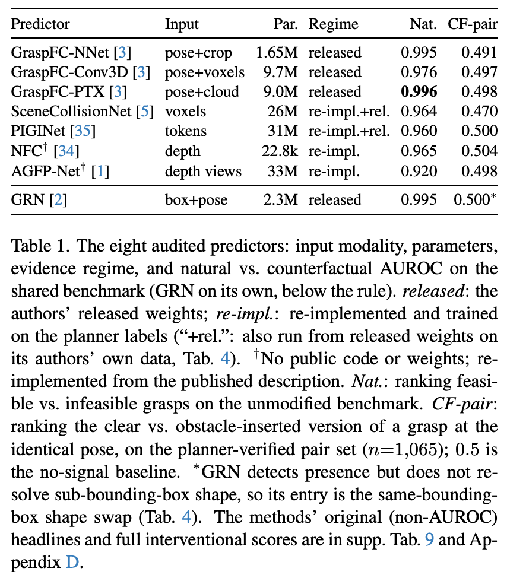

# 保持动作不变，让独立规划器重标可行性

**Auditing Grasp Feasibility Predictors with Planner-Verified Counterfactuals**  
Sajid Ansari、Antony Thomas、Girish Varma。首次提交及当前版本 v1 均为 2026-11-06。作者在 arXiv 备注 WACV 2027 已接收。 [arXiv 版本记录](https://arxiv.org/abs/2611.09130v1)

[本地 PDF](./assets/source/paper.pdf) · [本地 HTML](./assets/source/paper.html) · [[研究前沿/面向决策的履约建模/01-论文原文与精读/GraspCF/阅读覆盖|阅读范围与原文定位]] · [[研究前沿/面向决策的履约建模/01-论文原文与精读/GraspCF/代码核验|代码核验]]

## 为什么要保持抓取动作不变

原基准中的抓取位姿本身就能预测可行性。只看位姿的 25 近邻模型，在作者给出的一个自然任务上便有 0.963 AUROC。自然样本很少包含“姿态完全相同、关键约束却翻转”的场景。论文为同一次抓取合成配对场景，保持位姿固定，在接近通道内加入实体障碍，把新增点同时放进模型输入，再让独立规划器重新运行。另在通道外放匹配障碍作应保持可行的空对照。遮住点云或任意打乱标签都无法替代重标。[第 3 节](https://arxiv.org/html/2611.09130v1#S3) · [附录 F](https://arxiv.org/html/2611.09130v1#as1_A6)

## 一对输入，三种不同的问题

设 $s_i^+$ 和 $s_i^-$ 分别是可行原场景与阻挡场景的模型评分。仓库的 CF-pair AUROC 在**汇总的两组分数**上计算 AUROC；pick-clear 才逐对比较。变换位置得到一组多级干预后，另计算含有两类标签的每个抓取组 AUROC，再等权平均。以同姿态构造数据能消除只看姿态的辨别力，指标本身仍测不同尺度的排名。

$$
\mathrm{pick\text{-}clear}
=\frac1n\sum_i\big[\mathbf1(s_i^+>s_i^-)+\tfrac12\mathbf1(s_i^+=s_i^-)\big].
$$

这是从作者评估代码转写的算式。阈值正确率、校准和 AUROC 要分开记录。 [原文附录 I](https://arxiv.org/html/2611.09130v1#as1_A9) · [作者指标源码](https://github.com/codewithsajid/graspfc-cf/blob/43ad942d1e4d2275e91b199c68066bde91959d5f/graspfc_cf/metrics.py)

## 规划器条件与八种模型的证据

表 1 共同配对集有 1,065 对，八行方法有作者公开权重与重实现的区别；GRN 的 0.500 是原生数据上的同包围盒换形状，须单独读。自然 AUROC 0.920–0.996，表中干预测试 AUROC 0.470–0.504。原发布 GraspFC-PTX 为 0.996→0.498。其原生及重实现证据不能混称为同数据、同标签和八套官方模型。表 3 的标准盒设置，规划器翻转率 1.00、通道外空对照误翻 0.02；换成站立柱和沿转移路径的盒时，翻转率分别 0.74 和 0.56，并非插入的一切都不可行。四种规划算法 × 两种机械臂的标准盒翻转在八种设置中均成立；绝对可达区域仍随机械臂而变。[表 1](https://arxiv.org/html/2611.09130v1#S4.T1) · [表 3](https://arxiv.org/html/2611.09130v1#S4.T3)

## 能修复什么，什么会失效

自然基准上继续加数据，表 6 的 CF-pair 为 0.498；从头用配对样本训练可达 0.991，但对位置偏移敏感。另一条路线把局部通道沿轴切 13 段，每段保留最小横向净空、占用和位置，融合位姿评分。在相同原数据上用 BCE 训练，无需配对干预样本，约 2.3 万参数的净空表征有 0.983 CF-pair，原始通道点为 0.843，姿态为 0.503；直接使用最小净空、无训练时已有 0.899。跨新形状和跨新位置结果不同，未形成位置无关的安全判据；点根本不在输入裁剪区域时，表征无法复原。[第 4.5 节、图 7–8](https://arxiv.org/html/2611.09130v1#S4.SS5) · [附录 G](https://arxiv.org/html/2611.09130v1#as1_A7)

## 迁移到履约

适合首先审计确定性的硬约束，例如固定订单、人员和派单动作，只调整一个可核验的服务截止时间、已占容量或路网可达性，使调度校验器重标可行性；并构造同幅度但不翻转可行性的对照。随机是否接单或取消必须另有参照。规划器只定义指定条件下的可行性，不能自动生成真实完单概率或订单净价值。

## 原文关键图表

表 1 保留来源/重实现栏与 GRN 的特例脚注，便于区分公共基准上同姿态加障碍与原生数据上的同包围盒换形。

## 方法与实验

[[研究前沿/面向决策的履约建模/02-可复用方法卡/GraspCF-verified-pairs|保持候选动作的可行性翻转对与空对照]] · [[研究前沿/面向决策的履约建模/02-可复用方法卡/GraspCF-clearance-representation|在聚合前显式保留约束余量]]

[[研究前沿/面向决策的履约建模/03-实验假设与结果/2026-11-10-可行性模型是否读到了真正会翻转结果的时窗|可行性模型是否读到了真正会翻转结果的时窗（未运行）]]
