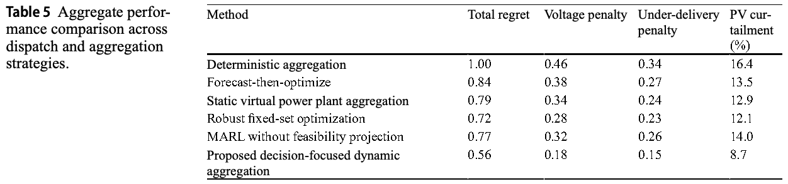

# 配电网调度怎样区分指令、承诺和实际交付

<!-- 全库方法复筛开始 -->
> **方法储备 · 面向决策的履约建模**。保留“决策训练中的资源分组与簇结构”这一研究问题或机制；是否用于当前业务另行验证。
> 原有阅读范围与证据等级不变；储备不等于效果已验证。
> 已恢复此前因业务距离被移出的原笔记；旧取舍原因仅作历史记录。
> [[研究前沿/论文库复筛与阅读路线|全库阅读路线]] · [[研究前沿/面向决策的履约建模/存量论文分层索引|本方向完整分层]]
<!-- 全库方法复筛结束 -->

Decision-focused learning for dynamic aggregation optimization of flexible resource clusters in active distribution networks  
Lei An、Xuan Liu、Yan Lu、Jing Xiang、Jianan Liu。Scientific Reports 于 11 月 12 日在线发出已接收稿。7 月 15 日收稿，10 月 22 日接收。 [作者或出版社记录](https://www.nature.com/articles/s41598-026-77850-6)

配电网数值案例中，整套方法的归一化遗憾为 0.56，先预测后优化为 0.84。表 13 列出组件对照设计，未给出单项数值。

## 作者要解决什么问题

聚合商要在特定地点和时间承诺可交付电力。给设备下达 1 MW 指令，设备可能不响应，也可能只完成一部分；同样大小的预测误差在电压逼近约束时能产生不同调度代价。

## 方法怎样从输入得到决策或预测

调度前的设备、天气及网络历史 → 图时序模型估能力和参与可靠性 → 按位置、恢复与重分配成本更新资源簇 → 固定簇和离散模式，解满足馈线和设备约束的连续调度 → 用实现的出力、需求与交付短缺计算损失，反传给估计器。滚动时仅使用指令发出前已收到的历史。

设 $d_i$ 为指令，$B_i$ 为参加标记，$A_i$ 为参加时的交付比例。实际交付 $D=\sum_i d_i B_i A_i$，承诺量为 $s$，短缺为 $[s-D]_+$。式 (52)–(54) 用交付比例的均值、协方差给承诺设可靠性界。仅当参与者全部交足时，参与概率才等于期望交付比例。

## 实验观察和证据范围

表 5 的遗憾、电压罚、欠交罚、最高光伏渗透情形弃光率依次为：固定确定性聚合 1.00 / 0.46 / 0.34 / 16.4%，先预测后优化 0.84 / 0.38 / 0.27 / 13.5%，完整方法 0.56 / 0.18 / 0.15 / 8.7%。前三列为加权或归一化指数；0.15 不能读作欠交概率，0.56 也不是运营支出降至 56%。

表 5，六种系统的数值比较。[原文 PDF](./assets/source/paper.pdf#page=22)

这是公共基准馈线、天气/光伏曲线与负载响应轨迹上的数值比较。训练、校准、验证和评估按时间切分。表 13 列出固定架构替换损失等应做对照，没有对应逐项结果或系统差值的区间。未验证实网运行或单独拆分指令与承诺的收益。

## 可采用的部分

最小可采用单元是三量分账和按承诺计短缺。若复用概率约束，还需要联合响应的协方差、同一时间单位和外生服务要求。通过调度损失训练需要固定离散决策后的连续求解器。

可把承诺运力、实际邀约、最终完成服务分别入账，按事件揭晓顺序估计参与和条件完成。业务数据下的反应与同伴相关性需重新测量。

[[研究前沿/面向决策的履约建模/02-可复用方法卡/GridDelivery-delivery-shortfall|方法卡：按实际交付和承诺计算短缺]] · [[研究前沿/面向决策的履约建模/03-实验假设与结果/2026-11-13-按承诺计短缺与按发出任务计短缺的区别|未运行假设：同一调度回放里，按承诺量训练是否减少履约短缺]]

## 阅读与核验范围

出版社稿 29 页，核对方法接口、式 (52)–(54)、表 3、5、10、13 和数据声明。 全文 Code availability 说明需向通讯作者申请，未取得可公开核验的源码或案例参数。 本地未运行原作者实验。出版社网页仅提供摘要；全文及表格来自已保存的提前发表 PDF。 [本地 PDF](./assets/source/paper.pdf) · [出版社页面快照](./assets/source/paper.html)
