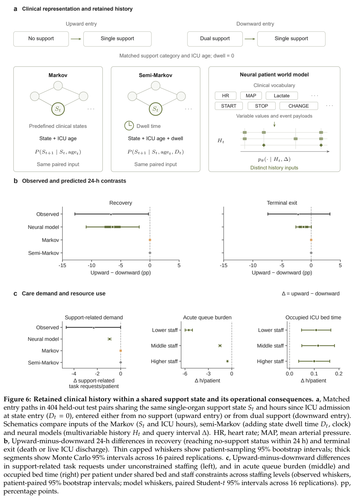

# 共用服务队列里，何时把一次行动写回个体历史

<!-- 全库方法复筛开始 -->
> **方法储备 · 司乘行为序列建模**。保留“个体世界模型与整体系统模拟的接口”这一研究问题或机制；是否用于当前业务另行验证。
> 原有阅读范围与证据等级不变；储备不等于效果已验证。
> 已恢复此前因业务距离被移出的原笔记；旧取舍原因仅作历史记录。
> [[研究前沿/论文库复筛与阅读路线|全库阅读路线]] · [[研究前沿/司乘行为序列建模/存量论文分层索引|本方向完整分层]]
<!-- 全库方法复筛结束 -->

**Learning a patient world model for health system simulation in intensive care**  
arXiv 首次提交 2026-11-05（UTC），核验时版本历史仅有 v1；本次检索日为上海时间 2026-11-12。正式发表日期待核。 [官方版本历史](https://arxiv.org/abs/2611.08392v1)

[原版 PDF](./assets/source/paper.pdf) · [原文 HTML 快照](./assets/source/paper.html)

## 研究问题

预测下一位对象的进展时，排队中的请求和已经完成的服务含义不同。作者将从 ICU 纵向记录习得的个体轨迹模型冻结，再把它接到统一日历、床位和人员队列；同一预测器可以更换排队策略和资源数量。

## 方法、计算与决策时点

模型读取带时钟的历史，按查询间隔产生后继状态及事件；离散事件仿真器处理到达、服务与终态。作者的反馈规则只在任务真实完成时把拟启动的干预写回历史，取消项与排队长度不给个体模型写入同样的完成标记。死亡/出院清除未完成任务。另有锁定同一条观测或生成轨迹的回放，用来检查调度差异。

## 实验结果与证据边界

670 名测试患者、每人 16 条 14 天轨迹，五状态占用分布平均总变差为 0.0388，限制平均 ICU 停留 2.923 天，实测 2.800 天。图 6 的 404 对匹配患者中，由较轻状态向上进入与由较重状态向下进入同一支持状态，24 小时恢复率之差实测 −6.68 个百分点，模型 −6.40；只用当前状态、时钟的基线按构造给出零差。开始服务请求的部分细分结果方向不一致。 [证据原文](https://arxiv.org/html/2611.08392v1#Sx2.F6)

*图 6 · 相同状态入口的历史对照与服务负荷，固定版 PDF 第 12 页。*

第 4 节说明训练和数据来自 MIMIC-IV。通过个体终点、队列回放和匹配历史逐层核验。仿真里的动作时点反馈是作者定义的场景假设，观察性轨迹和回放不能识别改变人员或服务时点之后的真实个体健康效应。

## 迁移到履约问题

适用于提醒、邀请、受理或到达存在显著延迟的流程；需要有请求、送达与取消的不同时间戳。 可以评估同一负荷刻度分别从上升或回落进入时是否应保留历史。成对预测差是观察对照，不能作为触发某个动作的因果效应。 本地尚未运行验证。

## 方法卡与候选实验

- [[研究前沿/面向决策的履约建模/02-可复用方法卡/ICUScenario-delivered-event|区分待服务请求与已完成动作，只把实到事件写回]]
- [[研究前沿/面向决策的履约建模/02-可复用方法卡/ICUScenario-entry-history|在相同当前状态与时钟下配对相反进入路径]]
- [[研究前沿/面向决策的履约建模/03-实验假设与结果/2026-11-12-按实际到达时刻写回是否改善共享队列回放|按实际到达时刻写回是否改善共享队列回放（未运行）]]

## 来源与实现核验

原文 Code availability 表示拟在发表时提供研究代码；本次未核得作者公开实现入口。

本次核验公开 v1 正文、列明的方法和实验及下列证据定位。作者报告的数值未做独立复算。 [队列与动作写回](https://arxiv.org/html/2611.08392v1#Sx4.SSx9) · [占用分布](https://arxiv.org/html/2611.08392v1#Sx2.SSx3) · [调度回放](https://arxiv.org/html/2611.08392v1#Sx2.SSx5) · [匹配入态历史](https://arxiv.org/html/2611.08392v1#Sx2.SSx6) · [局限](https://arxiv.org/html/2611.08392v1#Sx3)
