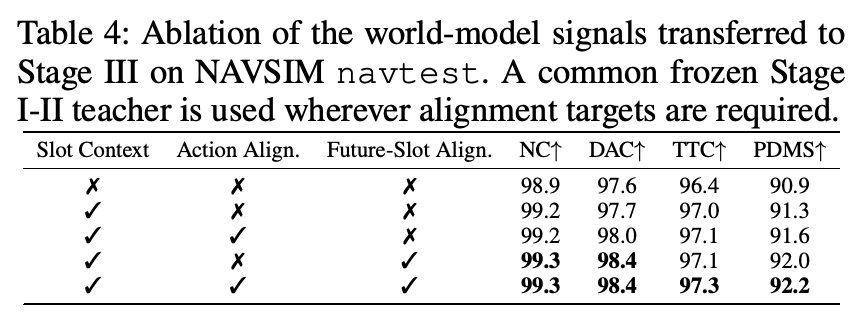

# 用动作条件的未来实体状态监督候选轨迹

**INTERACT: Learning Interaction-Aware World Dynamics from Driving Videos for Autonomous Driving**  
Zhan Chen、Songyan Zhang、Wenhui Huang、Zirui Li、Zhidong Wang、Qihang Huang、Shiyu Fang、Chen Lv。首次提交及当前版本 v1 均为 2026-11-02。arXiv 预印本。 [arXiv 版本记录](https://arxiv.org/abs/2611.02526v1)

[本地 PDF](./assets/source/paper.pdf) · [本地 HTML](./assets/source/paper.html) · [[研究前沿/面向决策的履约建模/01-论文原文与精读/INTERACT/阅读覆盖|阅读范围与原文定位]] · [[研究前沿/面向决策的履约建模/01-论文原文与精读/INTERACT/代码核验|代码核验]]

## 动机与整体约束

驾驶场景的致密向量保留像素，却未必记录某个其他参与者如何随自身运动改变。INTERACT 用无物体标注视频学习少量在相邻帧间延续的「槽」；每个槽是多个图像 patch 共享的实体表示，允许软归属。后续规划器在每种候选轨迹下同时预测潜动作和未来槽，从实际示范的后果中获得训练信号。潜动作由视频推断，与可执行干预之间的对应关系需要另行验证。[图 1](https://arxiv.org/html/2611.02526v1#Sx2.F1)

## 两个自监督阶段

1. 冻结 DINOv2 抽取每帧 patch 特征，以前一帧的 7 个槽初始化 Slot Attention，并保留 patch 到槽的软分配。监督包括重建 DINO 特征、跨帧 patch 对应分布与 VAE 潜变量重建。竞争归属加递归初始化共同增强身份稳定性；原文没有分开训练只保留其中之一的模型。
2. 以冻结 V-JEPA2 的历史和完整视频特征描述场景转移，跨注意力加入历史槽，再经三级残差向量量化得到潜动作 $z^{\mathrm{ego}}=\sum_{\ell=1}^{L}q^{(\ell)}$（式 5）。以该动作为 AdaLN 条件，用末个历史槽预测未来槽；同时重构目标视频特征。未来帧此时用于构造教师信号，预测到的变化可能包含其他车辆运动和相机变化。[第 3 节式 (1)–(7)](https://arxiv.org/html/2611.02526v1#Sx3.SSx2)

## 规划器的训练与推理

每个候选共享历史观察，但有自己的轨迹、动作和未来实体槽查询。利用真实轨迹找最接近的候选，对其轨迹计算 L1，对同一候选的潜动作和未来槽计算 MSE。动作标签来自读取完整片段的冻结阶段 II tokenizer；未来槽标签直接来自阶段 I 编码真实未来帧。可取得候选 oracle 分数时增加评分监督。推理只读历史图像、当前槽和路线/自车状态，执行得分最高的轨迹。[第 3 节式 (8)–(9)](https://arxiv.org/html/2611.02526v1#Sx3.SSx4)

$$
\mathcal{L}_{\mathrm{III}}=\lambda_{\mathrm{traj}}\mathcal{L}_{\mathrm{traj}}
+\lambda_{\mathrm{act}}\mathcal{L}_{\mathrm{act}}
+\lambda_{\mathrm{slot}}\mathcal{L}_{\mathrm{slot}}
+\lambda_{\mathrm{score}}\mathcal{L}_{\mathrm{score}}.\qquad\text{(9)}
$$

## 哪部分有对照

| NAVSIM navtest，16 候选，使用相同预训练教师 | PDMS，越高越好 |
|---|---:|
| 仅轨迹 | 90.9 |
| 加当前槽上下文 | 91.3 |
| 当前槽＋动作对齐 | 91.6 |
| 当前槽＋未来槽对齐 | 92.0 |
| 当前槽＋动作对齐＋未来槽对齐 | 92.2 |

表 5 仅切换阶段 II 的动作条件时 PDMS 91.9→92.2，前向进展 EP 86.4→86.2，说明综合分的提高伴随细项取舍。无动作对齐的独立比较中，致密未来特征监督是 91.5，未来槽为 92.0（表 12）。同一训练预算比较普通查询与递归槽，槽的物体集中度从 0.22 升至 0.72，轨迹槽一致性从 0.58 升至 0.86，29,846 条轨迹；这些只衡量表示质量。[表 4–6](https://arxiv.org/html/2611.02526v1#Sx4.T4) · [表 10–14](https://arxiv.org/html/2611.02526v1#Sx6.T10)

完整配置有 64 候选，可再加入 4 万段外域视频。主表 NAVSIM-v1 得 93.8 PDMS（DrivoR 93.7）；NAVSIM-v2 修正人类行为过滤后 EPDMS 为 91.4，未修正旧口径为 87.8。附录表 14 固定 navtrain 时 64 候选规划基线 92.4、加世界模型监督 93.5，不能把主榜与 16 候选基础模型的差值全部归于槽。nuScenes 开环平均 L2 为 0.32 米、平均碰撞率为 0.10%，表中另有同 L2、0.07% 碰撞率的对手。表 6 的 16 候选外域数据增量为 92.2→92.4。[表 1–3](https://arxiv.org/html/2611.02526v1#Sx4.T1) · [表 14](https://arxiv.org/html/2611.02526v1#Sx6.T14)

## 履约迁移及证据限制

可检验在已知动作的历史业务轨迹中，显式预测多个相关实体的下一阶段状态，是否能改善候选顺序；已有稳定订单和供给侧实体 ID 时可直接用实体表。论文的证据覆盖观测视频、模拟评分与部分组件消融。照片里的潜动作可能同时编码外部主体或道路变化，真实执行其他动作会怎样仍缺少同状态反事实。训练、评分时须隔离未来状态和事后实体标记。

## 原文关键图表

表 4 固定 16 个候选。以第二行的当前槽为参照，第四行的未来槽对齐提高 0.7 个 PDMS 点，第五行联合两个对齐目标又提高 0.2 点。

## 方法与实验

[[研究前沿/面向决策的履约建模/02-可复用方法卡/INTERACT-slot-transition|递归实体槽与潜动作条件的未来转移]] · [[研究前沿/面向决策的履约建模/02-可复用方法卡/INTERACT-mode-future-alignment|按候选模式对齐未来实体状态]]

[[研究前沿/面向决策的履约建模/03-实验假设与结果/2026-11-09-候选动作的未来实体监督是否改善履约排序|候选动作的未来实体监督是否改善履约排序（未运行）]]
