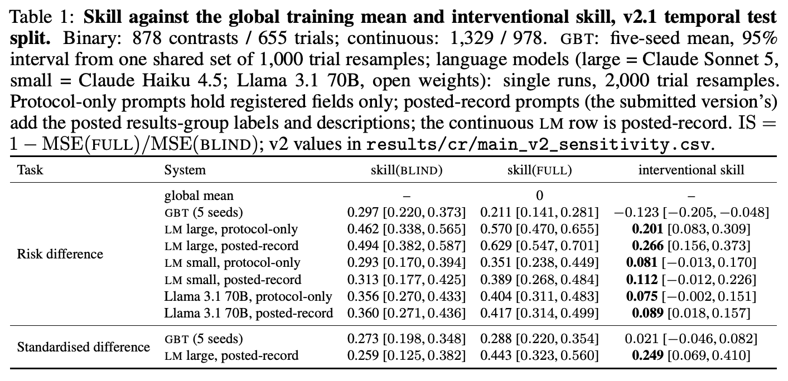

# 模拟器知道干预做了什么吗？用同构盲模型评估试验组差

**Does Your Trial Simulator Know What the Drug Does? An Intervention-Blind Test of Interventional Validity on 7,207 Registered Trials**  
Alicem Koyun。首次提交及当前版本 v1 均为 2026-11-04。arXiv 预印本，作者标注 NeurIPS 2026 高风险健康世界模型专题研讨会口头报告。 [arXiv 版本记录](https://arxiv.org/abs/2611.05907v1)

[本地 PDF](./assets/source/paper.pdf) · [本地 HTML](./assets/source/paper.html) · [[研究前沿/面向决策的履约建模/01-论文原文与精读/IVBench/阅读覆盖|阅读范围与原文定位]] · [[研究前沿/面向决策的履约建模/01-论文原文与精读/IVBench/代码核验|代码核验]]

## 一个总体基线会掩盖的问题

同一试验的治疗组减去比较组形成预测目标。终点类型、入组人群和比较组性质已能解释显著变异，模型即使读不懂具体干预，也可能胜过“输出所有试验的训练均值”。作者再构造一份保留同样上下文、隐藏所有干预标识的输入，让模型在这两个条件下预测同一组差。[第 3–4 节](https://arxiv.org/html/2611.05907v1#S3)

## 先验证组差标签

从 30,119 项已结束并公布结果的二、三期试验出发，取第一主要终点和每臂分析人数，剔除小于 20 人或无有限结果的组。每个治疗组优先配同试验最大惰性对照组，缺失时配活性比较组，每试验最多三个对比。二元结局取 $\Delta=p_T-p_C$，连续结局取 $(\bar y_T-\bar y_C)/s_{\mathrm{pooled}}$，须检查量纲、统计量与标准差换算。原 v2 数据随机抽查 100 对仅 76 对配对有效。v2.1 修订同分子剂量、不同阶段和双模拟对照身份等规则后，新抽查 100 对有 96 对有效，对新配或改配的测试样本另做人工审核。最终得到 7,207 项试验、9,996 对比，其中 4,014 个二元、5,982 个连续。[第 3 节、附录 A](https://arxiv.org/html/2611.05907v1#S3)

## 盲参照与试验级推断

$$
\mathrm{IS}=1-\frac{\operatorname{MSE}(\widehat\Delta_{\rm full})}
{\operatorname{MSE}(\widehat\Delta_{\rm blind})}.
$$

两个 MSE 都对同一批真实组差计算。结构化模型使用相同模型族、训练试验与调参流程，在 blind 端重新训练。删除干预名称、类型、描述、各臂名称与描述和结果组别标识，保留终点、条件、入组标准、设计、基线人口统计、比较组类型。语言模型共享提示模板，隐藏相同字段并清理保留文本中的标识词。测试按结果首次公布年份切分，2023 年前训练，之后测试；同一试验多对比共享试验臂，按试验整簇自举。注册数据模型五随机种子共用 1,000 次抽样，语言模型 2,000 次。[第 4 节、表 1](https://arxiv.org/html/2611.05907v1#S5.T1)

## 结果与可证伪检查

| 二元终点，878 对比 / 655 试验 | full 相对均值技能值 | IS，95% 试验级区间 |
|---|---:|---:|
| 梯度提升，5 种子 | 0.211 | −0.123 [−0.205, −0.048] |
| Sonnet 5，仅注册方案 | 0.570 | 0.201 [0.083, 0.309] |
| Haiku 4.5，仅注册方案 | 0.351 | 0.081 [−0.013, 0.170] |
| Llama 3.1 70B，仅注册方案 | 0.404 | 0.075 [−0.002, 0.151] |

连续终点 1,329 个对比的梯度提升 IS 为 0.021 [−0.046, 0.082]。二元模型共享文本 SVD 空间可能加大了负值，换为分块、稀疏岭或医学文本嵌入后结果靠近零。Sonnet 在原 posted-record 提示且 $|\hat\Delta|>0.01$ 的 742 个对比中，交换试验臂有 86.1% 翻转预测符号；这是不同提示条件下的压力测试。盲提示仍能恢复 45% 的药类，随机置换仅约 2%，所以 IS 量化的是在上下文之上显式字段增加的信息。无已知训练期暴露的 217 个对比上，Llama 方案输入 IS 为 0.01 [−0.10, 0.12]，不能排除记忆或功效不足。[表 1](https://arxiv.org/html/2611.05907v1#S5.T1) · [表 17–18](https://arxiv.org/html/2611.05907v1#A5.T17) · [附录 D](https://arxiv.org/html/2611.05907v1#A4)

置信排序与误差承诺需要分别评估。注册模型只回答时间外最有把握的四分之一时 MAE 从 0.130 降至 0.083；校准集选定目标 0.10 的阈值到了时间外 MAE 为 0.113，标称 90% 的等宽交叉拟合区间实际覆盖 87.4%。[表 19–20](https://arxiv.org/html/2611.05907v1#A5.T19)

## 履约迁移的边界

测量对象是试验层面的平均组差。注册数据有选择性，二元测试集中约 96% 为随机平行设计，个人潜在结果、跨动作策略价值和顺序反事实均未由此识别。迁移可先用已知分流概率、相同人群及时间窗的派单或等待动作试验，以完单率差为标签。仅有行为日志时，动作盲测只能说明显式字段的预测增量。与已有 StandIn 随机化检查的差别是此处还训练同构盲模型，直接用同一批试验组差量化增量，并核验动作代理泄漏。

## 原文关键图表

表 1 的前三列使用同一测试集。登记模型的 full 能胜过总体均值，却落后于 blind；解释数字时须先看比较分母。

## 方法与实验

[[研究前沿/面向决策的履约建模/02-可复用方法卡/IVBench-blind-skill|同构动作盲参照与组差技能值]] · [[研究前沿/面向决策的履约建模/02-可复用方法卡/IVBench-perturbation-audit|动作代理泄漏、交换与替代检查]]

[[研究前沿/面向决策的履约建模/03-实验假设与结果/2026-11-09-动作标识能否改善留出试验的完单率差预测|动作标识能否改善留出试验的完单率差预测（未运行）]]
