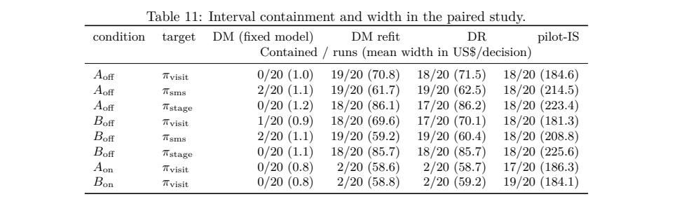

# 多种离线估值一致时，怎样发现它们共同偏了

<!-- 全库方法复筛开始 -->
> **方法储备 · 训练目标与数据反馈**。保留“JUBILEE: A Benchmark Environment for Off-Policy Evaluation in Debt Collections”这一研究问题或机制；是否用于当前业务另行验证。
> 原有阅读范围与证据等级不变；储备不等于效果已验证。
> [[研究前沿/论文库复筛与阅读路线|全库阅读路线]] · [[研究前沿/训练目标与数据反馈/存量论文分层索引|本方向完整分层]]
<!-- 全库方法复筛结束 -->

JUBILEE: A Benchmark Environment for Off-Policy Evaluation in Debt Collections。作者为 Prado, Diego Silva、de Jesus, Tiago Amaral Penteado、de Souza, Bruno Caldas、De Oliveira, Cristiano Bevitori Maffia。arXiv 首投 2026-11-07，本次核验 v1。 [版本记录](https://arxiv.org/abs/2611.10972v1) · [本地 PDF](./assets/source/paper.pdf) · [本地 HTML](./assets/source/paper.html)

## 研究问题

真实日志可能遗漏同时影响动作与结果的因素，此时多个估值器可以一致地选错策略。

## 方法与关键计算

在可访问真值的模拟器中成对开关“隐藏因素影响分配”，保留其对结果的作用；对策略重新独立模拟回报，再比较 DM、IPS、DR 与不同 bootstrap。分别以综合评分与未扣渠道成本的回款作目标。

$$
\mathrm{containment}=R^{-1}\sum_{r=1}^{R}\mathbf 1\{V^{\rm sim}_r\in [L_r,U_r]\}
$$

每次重复用独立模拟的策略参照与日志估计区间比较。参照自身有 Monte Carlo 误差，以上计算针对指定环境。 [原文定位](https://arxiv.org/html/2611.10972v1#S5.T11)

## 对照、结果和限制

§5 表 11 上门政策的 DR 区间，无隐藏分配时在 A、B 环境分别包含参照 18/20、17/20 次，打开隐藏分配后均为 2/20。原文另示同一动作的排名随评分与模拟现金口径翻转。参照是独立模拟估计。 [原文证据](https://arxiv.org/html/2611.10972v1#S5.T11)

原文 PDF 第 14 页。

负面对照来自合成催收机制，未直接识别任何真实人群的策略价值；现金指标未扣行动成本。

## 复用和阅读范围

已核问题设定、方法与上文所列的关键对照，详细证明及未列出的实验以所附全文为准。已按公开仓库快照核对文件路径。[reproduce/check_arxiv_tables.py](https://github.com/alpha-synthesis/jubilee/blob/af20667cc43be6d45743f70ed5333cf2e22d90e6/reproduce/check_arxiv_tables.py)

[[研究前沿/面向决策的履约建模/02-可复用方法卡/JubileeOPE-隐藏分配开关对照|隐藏分配开关对照]] · [[研究前沿/面向决策的履约建模/03-实验假设与结果/JubileeOPE-日志估值器是否会在隐藏分配共同影响下给出一致的错误排序|日志估值器是否会在隐藏分配共同影响下给出一致的错误排序]]

折外训练缓解拟合偏差，隐藏分流还需要额外识别证据。 [[研究前沿/uplift模型迭代/01-论文原文与精读/PFNNuisance/精读|另一方向的对照]]
