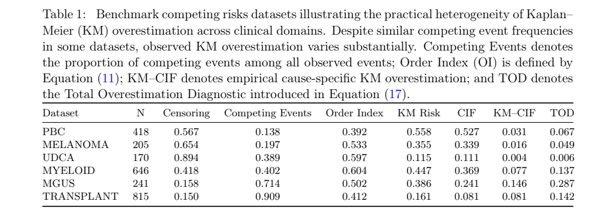

# 竞争事件发生的早晚怎样影响完单概率估计

<!-- 全库方法复筛开始 -->
> **方法储备 · 面向决策的履约建模**。保留“Measuring Kaplan--Meier Overestimation Under Competing Risks: Event Ordering, Quantification, and Exact Inference”这一研究问题或机制；是否用于当前业务另行验证。
> 原有阅读范围与证据等级不变；储备不等于效果已验证。
> [[研究前沿/论文库复筛与阅读路线|全库阅读路线]] · [[研究前沿/面向决策的履约建模/存量论文分层索引|本方向完整分层]]
<!-- 全库方法复筛结束 -->

**能改哪一环？** 改接单后分时取消风险的标签和评估基线。论文表 1 中两组竞争事件比例相近，朴素 KM 的高估却相差很大，说明还要看完单与取消发生的先后。

**第一步怎么验证？** 在同一批已接订单上固定观察起点和随访截止，对照将完单当作删失的 KM 与将完单列作竞争事件的 Aalen–Johansen 估计。按等待时长比较取消累计概率之差，在随访完整子集用实际频率核验。若关注时窗差异落在抽样误差内，暂不据此重做预测头。（本地验证未运行。）

Measuring Kaplan--Meier Overestimation Under Competing Risks: Event Ordering, Quantification, and Exact Inference。作者为 Espuny-Pujol, Ferran。arXiv 首投 2026-11-10，本次核验 v1。 [版本记录](https://arxiv.org/abs/2611.14457v1) · [本地 PDF](./assets/source/paper.pdf)

## 研究问题

终态互斥时，取消和完单谁先发生，会改变把另一终态当作删失得到的误差。

## 方法与关键计算

将每类事件各自的朴素 KM 风险减去 Aalen–Johansen 累积发生率；再把各原因差相加。式 (17) 用全部终态的生存曲线与逐原因的 KM 曲线直接求和。总量用于定位值得复查的时间窗，随后用逐原因结果判断偏差落在哪类终态。

$$
\widehat{\mathrm{TOD}}(t)=\widehat S_{\rm all}(t)-\sum_{k=1}^{K}\widehat S_{\mathrm{KM},k}(t)+(K-1)
$$

第一项是把任一终态均作事件的生存率，逐原因项把其他终态作删失。K 为原因数。 [原文定位](https://arxiv.org/pdf/2611.14457v1#page=11)

## 对照、结果和限制

原文表 1 中，UDCA 和 MYELOID 的竞争事件占全部观察事件的 38.9% 与 40.2%，朴素 KM 对目标风险分别高估 0.4 和 7.7 个百分点。分母是所有观察到的事件。该对照展示频率相近时偏差可能相差很大，无法单独归因于一个协变量。 [原文证据](https://arxiv.org/pdf/2611.14457v1#page=15)

原文 PDF 第 15 页。

需要互斥的首终态、同一时间起点、独立右删失与非空风险集。总高估是跨原因的和；本统计量本身不能识别策略的因果收益。

## 复用和阅读范围

已核问题设定、方法与上文所列的关键对照，详细证明及未列出的实验以所附全文为准。本次未核实作者公开实现入口。

[[研究前沿/面向决策的履约建模/02-可复用方法卡/KMBias-总高估诊断|总高估诊断]] · [[研究前沿/面向决策的履约建模/03-实验假设与结果/KMBias-固定同一批订单，比较相似取消占比、不同发生时序下的逐时点 KM–AJ 差|固定同一批订单，比较相似取消占比、不同发生时序下的逐时点 KM–AJ 差]]

先区分等待退出的风险和时间顺序，再测试是否达到组批条件。 [[研究前沿/动态等待与匹配决策/01-论文原文与精读/AbandonBatch/精读|另一方向的对照]]

## 2026-11-14 版本复核

KMBias v2 补全可复现材料的永久 DOI，正文比较未见实质变动。 [[研究前沿/面向决策的履约建模/01-论文原文与精读/KMBias/版本更新-2026-11-14|双版本对照与原文]]
