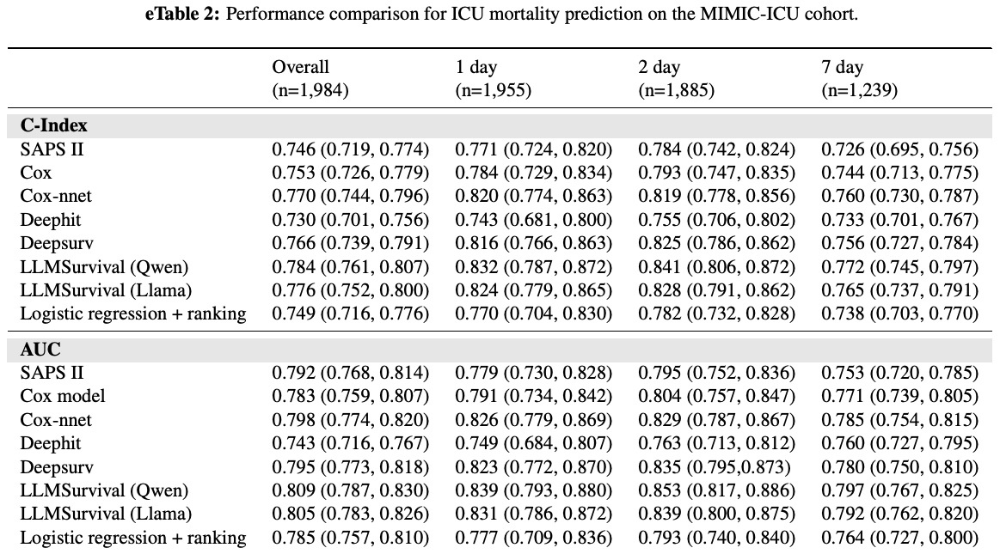

# 有删失的配对排序，换成语言模型多带来多少

<!-- 全库方法复筛开始 -->
> **方法储备 · 面向决策的履约建模**。保留“删失感知的成对排序监督”这一研究问题或机制；是否用于当前业务另行验证。
> 原有阅读范围与证据等级不变；储备不等于效果已验证。
> 已恢复此前因业务距离被移出的原笔记；旧取舍原因仅作历史记录。
> [[研究前沿/论文库复筛与阅读路线|全库阅读路线]] · [[研究前沿/面向决策的履约建模/存量论文分层索引|本方向完整分层]]
<!-- 全库方法复筛结束 -->

Towards end-to-end LLM-based censoring-aware survival analysis  
Yishu Wei、Hexin Dong、Yi Lin、Jiahe Qian、Yi Liu、Yifan Peng。5 月 25 日首发，11 月 10 日 v2 修订。逐项核对 v1/v2，v2 附表增加相同排序思路的 logistic regression 对照，ICU 和骨折的主要 LLM 结果在 v1 已存在。 [作者或出版社记录](https://arxiv.org/abs/2605.25399v2)

11 月修订补入同排序设置的逻辑回归。ICU 的 C-index 为 0.749，对应 Llama 为 0.776；骨折为 0.738 对 0.742，两队列的差别很不一样。

## 作者要解决什么问题

删失对象的真实事件时点未知；如果删除所有删失样本，或把其观察截止当真实时点，排序任务会失真。这里仅使用可根据随访确定先后的对象对。

## 方法怎样从输入得到决策或预测

把临床表格转成统一文本 → 对已发生事件的人，在其事件时点仍然处于随访的对象中抽取对照 → 随机置换提示中的次序，训练二选一比较器 → 测试时将新样本逐一与固定训练锚点比较 → 聚合胜出比例为风险顺序分数。

可比较对 $\mathcal P=\{(i,j):e_i=1,\ t_i<t_j\}$；允许 $j$ 在之后删失。固定训练锚点 $a_1,\ldots,a_K$ 后，风险排序为 $K^{-1}\sum_k \mathbf1\{f(x,a_k)=x\text{ 更早}\}$。主实验用 50 个锚点；这个比例并不等于某一业务时限前发生事件的概率。

## 实验观察和证据范围

v2 附表 2，ICU 整体 C-index 为 logistic + ranking 0.749 [0.716, 0.776]、Llama 0.776 [0.752, 0.800]、Qwen 0.784 [0.761, 0.807]、Cox 0.753。附表 3 骨折依次为 0.738、0.742、0.741、0.737。论文给出单模型区间，未据此计算两模型的配对差区间。表 3 的训练对规模由潜在约 602 万 / 302 万对降至实际 46,052 / 15,720 对。

v2 附表 2，ICU 队列包含新增的同排序逻辑回归对照。[原文 PDF](./assets/source/paper.pdf#page=23)

回顾性临床队列，目标是可比较人对的一致性。观察性排序没有各动作下的因果效应，也没有直接给出任意时限内的校准绝对风险。固定锚点使不同待评样本可比较，也增加每条请求 K 次推理的成本。普通模型的新增对照检验表示/比较器差异，不能单独证明自然语言序列化是增益来源。

## 可采用的部分

配对生成器可独立给线性或树比较器使用。原语言模型证据还依赖文本化、对照抽样、顺序随机化、微调与测试时的固定锚点；绝对概率另需校准。

在服务持续时间上用单一事件、明确观察截点重建可比对。取消与完成互为竞争终态时要先重定估计对象，不能直接把所有取消都当独立删失。

[[研究前沿/面向决策的履约建模/02-可复用方法卡/LLMSurvival-comparable-anchors|方法卡：只把可定先后的人配对，再以训练锚点汇总风险]] · [[研究前沿/面向决策的履约建模/03-实验假设与结果/2026-11-13-可比较对与固定锚点是否改善时长排序|未运行假设：低成本比较器能否取得大部分删失排序收益]]

## 阅读与核验范围

v2 全文 30 页，重点核对 §2–3、图 4、表 3、附表 2/3；另以 v1 PDF、HTML核对新增基线。 从作者仓库读取 generate_pairs.py 中 create_pair_df、generate_anchor.py、sft.py、inference.py 的源码入口，未运行训练。[作者仓库](https://github.com/bionlplab/llmsurvival) 本地未运行原作者实验。 [本地 PDF](./assets/source/paper.pdf) · [本地 HTML 原文](./assets/source/paper.html) · [首发 v1 对照稿](https://arxiv.org/pdf/2605.25399v1)
