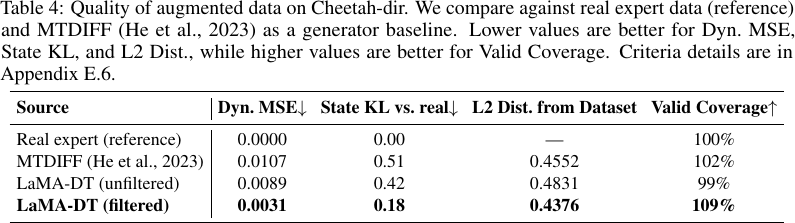

# LaMA-DT · 先检验合成轨迹是否自洽，再用于策略学习

Language Model Augmented Decision Transformer for Multi-Task Offline Reinforcement Learning

Zhao, Xinbo, Liu, Yuhang, Zhang, Xin, Le, Lei, Xi, Zhaohan, Yang, Yu, Zhang, Yingxue。arXiv v1 首投 2026-11-02。本轮新发现，检索于 2026-11-09，会议发表日期未核验。[版本页](https://arxiv.org/abs/2611.04031) · [本地 PDF](./assets/source/paper.pdf) · [本地 HTML](./assets/source/paper.html)

## 生成与筛选
作者希望用跨任务轨迹增强稀缺的离线决策样本。把任务描述与真实起点、初始动作交给冻结主干和 LoRA 适配器，采样多条未来轨迹。六个训练目标覆盖一步转移、片段重构、正向和反向展开、轨迹到文本以及描述条件下的展开，分别检查短期动力学、长程一致性及任务语义。
## 同一起点下比较候选
式 (1)–(4) 对各目标的条件对数似然按长度归一化，六项取均值得到分数。附录算法按种子状态动作对保留 top-K。随后用真、合成混合数据训练独立策略适配器，引入来源标签；推理设为 real。筛选和合成只在离线阶段进行。
$$
S(\tilde\tau)=\frac16\sum_{j=1}^{6}S_{O_j}(\tilde\tau).
$$
## 系统成绩和筛选增益
表 1–2 比较 Meta-World、MuJoCo 上的离线策略；表 3 单独关闭筛选，并移除若干训练目标。ML30 完整配置成功率 69.8，关闭筛选后 62.1，合并移除三个序列目标后 50.2。表 4 另外在 Cheetah-dir 检查合成数据质量。图 2 显示增大合成比例有时反而使表现变差。

## 原始证据

表 4 的 Cheetah-dir 配对对照中，筛选前后动力学 MSE 从 0.0089 变为 0.0031，状态 KL 从 0.42 变为 0.18。表 3 同时报告了关闭筛选后 ML30 成功率下降 7.7 个百分点。

原表 4　同一生成器筛选前后的动力学误差、分布距离与覆盖。

## 阅读范围和迁移边界

原领域是控制基准。高生成似然可能偏好重复的常见路径；迁移到接单、取消、完单轨迹需同时检查稀有但真实的状态覆盖，不能用模拟样本验证反事实因果效应。

阅读深度为核心方法、主实验与证据边界精读；数值来自作者，未逐行复证全部附录推导。作者匿名仓库文件清单已核验，训练六目标、生成与筛选、训练策略入口分别为 `scripts/train_llm_objectives.py`、`scripts/generate_augmented_data.py`、`scripts/train_lamadt.py`。未执行。[作者仓库](https://anonymous.4open.science/r/o33zlamadt-6587/)

[[研究前沿/面向决策的履约建模/02-可复用方法卡/LaMA-DT-用多目标一致性筛选合成轨迹|用多目标一致性筛选合成轨迹]] · [[研究前沿/面向决策的履约建模/03-实验假设与结果/LaMA-DT-固定样本量下检验合成履约轨迹筛选|固定样本量下检验合成履约轨迹筛选]]

[[研究前沿/面向决策的履约建模/01-论文原文与精读/LaMA-DT/原文导航|原文章节及图表公式导航]]
