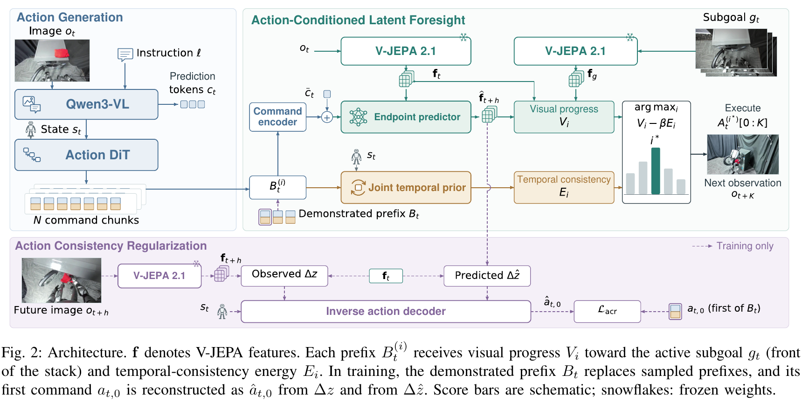

# Coordinating Humanoid Loco-Manipulation through Action-Conditioned Latent Foresight

[官方论文](https://arxiv.org/abs/2611.04839) · [本地PDF](./assets/source/paper.pdf) · [HTML快照](./assets/source/paper.html)

版本记录：[Submitted on 3 Nov 2026]；本次核验与精读：2026-11-06。本篇为滚动窗口内首次入库；检索日不等于首次发表日。

阅读范围：§III 方法与全部关键损失，§IV 主实验、三个消融、失败与部署成本，§V 限制。未逐行复证全部数学证明，未声称逐页翻译。[[研究前沿/面向决策的履约建模/01-论文原文与精读/LatentForesight/阅读覆盖|原文章节与公式索引]]；HTML为原始快照，外部样式和图片可能需要联网，PDF可离线阅读。

代码：已核验[作者项目页](https://ju6276.github.io/Action-Grounded-Foresight/)；Code 栏为 “Coming soon”，有数据集与展示，不是已发布训练/推理实现。未运行代码。 [[研究前沿/面向决策的履约建模/01-论文原文与精读/LatentForesight/代码核验|核验记录]]

## 问题与整体方法

候选动作可能视觉上接近目标，却在连续执行时破坏抓握等时序一致性。论文生成多条动作序列，预测各序列短前缀后的视觉 endpoint，再同时用目标进展和联合动作时序先验评分，选中后只执行更短前缀。

$N=8$ 条候选、评估长度 $h=20$、执行 $K=10$，$K<h\le H$。关键评分（Eq.2）为

$$i^*=\arg\max_i[V_i-\beta E_i],\quad V_i=d(z_t,z_g)-d(\widehat z_{t+h}^{(i)},z_g).$$

目标是示范提取的按时间排序的视觉子目标，不是无监督获得的通用奖励。

## 模块一：端点预测保留动作信息

冻结经过任务域预训练的 V-JEPA 编码器，分别编码当前和未来画面，避免 joint clip encoder 在训练看见未来而推理只重复当前画面的失配。动作前缀 tokens 与预测 tokens 条件化 endpoint predictor。训练 dense feature L1 与 pooled endpoint alignment。

共享 inverse decoder 同时从真实/预测特征变化重建第一条示范动作：

$$\mathcal L_{acr}=\|D_\psi(\operatorname{sg}(\Delta z),s_t)-a_{t,0}\|^2+\|D_\psi(\Delta\widehat z,s_t)-a_{t,0}\|^2.$$

真实分支训练 decoder；预测分支将动作重建梯度传回预测器。这只约束首动作可恢复性，不能称为整条动作一一可逆或因果识别。

## 模块二：联合时序先验

GRU 根据初始状态和此前完整 motion+hand 命令预测下一条完整命令。各组的归一化均方预测误差按维度加权，得到 $E_i$；联合历史捕捉身体运动和手部配合，区别于分别建模各动作组或只加平滑惩罚。

## 实验与消融

**系统结果，Tables II–IV**：10 个 SIMPLE 任务整体成功率 89.7%，DiT4DiT 82.0%；7 个真实 G1 任务标准/未见配置 85.7%/65.7%，GR00T N1.7 70.0%/48.6%。每任务/条件仅 10 次测试，且一部分模拟基线来自文献；各任务单独训练，本文使用的示范子目标也不是所有基线共享。

**可归因的组件消融**：

- Table V：独立端点预测 89.7%，feature-shift 84.3%，支持缓解其具体训练推理失配。
- Table VI：4 个额外任务、每配置 120 episodes，固定视觉评分时 ACR 55.0%→65.8%，+10.8 个百分点。
- Table VII：固定训练网络改评分，visual-only 65.8%，一阶平滑 67.5%，二阶 70.0%，参数量近似的 factorized prior 71.7%，joint prior 80.8%。联合先验比拆分先验 +9.1 个百分点（作者按未舍入计数报告 +9.2）。

**运行开销，Table VIII**：评估卡上约 9.1 chunks/s、7.2 GB；额外 Orin NX 部署仅 0.73 Hz。不能把 GPU 测试成功率说成同速度的端侧闭环验证。

## 局限和迁移

软物体抓握丢失、机构未完全打开仍失败；视觉子目标可能忽略接触和隐状态。动作候选生成器、视觉预训练、示范子目标、评分权重共同影响整体结果。迁移可先用“小步执行、稍长预测、候选重排”的模式，而不必训练视频模型：例如预测动作前缀后的履约状态，再以收益进展和动作序列一致性重排。但需要正确对齐动作与观察，并额外处理决策数据的选择偏差。

## 原文关键图表

原文 Figure 2，PDF 第 3 页；原始裁图，机制和证据解释见上文。裁图坐标与源文件校验值见 assets/source/figure-provenance.json。

## 方法卡

- [[研究前沿/面向决策的履约建模/02-可复用方法卡/LatentForesight-action-consistency|真实与预测转移共享逆动作头的表示约束]]
- [[研究前沿/面向决策的履约建模/02-可复用方法卡/LatentForesight-joint-prefix-scoring|目标进展与联合时序先验重排动作前缀]]

## 待验证想法

[[研究前沿/面向决策的履约建模/03-实验假设与结果/2026-11-06-动作一致性的候选前缀重排|动作一致性的候选前缀重排（未运行）]]
