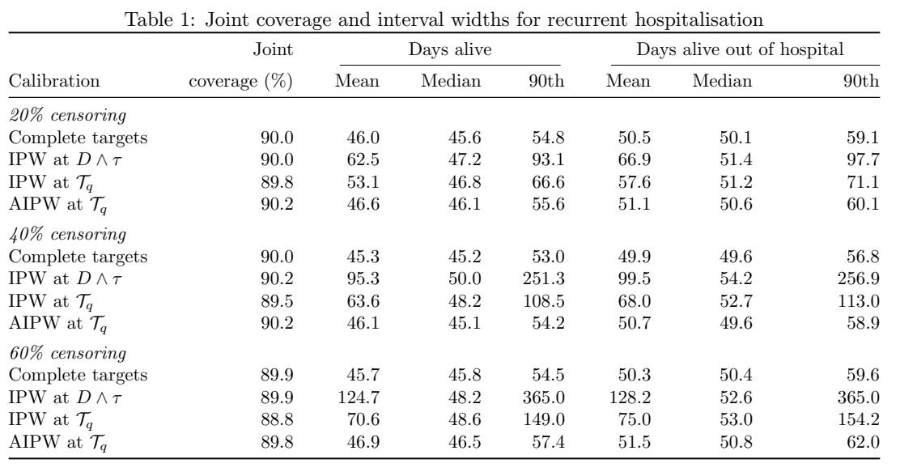

# 终态没回传，有些轨迹已经能判断区间是否覆盖

<!-- 全库方法复筛开始 -->
> **方法储备 · 面向决策的履约建模**。保留“删失生命史的共形校准”这一研究问题或机制；是否用于当前业务另行验证。
> 原有阅读范围与证据等级不变；储备不等于效果已验证。
> 已恢复此前因业务距离被移出的原笔记；旧取舍原因仅作历史记录。
> [[研究前沿/论文库复筛与阅读路线|全库阅读路线]] · [[研究前沿/面向决策的履约建模/存量论文分层索引|本方向完整分层]]
<!-- 全库方法复筛结束 -->

Conformal prediction for censored life history data  
Lu Mao。2026-11-11 首次提交 arXiv，本次核对 v1。[arXiv v1](https://arxiv.org/abs/2611.15724v1)

是否必须等到整个随访结束才能校准“在某个状态累计停留多久”的区间？

## 怎样从输入得到输出

先用独立训练样本拟合分数、删失与结局模型。对每个候选区域，随着轨迹增长，判断所有仍可能的终局是否全在区域内、或全在区域外。一旦能判定该样本是否覆盖即可使用；仍未判定的部分用基于已见历史的条件覆盖概率增广。新个体只用基线信息给出标量或联合区间。

令 $T_q$ 为区域归属第一次可判定的时刻；在判定前持续观察的概率 $G(T_q\mid Z)$ 给出逆权。固定区域的增广覆盖估计在删失模型或条件覆盖模型之一正确时一致；选择达到目标覆盖率的阈值时，还须考虑校准样本的不确定性。

## 哪个对照支持这个判断

表 1 中，40% 删失、校准样本 400 时，以终态时间加权、以可判定时间加权、再做增广，院外生存天数平均区间宽度依次为 99.5、68.0、50.7 天，联合覆盖率为 90.2%、89.5%、90.2%。表 2 的 HF-ACTION 在 40 次划分中相应宽度为 28.9、28.8、29.3 天，未出现仿真中的缩窄。

表 1，复发住院模拟的联合覆盖率与区间宽度。[本地原文](./assets/source/paper.pdf#page=13)

## 使用条件与可检验的迁移

只在随访可支持的固定观察窗内解释；删失需满足给定协变量的独立性和正性。真实数据覆盖率也需用删失校正估计。定理 3 的有限样本界含估计误差，双重稳健性不保证每个个体精确覆盖。

对“30 分钟内累计等待时长”先校验哪些未回传订单已经能确定区间归属；重删失时可能缩短区间，低删失时改善可能消失。

[[研究前沿/面向决策的履约建模/02-可复用方法卡/LifeConformal-method|方法卡 · 终态没回传，有些轨迹已经能判断区间是否覆盖]] · [[研究前沿/面向决策的履约建模/03-实验假设与结果/LifeConformal-提前可判定的等待区间能否缩窄|待验证 · 提前可判定的等待区间能否缩窄]]

## 阅读范围与复现入口

20 页，核对式 (3)、定理 1–3、表 1–2、图 2 与图 5；未复推完整效率界。公开 R 包有 R、src、vignettes 和测试目录。[lifeconformal](https://github.com/lmaowisc/lifeconformal) 本地验证状态为未运行。
