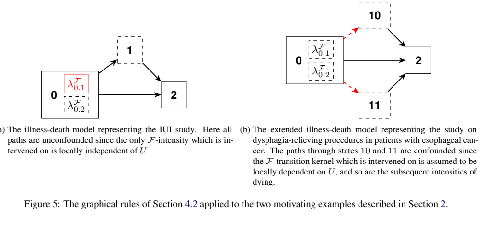

# 改变服务时点和改变服务类型，需要不同的无混杂假设

<!-- 全库方法复筛开始 -->
> **方法储备 · 面向决策的履约建模**。保留“Causal invariance and identifiability for interventions in multi-state models”这一研究问题或机制；是否用于当前业务另行验证。
> 原有阅读范围与证据等级不变；储备不等于效果已验证。
> [[研究前沿/论文库复筛与阅读路线|全库阅读路线]] · [[研究前沿/面向决策的履约建模/存量论文分层索引|本方向完整分层]]
<!-- 全库方法复筛结束 -->

Causal invariance and identifiability for interventions in multi-state models  
Mark Bech Knudsen; Helene Charlotte Wiese Rytgaard; Torben Martinussen。2026-11-11 首次提交 arXiv，本次核对 v1。[arXiv v1](https://arxiv.org/abs/2611.15616v1)

一个未记录的变量同时影响两段流程时，是否还能从状态转移日志识别干预后的结局？

## 怎样从输入得到输出

在连续时间多状态模型中，先把离开当前状态的事件按组划分。同一组什么时候发生由强度决定，发生后到哪个子状态由分配核决定。指定只替换的强度或分配核，沿每条可行路径核查潜在共同原因，保留其他条件机制，形成干预下的似然。

分组转移可写作 $\lambda_{x\to y}(t)=\lambda_{x,j}(t)\pi_{x,j}(y\mid t)$。定义 4 与定理 1 逐路径检验是否有隐过程同时影响被替换机制与竞争或后续未替换机制、或被测时变协变量演化；遇到右删失再检查定理 2 和命题 1。

## 哪个对照支持这个判断

图 4 给出同一隐变量处在干预前或干预后时不同的路径结论。图 5 用两例分别解释调整辅助生殖治疗时间、变更外科治疗类型。原文证明满足条件时从完全信息层过渡到观测层的因果不变性；未报告治疗效果或预测提升。

图 5，调整事件时点和调整类型对应的两种图。[本地原文](./assets/source/paper.pdf#page=11)

## 使用条件与可检验的迁移

结论是充分条件。隐变量依赖关系、干预覆盖与因果不变性不能由预测拟合优度证明；会改变未来的终止事件应建成状态。删失扩展另要求可估的留访与足够支持。

把“何时发出提醒”和“提醒内容”拆成两种干预，分别沿竞争取消和后续完成路径检查共同原因，可定位哪种政策比较需要额外测量。

[[研究前沿/面向决策的履约建模/02-可复用方法卡/LocalIntervention-method|方法卡 · 改变服务时点和改变服务类型，需要不同的无混杂假设]] · [[研究前沿/面向决策的履约建模/03-实验假设与结果/LocalIntervention-同一隐变量如何影响时点和类型干预|待验证 · 同一隐变量如何影响时点和类型干预]]

## 阅读范围与复现入口

21 页，核对定义 4、定理 1–2、图 3–6 和删失命题；未逐行重证附录。原稿以定理和应用图为主，可复核的数值实现入口未知。 本地验证状态为未运行。
