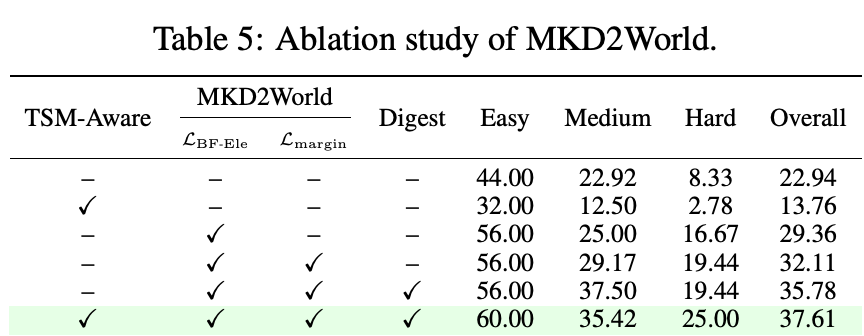

# 让动作后的局部变化在状态预测损失里可见

**MKD2World: A Typed Spatial MarkDown World Model For Web Agents**  
Zhihao Nan、Sifan Zhou、Yiming Cheng、Jinkai Zheng、Zheng Zhu、Si Shi、Ming Li、Fei Yu。首次提交及当前版本 v1 均为 2026-11-04。arXiv v1 预印本，本次新归档。 [arXiv 版本记录](https://arxiv.org/abs/2611.06544v1)

[本地 PDF](./assets/source/paper.pdf) · [本地 HTML](./assets/source/paper.html) · [[研究前沿/面向决策的履约建模/01-论文原文与精读/MKD2World/阅读覆盖|阅读范围与原文定位]] · [[研究前沿/面向决策的履约建模/01-论文原文与精读/MKD2World/代码核验|代码核验]]

## 建模接口

给定当前截图和候选操作，预测下一张界面的结构化状态。Typed Spatial Markdown（TSM）同时记录块/原子元素、类型、内容、可选控件状态、边界框及从属关系。作者用带有显式类型标记的生成网页构造检测监督，再结合检测、文字识别和视觉描述生成 TSM 教师。桌面网页状态只需要基于当前可见的元素，视频动画和后续的时间演化不在验证范围。[第 3.1–3.2 节](https://arxiv.org/html/2611.06544v1#S3.SS1)

## 明确发生变化时才把原状态当负例

第一阶段用 100,000 个样本训练从截图复述当前状态。第二阶段从已记录操作轨迹提取当前画面、动作和下一画面，渲染得到前后 TSM，确定性匹配标记新增/更新元素。31,245 个训练转移里，25,007 个明确变化、4,296 个近似无变化、1,942 个完全无变化。训练用真实下一状态每个元素的平均 token 交叉熵 $\ell_e$。以下将原式 (3) 的元素集合记作全部 $N$ 和其中重点 $F$：

$$
L_{\mathrm{BF}}=\frac{\sum_{e\in N}\ell_e+\lambda\sum_{e\in F}\ell_e}{|N|+\lambda|F|},\quad
\lambda=\min\left(3,\sqrt{|N|/|F|}\right)\quad(|F|>0).
$$

无重点元素取 $\lambda=0$。对于确实发生变化的样本，再在同一当前截图及动作条件下分别 teacher-force 下一状态与当前状态，使真实下一状态的页级 CE 低于当前状态至少 $m$；否则该项为零。训练逐步加大其权重。新增/更新元素既在完整页面的基本损失中，又获得额外权重。近似无变化或完全无变化的样本不使用原状态负例。[式 (2)–(5)](https://arxiv.org/html/2611.06544v1#S3.E2) · [附录 G](https://arxiv.org/html/2611.06544v1#A7)

## 决策时解释哪些差异，如何评价

推理时代理提议候选及意图，按其置信度决定是否查询世界模型，将各候选的预测状态压缩为变化、意图一致性、任务进度和证据摘要，再选执行动作。预测层的 EleF1 把元素间的语义、类型、空间相似度相乘，以二分图最大权匹配确定总分 $S^*$，返回 $2S^*/(|P|+|G|)$。这惩罚不匹配和遗漏元素，但不会自动衡量业务上关键的变化。[式 (6)–(7)、第 3.4 节](https://arxiv.org/html/2611.06544v1#S3.E6)

域外留出的 1,000 个转移样本上，MKD2World EleF1 为 26.50（按百分数标度），Qwen3.7-Plus 15.94，GPT-5.6-Sol 14.98；这仍留下大量元素预测误差。原文表 3 从 Online-Mind2Web 的 300 个任务中选择 109 个较稳定任务，成功由独立于执行代理的模型审阅轨迹，不能直接解释为所有网站任务的成功率。35B 代理基础为 22.94%，完整系统 37.61%；WebWorld 的 35.78% 是另一整套系统基线。VisualWebArena 233 项任务中的 deepseek-v4.1-flash 从 17.17% 降至 16.74%，增益没有覆盖每种代理。[表 2](https://arxiv.org/html/2611.06544v1#S4.T2) · [表 3–4](https://arxiv.org/html/2611.06544v1#S4.T4)

## 独立增量和耦合边界

表 5 用统一 35B 代理依序增加组件。带重点元素训练的世界模型为 29.36%，加入页级间隔为 32.11%，再加状态差异摘要为 35.78%，再做代理 TSM 感知训练为 37.61%。代理适配在无世界模型时单独使用为 13.76%。基础代理到 29.36% 同时引入世界模型和重点元素目标，没有给出固定同一世界模型只用均匀 CE 的对照；后续逐项差异也仅在前层配置中成立。[表 5](https://arxiv.org/html/2611.06544v1#S4.T5)

## 履约迁移

履约状态也可能大部分不变，仅少数订单、司机或容量位发生改变。可用已有实体 ID 和日志时钟定义变化集，保留完整状态监督，另训练发生变化时辨识“照抄旧状态”的能力。不完整观测、异步迟报及缺失实体必须单独标记；没有观察到更新不能直接当真无变化。论文评估为网页动作预测及任务完成，未做订单实验或干预效果识别。

## 原文关键图表

表 5 是 35B 代理上的累加消融。TSM 感知训练单独使用为 13.76%，与完整预测和摘要共同使用时为 37.61%。

## 方法与实验

[[研究前沿/面向决策的履约建模/02-可复用方法卡/MKD2World-focus-margin|变化实体加权与仅在变化样本使用的旧状态负例]] · [[研究前沿/面向决策的履约建模/02-可复用方法卡/MKD2World-state-evidence|按动作意图提取候选后继状态的变化证据]]

[[研究前沿/面向决策的履约建模/03-实验假设与结果/2026-11-10-只在可确认变化的履约转移上加入旧状态负例|只在可确认变化的履约转移上加入旧状态负例（未运行）]]
