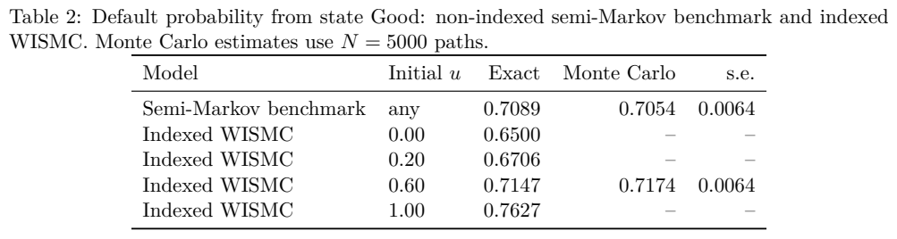

# 同一状态停留了多久，会怎样改变最终去向？

<!-- 全库方法复筛开始 -->
> **方法储备 · 业务决策与理论储备**。保留“Absorbing weighted-indexed semi-Markov chains with competing risks”这一研究问题或机制；是否用于当前业务另行验证。
> 原有阅读范围与证据等级不变；储备不等于效果已验证。
> [[研究前沿/论文库复筛与阅读路线|全库阅读路线]] · [[研究前沿/业务决策与理论储备/存量论文分层索引|本方向完整分层]]
<!-- 全库方法复筛结束 -->

状态相同、历史拥堵程度不同的请求，能否共用一条完成概率？ 把历史压缩为随停留时长衰减的分数，再同时预测何时结束、以哪种方式结束。

## 论文与阅读范围

Absorbing weighted-indexed semi-Markov chains with competing risks。Guglielmo D’Amico、Edoardo Lui、Filippo Petroni。Research Square 预印本；精读 §2–6、表 1–3 与声明。 首次公开 2026-11-10，核验版本 v1，本次阅读 2026-11-13。 [一手来源](https://www.researchsquare.com/article/rs-11443197/v1) · [paper-v1.pdf](./assets/source/paper-v1.pdf)

## 方法及关键假设

每次状态跳变输入所在状态、刚过去的时长 $s$ 和可观察历史的分数 $f(H)$。式 (1) 的更新为

$$
u'=\lambda^s u+(1-\lambda^s)f(H), \qquad 0\leq\lambda<1.
$$

分数只在跳变时更新。给定当前状态和指数的联合核 $Q_{ij}(u;ds)$ 同时指定下一个状态和停留时长。若下一状态已吸收，计入对应终点；若还会继续，用更新后的指数递归。各终点的累计发生概率加上存续概率等于一。按论文冻结分数先算预测，再检验改分数对结果的影响。

## 证据和比较基线

定理 2、3 给出期限内和最终吸收概率的递推。若每个状态在规定步数内都有统一的正吸收概率，迭代几何收敛。表 1 的 Good、起点 0.60 下，最终违约概率按不动点求得 0.7147，对照独立 Monte Carlo 为 0.7150。表 2 的无指数基线在同一生成器的 8,000 条训练路径上估计转移频率，停留时长使用相同 Weibull 律。表 3 中将评分反向并相应重参数化，风险数值保持一致；改变中间状态的相对评分，可使各初始状态估计差异最高达到 0.057。

原文表 2，PDF 第 21 页。数值对照的是同一生成过程下不同初始记忆，不能读作准确率提升。。[原表所在页](./assets/source/paper-v1.pdf#page=21)

## 迁移条件与局限

原文验证计算、收敛和评分敏感性。合成数据按有记忆机制生成，未给真实履约的预测收益，也未识别改变等待时长的因果作用。迁移要求完整的状态和终点时间戳，并为服务中断、失联和真正结束定义不同标签。作者提及 Python notebook，本次在原文及发表页面未核实公开文件入口。

[[研究前沿/面向决策的履约建模/02-可复用方法卡/MemorySemiMarkov-把停留时长写进竞争终点的历史状态|把停留时长写进竞争终点的历史状态]] · [[研究前沿/面向决策的履约建模/03-实验假设与结果/MemorySemiMarkov-相同当前状态下历史拥堵能否区分完成与取消|相同当前状态下历史拥堵能否区分完成与取消（未运行）]]
