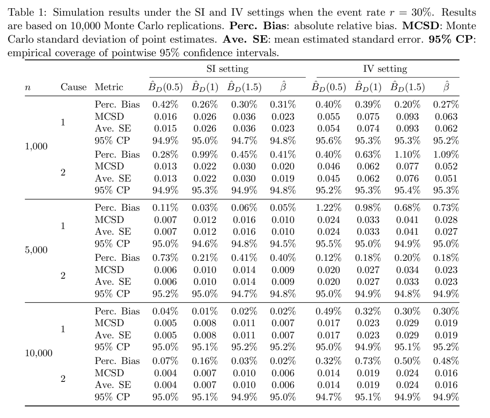

# 动作会变化、终态相互竞争，怎样估计替代策略的累计发生率

<!-- 全库方法复筛开始 -->
> **方法储备 · 面向决策的履约建模**。保留“Cause-specific structural nested cumulative survival time models for competing risks, with application to the Antibody Mediated Prevention trials”这一研究问题或机制；是否用于当前业务另行验证。
> 原有阅读范围与证据等级不变；储备不等于效果已验证。
> [[研究前沿/论文库复筛与阅读路线|全库阅读路线]] · [[研究前沿/面向决策的履约建模/存量论文分层索引|本方向完整分层]]
<!-- 全库方法复筛结束 -->

**Cause-specific structural nested cumulative survival time models for competing risks, with application to the Antibody Mediated Prevention trials**  
arXiv 首次提交 2026-11-07（UTC），核验时版本历史仅有 v1；本次检索日为上海时间 2026-11-12。正式发表日期待核。 [官方版本历史](https://arxiv.org/abs/2611.11008v1)

[原版 PDF](./assets/source/paper.pdf) · [原文 HTML 快照](./assets/source/paper.html)

## 研究问题

同一对象可能经历数次处理，且只能先进入一种终态。研究目标是设定一条处理历史后，到 $t$ 时首先发生指定终态的概率。若把其他终态简单当作失访，估计对象会改变。

## 方法、计算与决策时点

第 2.2 节用 $Y^j(t)=1-N^j(t^-)$ 表示仍未发生目标原因 $j$，所以已经发生其他原因的对象仍计入该亚分布风险集。式 (2.4) 以 $\exp[-\int D_k\,dB_D]$ 表示保留当期处理相对从当期撤除处理的亚分布生存比，比较时条件于此前未发生任何终态。逐段估计累计效应 $B_D$，再依式 (5.1) 用删失权重和历史处理计算 $F^j(t)=1-E[Y^j(t)]$。

## 实验结果与证据边界

表 1 的事件率 30%、样本 1,000、原因一、时刻 1 的一万次仿真，序贯法相对偏差 0.26%、覆盖 95.0%；工具变量法为 0.39%、95.3%，蒙特卡洛标准差分别为 0.026 和 0.075。试验数据的图 2、4 是在识别假设下重估不同依从策略的 CIF；论文没有处理订单数据。 [证据原文](https://arxiv.org/html/2611.11008v1#S6.T1)

*表 1 · 两种识别路径的仿真偏差和区间覆盖，固定版 PDF 第 19 页。*

第 3 节的序贯可忽略性路径要求纳入历史后当期处理与未来未处理结局可交换。第 4 节给有相关性、排除限制等条件的工具变量路径，用于真实依从而非随机分派本身。文中的随机分组不能用作另一个并无关联的自选处理的工具变量。估计离不开一致性、正值性、删失与结构模型假设。

## 迁移到履约问题

用于比较不同提醒或改派历程下先取消/先完成的绝对风险。动作非随机且缺少测量的混杂或合格工具时，结果没有识别依据。 本地尚未运行验证。

## 方法卡与候选实验

- [[研究前沿/面向决策的履约建模/02-可复用方法卡/NestedCompetingRisks-counterfactual-cif|用分段动作历史重建竞争终态的反事实累计发生率]]
- [[研究前沿/面向决策的履约建模/03-实验假设与结果/2026-11-12-含动态提醒和互斥终态的反事实累计风险|含动态提醒和互斥终态的反事实累计风险（未运行）]]

## 来源与实现核验

论文直接链接作者仿真仓库。已查询 GitHub 文件树，固定提交 `a838cc8583638cac7ec6e58f45c380f9932c5156` 的 `R/SI.R`、`R/IV.R` 和 `scripts/run_iv_table1.R` 可定位两条估计路径及仿真入口；本次未执行。[作者代码及固定版本](https://github.com/Jacobs-Lee/cause-specific-SNCSTMs-simulation/tree/a838cc8583638cac7ec6e58f45c380f9932c5156)

本次核验公开 v1 正文、列明的方法和实验及下列证据定位。作者报告的数值未做独立复算。 [亚分布建模](https://arxiv.org/html/2611.11008v1#S2.SS2) · [序贯路径](https://arxiv.org/html/2611.11008v1#S3) · [工具变量路径](https://arxiv.org/html/2611.11008v1#S4) · [CIF](https://arxiv.org/html/2611.11008v1#S5) · [生成真值仿真](https://arxiv.org/html/2611.11008v1#S6) · [试验数据分析](https://arxiv.org/html/2611.11008v1#S7)
