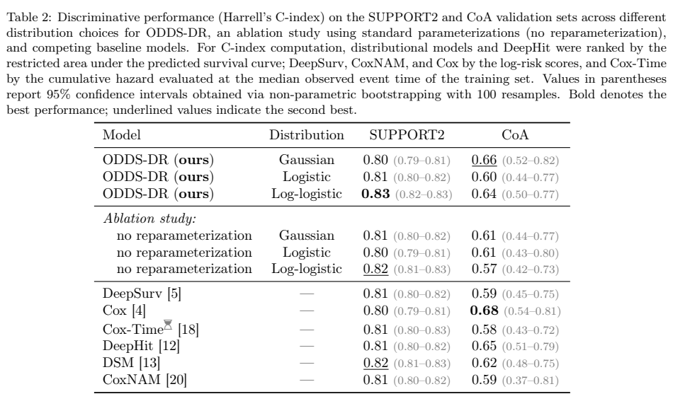

# 用连续时间的对数优势解释风险何时变化

<!-- 全库方法复筛开始 -->
> **方法储备 · 面向决策的履约建模**。保留“结果分布的 odds 参数化回归”这一研究问题或机制；是否用于当前业务另行验证。
> 原有阅读范围与证据等级不变；储备不等于效果已验证。
> 已恢复此前因业务距离被移出的原笔记；旧取舍原因仅作历史记录。
> [[研究前沿/论文库复筛与阅读路线|全库阅读路线]] · [[研究前沿/面向决策的履约建模/存量论文分层索引|本方向完整分层]]
<!-- 全库方法复筛结束 -->

Odds-Structured Distributional Regression for Interpretable Time-to-Event Prediction。作者为 Versnjak, Jakob、Welte, Manuel、Kuehne, Titus、Kelm, Marcus、Montavon, Grégoire。arXiv 首投 2026-11-09，本次核验 v1。 [版本记录](https://arxiv.org/abs/2611.12268v1) · [本地 PDF](./assets/source/paper.pdf) · [本地 HTML](./assets/source/paper.html)

## 研究问题

同一特征可能只影响短期风险。把所有时长压成一个排序分数，会丢失时间尺度。

## 方法与关键计算

网络输出分布的替代参数，使预测时点的累积风险对数优势可从表示中分解；比较 Gaussian、logistic 和 log-logistic 族，另可建模事件永不发生的质量。对固定时点的对数优势作逐层相关性传播，区分早期与远期贡献。

$$
L(t,x)=\log\frac{P(T\le t\mid x)}{1-P(T\le t\mid x)}
$$

同一人的对数优势随时点变化。与普通参数头的差别在于输出按这一尺度设计，进而分摊到特征。 [原文定位](https://arxiv.org/html/2611.12268v1#S3)

## 对照、结果和限制

表 2 的 SUPPORT2 上 log-logistic 模型 C-index 为 0.83；表 3 在检索既知风险指标时，两个队列的 AUROC 为 0.89 和 0.84。表 2 含同分布普通参数化消融。指标检索衡量解释与指南的一致性，分布准确度需另测。 [原文证据](https://arxiv.org/html/2611.12268v1#S5.T2)

原文 PDF 第 12 页。

分布族和随访覆盖限定尾部；指南指标不能验证个体因果归因。CoA 的置信区间宽，单一队列的排序优势不宜外推。

## 复用和阅读范围

已核问题设定、方法与上文所列的关键对照，详细证明及未列出的实验以所附全文为准。本次未核实作者公开实现入口。

[[研究前沿/面向决策的履约建模/02-可复用方法卡/OddsDR-连续时点对数优势头|连续时点对数优势头]] · [[研究前沿/面向决策的履约建模/03-实验假设与结果/OddsDR-同一时长骨干换输出参数化后，能否保留排序并改善分时点校准|同一时长骨干换输出参数化后，能否保留排序并改善分时点校准]]
