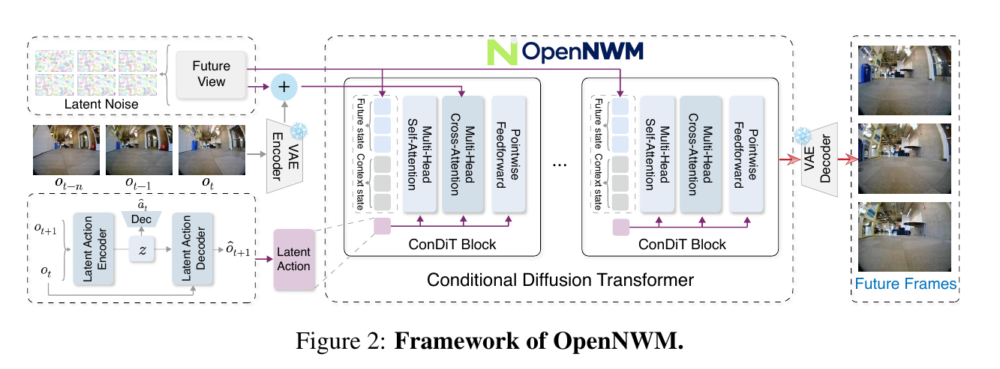

# OpenNWM: A Generalist Navigation World Model with Latent Action Pretraining

[官方论文](https://arxiv.org/abs/2611.01844) · [本地PDF](./assets/source/paper.pdf) · [HTML快照](./assets/source/paper.html)

版本记录：[Submitted on 1 Nov 2026 ( v1 ), last revised 5 Nov 2026 (this version, v2)]；本次核验与精读：2026-11-06。本篇为滚动窗口内首次入库；检索日不等于首次发表日。

阅读范围：§3 潜在动作、条件世界模型和真实动作 CEM，§4 主结果与双监督消融，§5 局限；数据与次要附录细节保留原文。未逐行复证全部数学证明，未声称逐页翻译。[[研究前沿/面向决策的履约建模/01-论文原文与精读/OpenNWM/阅读覆盖|原文章节与公式索引]]；HTML为原始快照，外部样式和图片可能需要联网，PDF可离线阅读。

代码：已核验[作者仓库](https://github.com/OpenSpace-Lab/OpenNWM)，commit `8a53524c6ed7e26aecbc91257f3a0b3bd212e9e5`；入口：[lam/lam/model.py](https://github.com/OpenSpace-Lab/OpenNWM/blob/8a53524c6ed7e26aecbc91257f3a0b3bd212e9e5/lam/lam/model.py)；[run.py](https://github.com/OpenSpace-Lab/OpenNWM/blob/8a53524c6ed7e26aecbc91257f3a0b3bd212e9e5/run.py)。已读取入口声明/关键片段，未审计全部实现、未安装运行。 [[研究前沿/面向决策的履约建模/01-论文原文与精读/OpenNWM/代码核验|核验记录]]

## 问题与整体方法

动作未标注的视频、带相机位姿的导航数据以及不同机器人动作空间很难联合训练。OpenNWM 用潜在动作作为预训练接口，同时用有标注子集约束它的物理运动含义；随后切换到真实 waypoint action 条件的世界模型供在线规划。潜在动作不是上线直接优化的控制量。

## 模块：视觉转移与物理监督共同定义潜在动作

从当前/未来画面推断高斯潜变量 $q_\phi(z\mid x_t,x_m)$，辅助转移模型训练：

$$\mathcal L_{vis}=-\mathbb E_q\log p_\psi(x_m\mid x_t,z)+\beta D_{KL}(q_\phi(z\mid x_t,x_m)\Vert\mathcal N(0,I)).$$

有运动标注的子集增加 $\mathcal L_{phy}=-\mathbb E_q\log p_\omega(y_{t:m}\mid z)$；联合训练是全体视觉损失加该子集的物理损失。否则潜变量可能把光照、环境变化也当成动作。

世界模型用 latent action、预测时距及扩散时间的嵌入之和经 AdaLN 注入，历史视觉状态走 cross-attention。预测 latent 的平方误差加扩散 variational loss 训练未来分布。NavAnywhere 来自 15 个来源约 1,750 万观测；下游使用 RECON、HuRoN、SCAND、TartanDrive 的位姿数据。Fig.3 的流程为 latent-action 预训练 → 冻结主干 warmup 真实 action encoder → 全模型 joint post-training。

## 在线规划与证据

在线直接采样真实 waypoint action 序列，通过世界模型多次 rollout，最小化终局目标距离及可行性/安全代价：

$$a^*=\arg\min_a\mathbb E[-S_{goal}(\widehat s_H,s^g)+C_{nav}(\widehat s_{1:H},a,c)].$$

CEM 反复保留精英序列更新分布，只执行第一步，下一观测再规划；辅助物理预测头不承担在线 latent-to-action 解码。

**完整模型，Tables 1–2**：280M 参数，ID LPIPS 0.368，对 NWM 0.405；RECON ATE 1.12 对 1.13，SCAND 0.98 对 1.01，OOD Office Go2 2.89 对最强基线 RAE-NWM 3.01。导航改善较小，不能用图像指标夸大闭环收益。Office Go2 PSNR 11.047 仍低于大号 NWM 的 11.083。

**消融，Tables 4–5（HTML 正文引用编号有错位，以表标题为准）**：较小预训练子集上，时间+latent action 条件使 SCAND ATE 从仅时间的 1.045 降到 0.950；Pixel+Action 监督的 0.950 对 action-only 0.981、pixel-only 0.982，联合监督在 6 指标中领先 5 个，RECON RPE 仍不如 pixel-only。支持互补监督，不是所有指标必胜。

## 边界与迁移

潜在转移没有自动获得可干预意义；真实动作适配不可省略。动作归一化、去除后退数据、跨来源视觉差异和长程动态都限制泛化；论文尚将更长时距及动态环境在线适配列为未来工作。主结果使用训练资源 8 张 L20，并不是只需一个轻量头就可复现。

迁移推断：大量只有状态轨迹、少量有动作标注的数据，可先学共享状态转移表示，再用动作标签约束与适配。用于履约时应预测状态/风险而非照搬像素生成；仍需检验动作覆盖、混杂与反事实有效性。

## 原文关键图表

原文 Figure 2，PDF 第 4 页；原始裁图，机制和证据解释见上文。裁图坐标与源文件校验值见 assets/source/figure-provenance.json。

## 方法卡

- [[研究前沿/面向决策的履约建模/02-可复用方法卡/OpenNWM-latent-action-grounding|无动作轨迹预训练与少量物理动作联合约束]]
