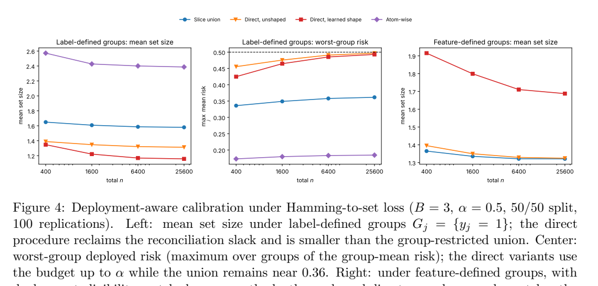

# 重叠分组要共用预测集合时，分开校准还是直接校准

<!-- 全库方法复筛开始 -->
> **方法储备 · 面向决策的履约建模**。保留“Group-Conditional Conformal Risk Control: Exact Guarantees, Limits, and Overlapping Extensions”这一研究问题或机制；是否用于当前业务另行验证。
> 原有阅读范围与证据等级不变；储备不等于效果已验证。
> [[研究前沿/论文库复筛与阅读路线|全库阅读路线]] · [[研究前沿/面向决策的履约建模/存量论文分层索引|本方向完整分层]]
<!-- 全库方法复筛结束 -->

Group-Conditional Conformal Risk Control: Exact Guarantees, Limits, and Overlapping Extensions  
Tareq Aldirawi; Wenge Guo。2026-11-07 首次提交 arXiv，本次核对 v1。[arXiv v1](https://arxiv.org/abs/2611.10472v1)

把每一组单独校准再取并集，最终输出可能过宽；直接校准会在哪些条件下反而更差？

## 怎样从输入得到输出

在有界且对集合扩张单调的损失上，使用独立校准样本。方案一对每个组切片估风险再合并安全集合；方案二先固定最终部署的嵌套集合族，在该族上为每组校准约束并采用能通过所有组的阈值。可分开拟合形状和做最后的分布无关修正。

对所有预定组约束 $E[L(C(X),Y)\mid G_j]\le\alpha_j$。直接法可省掉合并时额外覆盖造成的空间，但共用阈值会受最苛刻组支配；若组内校准样本太少，有限样本修正可迫使输出最大集合。

## 哪个对照支持这个判断

标签定义组的 Hamming 仿真中，n=25,600 时，分组合集平均大小 1.579、最差组风险 0.362；直接无形状拟合为 1.313、0.497（目标 0.5）。真实视网膜数据 200 次配对重抽样，合集为 2.322，直接法为 2.518，反而大 8.4%。

图 4，标签组与特征组下的直接校准和分组合集。[本地原文](./assets/source/paper.pdf#page=26)

## 使用条件与可检验的迁移

保证对事先定义的群组期望风险，要求交换性和有界单调损失；不能推到每个新个体。重叠的真实结局标签在部署时未必已知，应复核候选合并的可执行性。

当高峰、区域和长距离等条件重叠时，应对实际输出的备选集合计风险，同时与逐组并集比较；稀有组可能抹掉直接校准的节省。

[[研究前沿/面向决策的履约建模/02-可复用方法卡/OverlappingGroupCRC-method|方法卡 · 重叠分组要共用预测集合时，分开校准还是直接校准]] · [[研究前沿/面向决策的履约建模/03-实验假设与结果/OverlappingGroupCRC-交叉群组中的直接校准何时扩大预测集合|待验证 · 交叉群组中的直接校准何时扩大预测集合]]

## 阅读范围与复现入口

68 页，核对 §2–5 的适用条件、§6 实验、图 3–6 和真实数据的反例；未逐项复推 68 页证明。论文列出 [复现项目地址](https://github.com/TareqAldirawi94/Group-Conditional-Conformal-Risk-Control)，正文注明计划公开，未核实完整运行。 本地验证状态为未运行。
