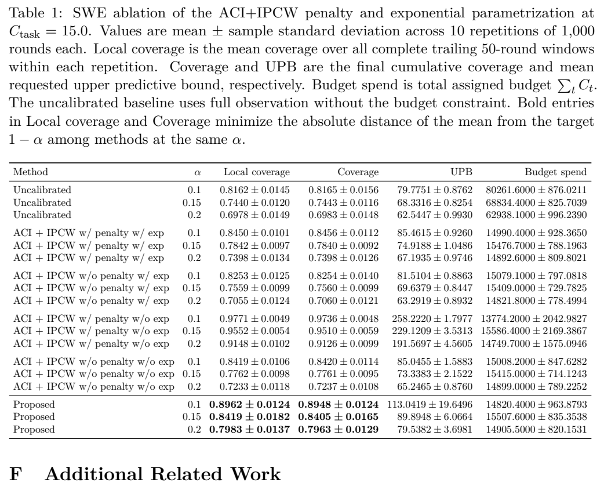

# 预算会主动截短轨迹，怎样预测任务何时成功

<!-- 全库方法复筛开始 -->
> **方法储备 · 面向决策的履约建模**。保留“预算截断导致的 Agent 执行删失”这一研究问题或机制；是否用于当前业务另行验证。
> 原有阅读范围与证据等级不变；储备不等于效果已验证。
> 已恢复此前因业务距离被移出的原笔记；旧取舍原因仅作历史记录。
> [[研究前沿/论文库复筛与阅读路线|全库阅读路线]] · [[研究前沿/面向决策的履约建模/存量论文分层索引|本方向完整分层]]
<!-- 全库方法复筛结束 -->

How Efficient Is Your Agent? Online Predictive Bounds under Budget Constraints  
Roy Maor Lotan; Shai Feldman; Yaniv Romano。2026-11-08 首次提交 arXiv，本次核对 v1。[arXiv v1](https://arxiv.org/abs/2611.11279v1)

只够跟踪部分任务到自己的时间上界，如何评价上界还剩多少漏覆盖？

## 怎样从输入得到输出

任务到达先给出完成所需交互次数的预测上界。系统依据已知特征、已有免费进度和过去日志随机决定追加评估预算；不够跑完时形成右删失。用设计给出的到达上界概率校正误覆盖，并用预计误覆盖作中心化修正。预算结余控制平均额外观测成本。

式 (15) 的反馈为 $I^{err}/G+\rho(1-I^{reach}/G)$，其中 $G$ 是分配方案到达所发上界的概率，$\rho=1-\hat F(U)$。需要 $G$ 有正下界。定理 3 控制平均条件覆盖的有限样本下界；定理 4 的预算结论针对平均期望消耗。

## 哪个对照支持这个判断

附表 1 的 SWE 回放每次 1,000 轮、10 次重复，目标 90%、平均预算 15。PROBE 最终覆盖 89.48%、平均上界 113.04 步。同为指数参数化且加惩罚的 ACI+IPCW 仅 84.56%，上界 85.46 步。另一线性参数化加惩罚的基线覆盖 97.36% 而上界 258.22 步，区间更紧取决于选哪种对照。

附表 1，平均追加预算 15 时的 SWE 消融。[本地原文](./assets/source/paper.pdf#page=39)

## 使用条件与可检验的迁移

SWE 的终点是日志交互长度；检索任务终点是找到全部相关项目。这里可主动选择额外观测预算，不能把因退出而永远不再发生的服务当成可继续观测的同一事件。

对于仍可追踪但补采有成本的任务，可给每项预测一个时长上界，再检验同预算分配是否改善覆盖与上界长度之间的取舍。

[[研究前沿/面向决策的履约建模/02-可复用方法卡/PROBEBudget-method|方法卡 · 预算会主动截短轨迹，怎样预测任务何时成功]] · [[研究前沿/面向决策的履约建模/03-实验假设与结果/PROBEBudget-定额补采能否改善完成时长上界|待验证 · 定额补采能否改善完成时长上界]]

## 阅读范围与复现入口

44 页，核对式 (9)、(13)–(17)、定理 3–4、图 2–5 与附表 1；未复推全部高概率界。论文 PDF 链接到 [PROBE 仓库](https://github.com/Roy-Maor-Lotan/PROBE)。 本地验证状态为未运行。
