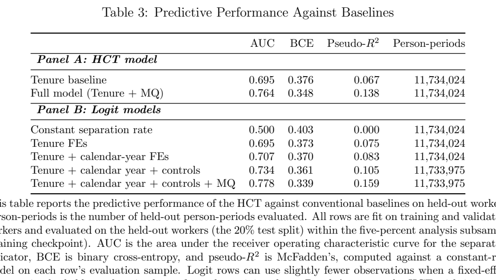

# 配对本身能否解释双方特征以外的关系终止

<!-- 全库方法复筛开始 -->
> **方法储备 · 面向决策的履约建模**。保留“Human Capital in Context: What Employment Survival Reveals About Worker-Firm Match”这一研究问题或机制；是否用于当前业务另行验证。
> 原有阅读范围与证据等级不变；储备不等于效果已验证。
> [[研究前沿/论文库复筛与阅读路线|全库阅读路线]] · [[研究前沿/面向决策的履约建模/存量论文分层索引|本方向完整分层]]
<!-- 全库方法复筛结束 -->

Human Capital in Context: What Employment Survival Reveals About Worker-Firm Match  
Jung Ho Choi; Mario Milone。2026-11-11 首次提交 arXiv，本次核对 v1。[arXiv v1](https://arxiv.org/abs/2611.16058v1)

相同的双方特征和关系年龄下，两端的匹配程度还有多少独立预测信息？

## 怎样从输入得到输出

员工塔读职业历史、当前职位和属性，企业塔读企业属性与业务描述，两份嵌入取余弦。把关系每个任期年度是否终止作为离散风险标签，在每个仍存续的人期记录上训练；推理时用任期基线与动态配对得分输出终止概率。

$MQ=\cos(e_{worker},e_{firm}),\quad h_t=\sigma(b(t)+\beta MQ_t)$。作者把训练所得标量固定后加到同一常规 logit，单独检查它携带的信息。采样和训练划分以员工为单位，避免同一人在训练测试中出现。

## 哪个对照支持这个判断

表 3 在 5% 分析子样本内、20% 员工留出中，任期加年份及常规特征的 AUC 为 0.734，HCT 双塔为 0.764；仅把学得的配对得分加回相同 logit 得到 0.778。总研究涵盖约 1.01 亿员工、840 万家企业，但表 3 并非在全部数据上计算。

表 3，留出员工后的任期、常规特征与配对得分对照。[本地原文](./assets/source/paper.pdf#page=55)

## 使用条件与可检验的迁移

员工留出仍使用与训练重叠的日历时期；表中 logit 因未见固定效应而可少量少样本。离职由已建立雇佣关系监督，未形成配对的存续时长没有观察真值，配对得分的关联不能解释成干预效果。

冻结双方表征或生成一个配对标量，加回同一风险头，在相同候选和实体留出上比较，有助于判断相互作用信息是否超越单边历史。

[[研究前沿/面向决策的履约建模/02-可复用方法卡/PairSurvivalTower-method|方法卡 · 配对本身能否解释双方特征以外的关系终止]] · [[研究前沿/面向决策的履约建模/03-实验假设与结果/PairSurvivalTower-冻结配对得分能否改善同一终止风险头|待验证 · 冻结配对得分能否改善同一终止风险头]]

## 阅读范围与复现入口

72 页，核对离散风险目标、§5–6、表 2–3、员工留出与日期覆盖说明，未重跑私有履历。原文披露数据和方法，未核到公开训练代码或可重新分发的全量履历。 本地验证状态为未运行。
