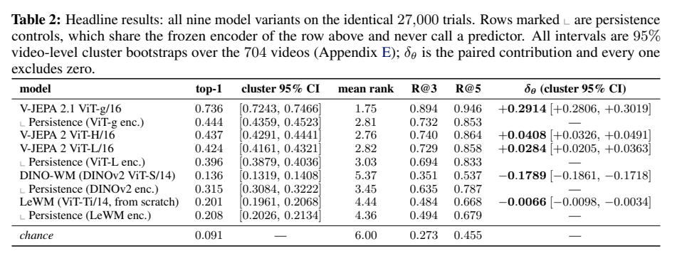

# 去掉状态预测器，只复用上一步，成绩还剩多少

<!-- 全库方法复筛开始 -->
> **方法储备 · 面向决策的履约建模**。保留“预测模型与持续性基线的负结果”这一研究问题或机制；是否用于当前业务另行验证。
> 原有阅读范围与证据等级不变；储备不等于效果已验证。
> 已恢复此前因业务距离被移出的原笔记；旧取舍原因仅作历史记录。
> [[研究前沿/论文库复筛与阅读路线|全库阅读路线]] · [[研究前沿/面向决策的履约建模/存量论文分层索引|本方向完整分层]]
<!-- 全库方法复筛结束 -->

Prediction or Persistence? What Future-Prediction Scores Miss About World Models  
Animesh Maheshwari。2026-11-11 首次提交 arXiv，本次核对 v1。[arXiv v1](https://arxiv.org/abs/2611.15082v1)

预测分数有多少来自真正的前推，又有多少来自状态自身持续？

## 怎样从输入得到输出

在同一个视频中构造一个锚点和 11 个候选续段。用冻结编码器、同一检索目标与同一批候选测试完整预测器，再跳过预测器，用锚点表示直接匹配。每个试次产生配对差，以视频为单位重抽样。

定义 $\delta=\mathrm{Top1}_{full}-\mathrm{Top1}_{persist}$，只在双方评分函数和表示可比的配对条件解释。无预测基线也会高于 $1/11$，因为相邻视频共享内容。

## 哪个对照支持这个判断

附表 2 在 704 段视频的 27,000 次试验中，V-JEPA 2.1 的 Top-1 为 0.736，仅保持表示为 0.444，配对差 0.2914，视频级 95% 区间 [0.2806, 0.3019]。V-JEPA 2 ViT-L 对应差为 0.0284。动作条件 DINO-WM 在域外使用时差为 −0.1789。

附表 2，同一批视频检索任务上的配对结果。[本地原文](./assets/source/paper.pdf#page=12)

## 使用条件与可检验的迁移

指标考查前瞻检索，未测试规划回报；域外动作模型处于非训练条件。模型间表征原本不同，配对差只回答每个模型相对其自身参照的贡献。

对变化稀少的履约状态，在每个起点做同一编码器的“保留最近状态”对照，有助于识别前推模块是否真的提高变化处预测。

[[研究前沿/面向决策的履约建模/02-可复用方法卡/PersistenceControl-method|方法卡 · 去掉状态预测器，只复用上一步，成绩还剩多少]] · [[研究前沿/面向决策的履约建模/03-实验假设与结果/PersistenceControl-真实变化稀少时前推是否胜过保持状态|待验证 · 真实变化稀少时前推是否胜过保持状态]]

## 阅读范围与复现入口

16 页，核对图 1–2、附表 1–3 和附录 E 的重抽样单位，未重新运行视频模型。论文列出公开 V-JEPA 上游权重；本研究整套配对评测代码入口未核实。 本地验证状态为未运行。
