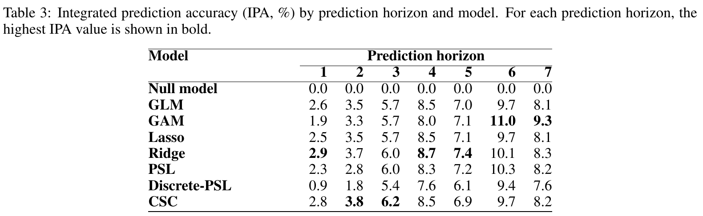

# Poisson Super Learning For Survival And Competing Risks On A Discretized Time Scale

[官方论文](https://arxiv.org/abs/2611.03256) · [本地PDF](./assets/source/paper.pdf) · [HTML快照](./assets/source/paper.html)

版本记录：[Submitted on 2 Nov 2026]；本次核验与精读：2026-11-06。本篇为滚动窗口内首次入库；检索日不等于首次发表日。

阅读范围：§3/§5/§7 方法与概率组合，§8 模拟和扩展性，§9 真实数据、§10 局限。未逐行复证全部数学证明，未声称逐页翻译。[[研究前沿/面向决策的履约建模/01-论文原文与精读/PoissonSL/阅读覆盖|原文章节与公式索引]]；HTML为原始快照，外部样式和图片可能需要联网，PDF可离线阅读。

代码：已核验[作者仓库](https://github.com/gpitt71/poissonsuperlearner)，commit `04f85ed39f8798cd9d137ae0031b8fc2f13c0e70`；入口：[R/superlearner.R](https://github.com/gpitt71/poissonsuperlearner/blob/04f85ed39f8798cd9d137ae0031b8fc2f13c0e70/R/superlearner.R)；[R/pch_absolute_risk.R](https://github.com/gpitt71/poissonsuperlearner/blob/04f85ed39f8798cd9d137ae0031b8fc2f13c0e70/R/pch_absolute_risk.R)。已读取入口声明/关键片段，未审计全部实现、未安装运行。 [[研究前沿/面向决策的履约建模/01-论文原文与精读/PoissonSL/代码核验|核验记录]]

## 问题与方法

不同原因的事件预测不能各自输出不相容的发生概率。论文用分段常数原因别风险率，把右删失、竞争风险数据展开成 person–time Poisson 数据，再对多个风险率学习器进行交叉拟合堆叠。它解决的是条件分布预测；没有凭借这一结构识别动作的因果效果。

对个体 $i$、区间 $k$、原因 $j$，记事件指示 $D_{ikj}$、暴露时长 $R_{ik}$，训练负对数似然为

$$\mathcal L=-\sum_{i,k,j}\{D_{ikj}\log\lambda_j(t_k\mid X_i)-R_{ik}\lambda_j(t_k\mid X_i)\}.$$

用 Poisson 回归时，$\log R_{ik}$ 是 offset，零暴露记录须单独处理。GLM、lasso、ridge、GAM 等可作为基学习器。先生成折外 log-hazard，再拟合元学习器，最后在全训练集重训基模型。

$$\lambda_j^{SL}(t\mid x)=\exp\!\left[\sum_s\alpha_{js}\log\widehat\lambda_{js}(t\mid x)\right].$$

原文元系数为不受 simplex 约束的实系数，且同一原因的系数跨时间共享；不能擅自改述成凸加权平均。元模型拟合同一个 Poisson 损失。

## 从风险率到概率

总生存概率由所有原因共同决定：$S(t\mid x)=\exp[-\sum_j\Lambda_j(t\mid x)]$。每段累积发生概率增量为

$$\Delta F_{jk}(t)=S(t_{k-1})\frac{\lambda_{jk}}{\lambda_{\mathrm{tot},k}}\{1-\exp[-\lambda_{\mathrm{tot},k}\Delta_k(t)]\},$$

其中 $\lambda_{\mathrm{tot},k}=\sum_j\lambda_{jk}$，零总风险时增量取零。跨段求和得到 CIF；这比独立训练多个“是否发生”分类器更容易保持概率一致性。

## 效果证据与消融

- **模拟，§8**：80 次重复、固定 10,000 条测试样本。近线性机制下线性库与完整库接近；非线性机制下 GAM 带来收益，删去非线性学习器会变差。说明学习器库覆盖真实机制很关键，不支持“堆叠必定超过每个单模型”。
- **真实临床数据，§9/Table 3**：Steno 4,821 人，按年代划分 3,583 训练、1,238 测试，预测 CVD 并处理非 CVD 死亡。1–7 年的 PSL IPA 为 2.3、2.8、6.0、8.3、7.2、10.3、8.2；ridge 为 2.9、3.7、6.0、8.7、7.4、10.1、8.3。PSL 有竞争力，但不是一致最优。第 6 年 GAM 为 11.0，高于 PSL 的 10.3。
- **工程实验，§8**：从 1 千到 100 万样本测试离散化与聚合的计算收益。完全相同特征与时间区间的 exposure/event count 聚合可保留该 Poisson 目标；先将连续特征离散化则引入近似，不能混称完全无损。应在训练折内聚合，避免泄漏。

## 局限与迁移

训练不要求显式拟合删失分布，仍要求给定特征后的独立删失；信息性删失会破坏解释。时间分段、非线性库、稀有原因样本量都会影响结果。真实案例第二原因使用更小的学习器库，不能把跨原因差异直接当成堆叠消融。

迁移推断：可将完成、取消、失联等互斥吸收事件建成原因别风险率，再输出给定时间窗内的发生概率及未完成概率。若把派单/等待动作放入特征，得到的首先是条件预测；反事实比较还需额外的识别与覆盖条件。

## 原文关键图表

原文 Table 3，PDF 第 14 页；原始裁图，机制和证据解释见上文。裁图坐标与源文件校验值见 assets/source/figure-provenance.json。

## 方法卡

- [[研究前沿/面向决策的履约建模/02-可复用方法卡/PoissonSL-hazard-stacking|Poisson 折外风险率堆叠与一致竞争风险概率]]

## 待验证想法

[[研究前沿/面向决策的履约建模/03-实验假设与结果/2026-11-06-竞争风险的折外堆叠|竞争风险的折外堆叠（未运行）]]
